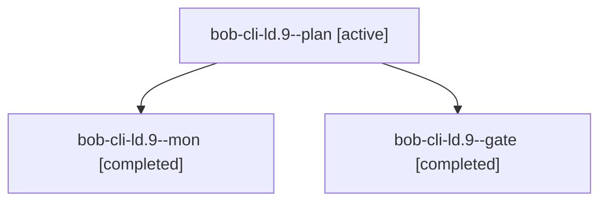

# Session: bob-cli-ld.9

[Agent Hoods](../README.md) / [bbugyi200](../users/bbugyi200/README.md) / [athena](../users/bbugyi200/machines/athena/README.md) / [bob-cli-ld](../users/bbugyi200/machines/athena/hoods/bob-cli-ld/README.md) / bob-cli-ld.9

Owner: `bbugyi200.athena` · Hood: `bob-cli-ld` · Members: 3 · Bead: [bob-cli-ld.9](https://github.com/bobs-org/bob-cli--beads/blob/main/pages/bob-cli-ld/bob-cli-ld.9.md)

## Lineage

The diagram is an optional enhancement; the ordered table below contains the same lineage in accessible text.

| Role | Agent | State | Model / provider | Timing | Commits | Prompt | Chat |
|---|---|---|---|---|---:|---|---|
| plan | bob-cli-ld.9--plan | active | gpt-6-astra / codex | 2026-11-13T20:21:16.779776+00:00 → 2026-11-13T20:29:27.861453+00:00 | 0 | [Prompt](../agents/bbugyi200.athena.bob-cli-ld.9--plan/prompt.md) | [Chat](../agents/bbugyi200.athena.bob-cli-ld.9--plan/chat.md) |
| mon | bob-cli-ld.9--mon | completed | gpt-6-astra / codex | 2026-11-13T20:29:14.889630+00:00 → 2026-11-13T20:32:18.424322+00:00 | 0 | — | [Chat](../agents/bbugyi200.athena.bob-cli-ld.9--mon/chat.md) |
| gate | bob-cli-ld.9--gate | completed | gpt-6-astra / codex | 2026-11-13T20:28:59.850592+00:00 → 2026-11-13T20:29:18.837981+00:00 | 0 | — | [Chat](../agents/bbugyi200.athena.bob-cli-ld.9--gate/chat.md) |

## Neighbors

| Agent | Relation | State |
|---|---|---|
| [bob-cli-ld.9.1.1](../agents/bbugyi200.athena.bob-cli-ld.9.1.1/README.md) | descendant | completed |
| [bob-cli-ld.9.1.2](../agents/bbugyi200.athena.bob-cli-ld.9.1.2/README.md) | descendant | active |
| [bob-cli-ld.9.1.3](../agents/bbugyi200.athena.bob-cli-ld.9.1.3/README.md) | descendant | waiting |
| [bob-cli-ld.9.1.land](../agents/bbugyi200.athena.bob-cli-ld.9.1.land/README.md) | descendant | waiting |
| [bob-cli-ld.1](../agents/bbugyi200.athena.bob-cli-ld.1/README.md) | bob-cli-ld hood | completed |
| [bob-cli-ld.10](../agents/bbugyi200.athena.bob-cli-ld.10/README.md) | bob-cli-ld hood | waiting |
| [bob-cli-ld.2](../agents/bbugyi200.athena.bob-cli-ld.2/README.md) | bob-cli-ld hood | completed |
| [bob-cli-ld.3](../agents/bbugyi200.athena.bob-cli-ld.3/README.md) | bob-cli-ld hood | completed |
| [bob-cli-ld.4](../agents/bbugyi200.athena.bob-cli-ld.4/README.md) | bob-cli-ld hood | completed |
| [bob-cli-ld.5](../agents/bbugyi200.athena.bob-cli-ld.5/README.md) | bob-cli-ld hood | completed |
| [bob-cli-ld.6](bbugyi200.athena.bob-cli-ld.6.md) (session · 3) | bob-cli-ld hood | completed 2, failed 1 |
| [bob-cli-ld.7](bbugyi200.athena.bob-cli-ld.7.md) (session · 5) | bob-cli-ld hood | completed 4, failed 1 |
| [bob-cli-ld.8](bbugyi200.athena.bob-cli-ld.8.md) (session · 3) | bob-cli-ld hood | completed 2, failed 1 |
| [bob-cli-ld.land](../agents/bbugyi200.athena.bob-cli-ld.land/README.md) | bob-cli-ld hood | waiting |
