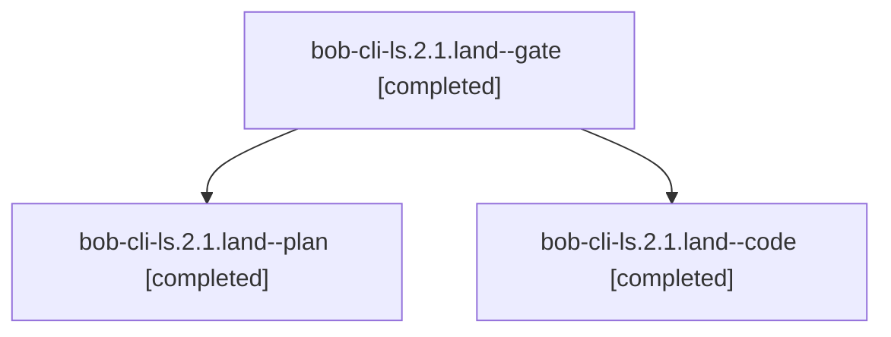

# Session: bob-cli-ls.2.1.land

[Agent Hoods](../README.md) / [bbugyi200](../users/bbugyi200/README.md) / [athena](../users/bbugyi200/machines/athena/README.md) / [bob-cli-ls](../users/bbugyi200/machines/athena/hoods/bob-cli-ls/README.md) / bob-cli-ls.2.1.land

Owner: `bbugyi200.athena` · Hood: `bob-cli-ls` · Members: 3 · Bead: [bob-cli-ls.2.1](https://github.com/bobs-org/bob-cli--beads/blob/main/pages/bob-cli-ls/bob-cli-ls.2.1.md)

## Lineage

The diagram is an optional enhancement; the ordered table below contains the same lineage in accessible text.

| Role | Agent | State | Model / provider | Timing | Commits | Prompt | Chat |
|---|---|---|---|---|---:|---|---|
| gate | bob-cli-ls.2.1.land--gate | completed | gpt-6-astra / codex | 2026-11-15T22:06:39.686600+00:00 → 2026-11-15T22:06:53.206272+00:00 | 0 | — | [Chat](../agents/bbugyi200.athena.bob-cli-ls.2.1.land--gate/chat.md) |
| plan | bob-cli-ls.2.1.land--plan | completed | gpt-6-astra / codex | 2026-11-15T21:53:57.665083+00:00 → 2026-11-15T23:00:39.692279+00:00 | 0 | [Prompt](../agents/bbugyi200.athena.bob-cli-ls.2.1.land--plan/prompt.md) | [Chat](../agents/bbugyi200.athena.bob-cli-ls.2.1.land--plan/chat.md) |
| code | bob-cli-ls.2.1.land--code | completed | grok-4.6 / grok | 2026-11-15T22:07:25.145398+00:00 → 2026-11-15T23:00:39.692279+00:00 | [1](../agents/bbugyi200.athena.bob-cli-ls.2.1.land--code/README.md#commits) | — | [Chat](../agents/bbugyi200.athena.bob-cli-ls.2.1.land--code/chat.md) |

## Commits

| Role | Repo | Commit | Subject | Committed |
|---|---|---|---|---|
| code | bob-cli | [`b8aed5a`](https://github.com/bobs-org/bob-cli/commit/b8aed5a943242a5517a6f536de9914432193ed90) | fix(bank): repair subscription core ledger, import after-state, and guards | 2026-11-15 17:58:47 EST |

## Neighbors

| Agent | Relation | State |
|---|---|---|
| [bob-cli-ls.2](bbugyi200.athena.bob-cli-ls.2.md) (session · 3) | ancestor | active 1, completed 2 |
| [bob-cli-ls.2.1.1](bbugyi200.athena.bob-cli-ls.2.1.1.md) (session · 5) | bob-cli-ls.2.1 hood | completed 4, failed 1 |
| [bob-cli-ls.2.1.2](bbugyi200.athena.bob-cli-ls.2.1.2.md) (session · 5) | bob-cli-ls.2.1 hood | completed 4, failed 1 |
| [bob-cli-ls.2.1.3](../agents/bbugyi200.athena.bob-cli-ls.2.1.3/README.md) | bob-cli-ls.2.1 hood | completed |
| [bob-cli-ls.1](bbugyi200.athena.bob-cli-ls.1.md) (session · 3) | bob-cli-ls hood | completed 3 |
| [bob-cli-ls.1](../agents/bbugyi200.athena.bob-cli-ls.1/README.md) | bob-cli-ls hood | active |
| [bob-cli-ls.10](../agents/bbugyi200.athena.bob-cli-ls.10/README.md) | bob-cli-ls hood | completed |
| [bob-cli-ls.3](../agents/bbugyi200.athena.bob-cli-ls.3/README.md) | bob-cli-ls hood | completed |
| [bob-cli-ls.4](../agents/bbugyi200.athena.bob-cli-ls.4/README.md) | bob-cli-ls hood | completed |
| [bob-cli-ls.5](bbugyi200.athena.bob-cli-ls.5.md) (session · 3) | bob-cli-ls hood | completed 2, failed 1 |
| [bob-cli-ls.6](../agents/bbugyi200.athena.bob-cli-ls.6/README.md) | bob-cli-ls hood | completed |
| [bob-cli-ls.7](../agents/bbugyi200.athena.bob-cli-ls.7/README.md) | bob-cli-ls hood | completed |
| [bob-cli-ls.8](bbugyi200.athena.bob-cli-ls.8.md) (session · 5) | bob-cli-ls hood | completed 4, failed 1 |
| [bob-cli-ls.9](../agents/bbugyi200.athena.bob-cli-ls.9/README.md) | bob-cli-ls hood | completed |
| [bob-cli-ls.land](bbugyi200.athena.bob-cli-ls.land.md) (session · 7) | bob-cli-ls hood | active 1, completed 4, failed 2 |
