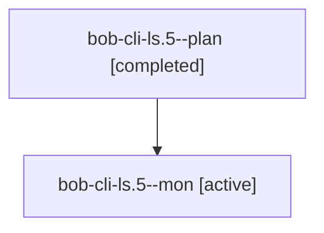

# Session: bob-cli-ls.5

[Agent Hoods](../README.md) / [bbugyi200](../users/bbugyi200/README.md) / [athena](../users/bbugyi200/machines/athena/README.md) / [bob-cli-ls](../users/bbugyi200/machines/athena/hoods/bob-cli-ls/README.md) / bob-cli-ls.5

Owner: `bbugyi200.athena` · Hood: `bob-cli-ls` · Members: 2 · Bead: [bob-cli-ls.5](https://github.com/bobs-org/bob-cli--beads/blob/main/pages/bob-cli-ls/bob-cli-ls.5.md)

## Lineage

The diagram is an optional enhancement; the ordered table below contains the same lineage in accessible text.

| Role | Agent | State | Model / provider | Timing | Commits | Prompt | Chat |
|---|---|---|---|---|---:|---|---|
| plan | bob-cli-ls.5--plan | completed | gpt-6-luna / codex | 2026-11-15T22:55:39.627595+00:00 → 2026-11-15T23:31:22.716411+00:00 | 0 | [Prompt](../agents/bbugyi200.athena.bob-cli-ls.5--plan/prompt.md) | [Chat](../agents/bbugyi200.athena.bob-cli-ls.5--plan/chat.md) |
| mon | bob-cli-ls.5--mon | active | gpt-6-luna / codex | 2026-11-15T23:30:02.087158+00:00 | 0 | — | — |

## Neighbors

| Agent | Relation | State |
|---|---|---|
| [bob-cli-ls.1](bbugyi200.athena.bob-cli-ls.1.md) (session · 3) | bob-cli-ls hood | completed 3 |
| [bob-cli-ls.1](../agents/bbugyi200.athena.bob-cli-ls.1/README.md) | bob-cli-ls hood | active |
| [bob-cli-ls.10](../agents/bbugyi200.athena.bob-cli-ls.10/README.md) | bob-cli-ls hood | waiting |
| [bob-cli-ls.2](bbugyi200.athena.bob-cli-ls.2.md) (session · 3) | bob-cli-ls hood | active 1, completed 2 |
| [bob-cli-ls.2.1.1](bbugyi200.athena.bob-cli-ls.2.1.1.md) (session · 5) | bob-cli-ls hood | completed 4, failed 1 |
| [bob-cli-ls.2.1.2](bbugyi200.athena.bob-cli-ls.2.1.2.md) (session · 5) | bob-cli-ls hood | completed 4, failed 1 |
| [bob-cli-ls.2.1.3](../agents/bbugyi200.athena.bob-cli-ls.2.1.3/README.md) | bob-cli-ls hood | completed |
| [bob-cli-ls.2.1.land](bbugyi200.athena.bob-cli-ls.2.1.land.md) (session · 3) | bob-cli-ls hood | completed 3 |
| [bob-cli-ls.3](../agents/bbugyi200.athena.bob-cli-ls.3/README.md) | bob-cli-ls hood | completed |
| [bob-cli-ls.4](../agents/bbugyi200.athena.bob-cli-ls.4/README.md) | bob-cli-ls hood | waiting |
| [bob-cli-ls.6](../agents/bbugyi200.athena.bob-cli-ls.6/README.md) | bob-cli-ls hood | waiting |
| [bob-cli-ls.7](../agents/bbugyi200.athena.bob-cli-ls.7/README.md) | bob-cli-ls hood | completed |
| [bob-cli-ls.8](../agents/bbugyi200.athena.bob-cli-ls.8/README.md) | bob-cli-ls hood | waiting |
| [bob-cli-ls.9](../agents/bbugyi200.athena.bob-cli-ls.9/README.md) | bob-cli-ls hood | waiting |
| [bob-cli-ls.land](../agents/bbugyi200.athena.bob-cli-ls.land/README.md) | bob-cli-ls hood | waiting |
