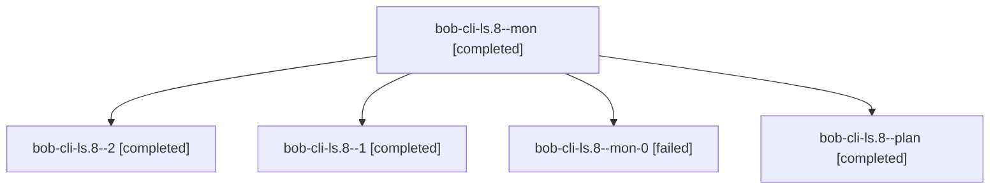

# Session: bob-cli-ls.8

[Agent Hoods](../README.md) / [bbugyi200](../users/bbugyi200/README.md) / [athena](../users/bbugyi200/machines/athena/README.md) / [bob-cli-ls](../users/bbugyi200/machines/athena/hoods/bob-cli-ls/README.md) / bob-cli-ls.8

Owner: `bbugyi200.athena` · Hood: `bob-cli-ls` · Members: 5 · Bead: [bob-cli-ls.8](https://github.com/bobs-org/bob-cli--beads/blob/main/pages/bob-cli-ls/bob-cli-ls.8.md)

## Lineage

The diagram is an optional enhancement; the ordered table below contains the same lineage in accessible text.

| Role | Agent | State | Model / provider | Timing | Commits | Prompt | Chat |
|---|---|---|---|---|---:|---|---|
| mon | bob-cli-ls.8--mon | completed | gpt-6-luna / codex | 2026-11-16T01:45:08.454080+00:00 → 2026-11-16T01:49:58.398172+00:00 | 0 | — | [Chat](../agents/bbugyi200.athena.bob-cli-ls.8--mon/chat.md) |
| 2 | bob-cli-ls.8--2 | completed | gpt-6-luna / codex | 2026-11-16T02:05:25.165622+00:00 → 2026-11-16T02:11:55.701110+00:00 | 0 | [Prompt](../agents/bbugyi200.athena.bob-cli-ls.8--2/prompt.md) | [Chat](../agents/bbugyi200.athena.bob-cli-ls.8--2/chat.md) |
| 1 | bob-cli-ls.8--1 | completed | gpt-6-luna / codex | 2026-11-16T01:51:00.560016+00:00 → 2026-11-16T02:01:29.899353+00:00 | 0 | [Prompt](../agents/bbugyi200.athena.bob-cli-ls.8--1/prompt.md) | [Chat](../agents/bbugyi200.athena.bob-cli-ls.8--1/chat.md) |
| mon-0 | bob-cli-ls.8--mon-0 | failed | gpt-6-luna / codex | 2026-11-16T02:00:21.777353+00:00 → 2026-11-16T02:04:32.103386+00:00 | 0 | — | [Chat](../agents/bbugyi200.athena.bob-cli-ls.8--mon-0/chat.md) |
| plan | bob-cli-ls.8--plan | completed | gpt-6-luna / codex | 2026-11-16T00:54:33.966201+00:00 → 2026-11-16T01:46:18.743627+00:00 | 0 | [Prompt](../agents/bbugyi200.athena.bob-cli-ls.8--plan/prompt.md) | [Chat](../agents/bbugyi200.athena.bob-cli-ls.8--plan/chat.md) |

## Neighbors

| Agent | Relation | State |
|---|---|---|
| [bob-cli-ls.1](bbugyi200.athena.bob-cli-ls.1.md) (session · 3) | bob-cli-ls hood | completed 3 |
| [bob-cli-ls.1](../agents/bbugyi200.athena.bob-cli-ls.1/README.md) | bob-cli-ls hood | active |
| [bob-cli-ls.10](../agents/bbugyi200.athena.bob-cli-ls.10/README.md) | bob-cli-ls hood | completed |
| [bob-cli-ls.2](bbugyi200.athena.bob-cli-ls.2.md) (session · 3) | bob-cli-ls hood | active 1, completed 2 |
| [bob-cli-ls.2.1.1](bbugyi200.athena.bob-cli-ls.2.1.1.md) (session · 5) | bob-cli-ls hood | completed 4, failed 1 |
| [bob-cli-ls.2.1.2](bbugyi200.athena.bob-cli-ls.2.1.2.md) (session · 5) | bob-cli-ls hood | completed 4, failed 1 |
| [bob-cli-ls.2.1.3](../agents/bbugyi200.athena.bob-cli-ls.2.1.3/README.md) | bob-cli-ls hood | completed |
| [bob-cli-ls.2.1.land](bbugyi200.athena.bob-cli-ls.2.1.land.md) (session · 3) | bob-cli-ls hood | completed 3 |
| [bob-cli-ls.3](../agents/bbugyi200.athena.bob-cli-ls.3/README.md) | bob-cli-ls hood | completed |
| [bob-cli-ls.4](../agents/bbugyi200.athena.bob-cli-ls.4/README.md) | bob-cli-ls hood | completed |
| [bob-cli-ls.5](bbugyi200.athena.bob-cli-ls.5.md) (session · 3) | bob-cli-ls hood | completed 2, failed 1 |
| [bob-cli-ls.6](../agents/bbugyi200.athena.bob-cli-ls.6/README.md) | bob-cli-ls hood | completed |
| [bob-cli-ls.7](../agents/bbugyi200.athena.bob-cli-ls.7/README.md) | bob-cli-ls hood | completed |
| [bob-cli-ls.9](../agents/bbugyi200.athena.bob-cli-ls.9/README.md) | bob-cli-ls hood | completed |
| [bob-cli-ls.land](bbugyi200.athena.bob-cli-ls.land.md) (session · 3) | bob-cli-ls hood | active 2, completed 1 |
