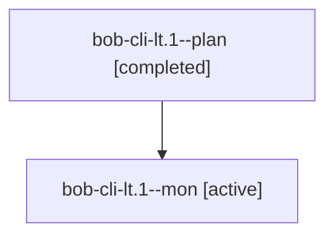

# Session: bob-cli-lt.1

[Agent Hoods](../README.md) / [bbugyi200](../users/bbugyi200/README.md) / [athena](../users/bbugyi200/machines/athena/README.md) / [bob-cli-lt](../users/bbugyi200/machines/athena/hoods/bob-cli-lt/README.md) / bob-cli-lt.1

Owner: `bbugyi200.athena` · Hood: `bob-cli-lt` · Members: 2 · Bead: [bob-cli-lt.1](https://github.com/bobs-org/bob-cli--beads/blob/main/pages/bob-cli-lt/bob-cli-lt.1.md)

## Lineage

The diagram is an optional enhancement; the ordered table below contains the same lineage in accessible text.

| Role | Agent | State | Model / provider | Timing | Commits | Prompt | Chat |
|---|---|---|---|---|---:|---|---|
| plan | bob-cli-lt.1--plan | completed | gpt-6-luna / codex | 2026-11-15T18:19:12.411818+00:00 → 2026-11-15T19:33:56.366888+00:00 | 0 | [Prompt](../agents/bbugyi200.athena.bob-cli-lt.1--plan/prompt.md) | [Chat](../agents/bbugyi200.athena.bob-cli-lt.1--plan/chat.md) |
| mon | bob-cli-lt.1--mon | active | gpt-6-luna / codex | 2026-11-15T19:31:37.127945+00:00 | 0 | — | — |

## Neighbors

| Agent | Relation | State |
|---|---|---|
| [bob-cli-lt.2](bbugyi200.athena.bob-cli-lt.2.md) (session · 3) | bob-cli-lt hood | completed 3 |
| [bob-cli-lt.3](../agents/bbugyi200.athena.bob-cli-lt.3/README.md) | bob-cli-lt hood | waiting |
| [bob-cli-lt.4](../agents/bbugyi200.athena.bob-cli-lt.4/README.md) | bob-cli-lt hood | waiting |
| [bob-cli-lt.5](../agents/bbugyi200.athena.bob-cli-lt.5/README.md) | bob-cli-lt hood | waiting |
| [bob-cli-lt.6](../agents/bbugyi200.athena.bob-cli-lt.6/README.md) | bob-cli-lt hood | waiting |
| [bob-cli-lt.7](../agents/bbugyi200.athena.bob-cli-lt.7/README.md) | bob-cli-lt hood | waiting |
| [bob-cli-lt.8](../agents/bbugyi200.athena.bob-cli-lt.8/README.md) | bob-cli-lt hood | waiting |
| [bob-cli-lt.land](../agents/bbugyi200.athena.bob-cli-lt.land/README.md) | bob-cli-lt hood | waiting |
