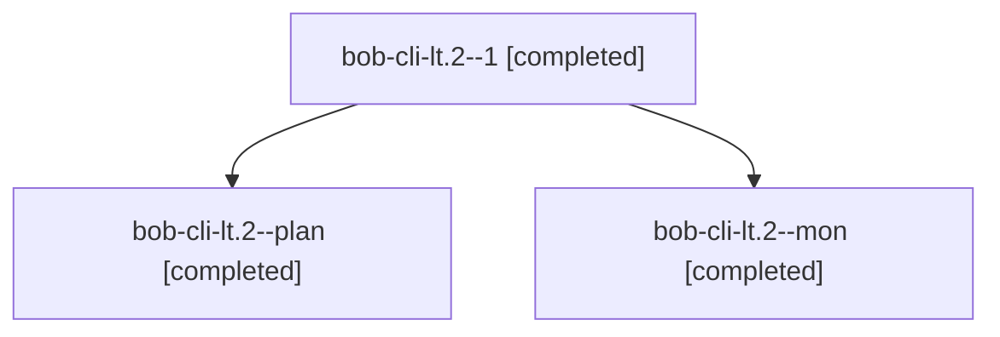

# Session: bob-cli-lt.2

[Agent Hoods](../README.md) / [bbugyi200](../users/bbugyi200/README.md) / [athena](../users/bbugyi200/machines/athena/README.md) / [bob-cli-lt](../users/bbugyi200/machines/athena/hoods/bob-cli-lt/README.md) / bob-cli-lt.2

Owner: `bbugyi200.athena` · Hood: `bob-cli-lt` · Members: 3 · Bead: [bob-cli-lt.2](https://github.com/bobs-org/bob-cli--beads/blob/main/pages/bob-cli-lt/bob-cli-lt.2.md)

## Lineage

The diagram is an optional enhancement; the ordered table below contains the same lineage in accessible text.

| Role | Agent | State | Model / provider | Timing | Commits | Prompt | Chat |
|---|---|---|---|---|---:|---|---|
| 1 | bob-cli-lt.2--1 | completed | grok-4.6 / grok | 2026-11-15T19:20:27.030282+00:00 → 2026-11-15T19:31:35.697701+00:00 | [1](../agents/bbugyi200.athena.bob-cli-lt.2--1/README.md#commits) | [Prompt](../agents/bbugyi200.athena.bob-cli-lt.2--1/prompt.md) | [Chat](../agents/bbugyi200.athena.bob-cli-lt.2--1/chat.md) |
| plan | bob-cli-lt.2--plan | completed | grok-4.6 / grok | 2026-11-15T18:19:16.485568+00:00 → 2026-11-15T19:12:18.384183+00:00 | 0 | [Prompt](../agents/bbugyi200.athena.bob-cli-lt.2--plan/prompt.md) | [Chat](../agents/bbugyi200.athena.bob-cli-lt.2--plan/chat.md) |
| mon | bob-cli-lt.2--mon | completed | grok-4.6 / grok | 2026-11-15T19:10:51.537314+00:00 → 2026-11-15T19:19:45.295478+00:00 | 0 | — | [Chat](../agents/bbugyi200.athena.bob-cli-lt.2--mon/chat.md) |

## Commits

| Role | Repo | Commit | Subject | Committed |
|---|---|---|---|---|
| 1 | bob-cli | [`bd9c4c1`](https://github.com/bobs-org/bob-cli/commit/bd9c4c13e7a6a1f64f57baff735f05834f9f8bb1) | feat(bank): extract YAML span primitives and add a bank config editor | 2026-11-15 14:30:49 EST |

## Neighbors

| Agent | Relation | State |
|---|---|---|
| [bob-cli-lt.1](bbugyi200.athena.bob-cli-lt.1.md) (session · 5) | bob-cli-lt hood | completed 4, failed 1 |
| [bob-cli-lt.3](../agents/bbugyi200.athena.bob-cli-lt.3/README.md) | bob-cli-lt hood | completed |
| [bob-cli-lt.4](bbugyi200.athena.bob-cli-lt.4.md) (session · 5) | bob-cli-lt hood | completed 4, failed 1 |
| [bob-cli-lt.5](../agents/bbugyi200.athena.bob-cli-lt.5/README.md) | bob-cli-lt hood | waiting |
| [bob-cli-lt.6](../agents/bbugyi200.athena.bob-cli-lt.6/README.md) | bob-cli-lt hood | completed |
| [bob-cli-lt.7](../agents/bbugyi200.athena.bob-cli-lt.7/README.md) | bob-cli-lt hood | waiting |
| [bob-cli-lt.8](../agents/bbugyi200.athena.bob-cli-lt.8/README.md) | bob-cli-lt hood | waiting |
| [bob-cli-lt.land](../agents/bbugyi200.athena.bob-cli-lt.land/README.md) | bob-cli-lt hood | waiting |
