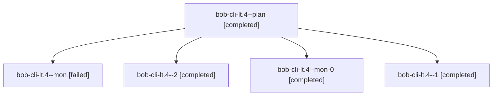

# Session: bob-cli-lt.4

[Agent Hoods](../README.md) / [bbugyi200](../users/bbugyi200/README.md) / [athena](../users/bbugyi200/machines/athena/README.md) / [bob-cli-lt](../users/bbugyi200/machines/athena/hoods/bob-cli-lt/README.md) / bob-cli-lt.4

Owner: `bbugyi200.athena` · Hood: `bob-cli-lt` · Members: 5 · Bead: [bob-cli-lt.4](https://github.com/bobs-org/bob-cli--beads/blob/main/pages/bob-cli-lt/bob-cli-lt.4.md)

## Lineage

The diagram is an optional enhancement; the ordered table below contains the same lineage in accessible text.

| Role | Agent | State | Model / provider | Timing | Commits | Prompt | Chat |
|---|---|---|---|---|---:|---|---|
| plan | bob-cli-lt.4--plan | completed | grok-4.6 / grok | 2026-11-15T20:49:35.769511+00:00 → 2026-11-15T22:35:05.817118+00:00 | 0 | [Prompt](../agents/bbugyi200.athena.bob-cli-lt.4--plan/prompt.md) | [Chat](../agents/bbugyi200.athena.bob-cli-lt.4--plan/chat.md) |
| mon | bob-cli-lt.4--mon | failed | grok-4.6 / grok | 2026-11-15T22:33:34.596045+00:00 → 2026-11-15T22:42:51.643922+00:00 | 0 | — | [Chat](../agents/bbugyi200.athena.bob-cli-lt.4--mon/chat.md) |
| 2 | bob-cli-lt.4--2 | completed | grok-4.6 / grok | 2026-11-15T23:04:04.248581+00:00 → 2026-11-15T23:20:20.927216+00:00 | [1](../agents/bbugyi200.athena.bob-cli-lt.4--2/README.md#commits) | [Prompt](../agents/bbugyi200.athena.bob-cli-lt.4--2/prompt.md) | [Chat](../agents/bbugyi200.athena.bob-cli-lt.4--2/chat.md) |
| mon-0 | bob-cli-lt.4--mon-0 | completed | grok-4.6 / grok | 2026-11-15T22:51:51.486185+00:00 → 2026-11-15T23:03:27.303096+00:00 | 0 | — | [Chat](../agents/bbugyi200.athena.bob-cli-lt.4--mon-0/chat.md) |
| 1 | bob-cli-lt.4--1 | completed | grok-4.6 / grok | 2026-11-15T22:43:48.235562+00:00 → 2026-11-15T22:53:11.341180+00:00 | 0 | [Prompt](../agents/bbugyi200.athena.bob-cli-lt.4--1/prompt.md) | [Chat](../agents/bbugyi200.athena.bob-cli-lt.4--1/chat.md) |

## Commits

| Role | Repo | Commit | Subject | Committed |
|---|---|---|---|---|
| 2 | bob-cli | [`8a6d746`](https://github.com/bobs-org/bob-cli/commit/8a6d746d86a6ef88483530df22da0a65f666c620) | feat(bank): add guarded config update for category and group ops | 2026-11-15 18:19:29 EST |

## Neighbors

| Agent | Relation | State |
|---|---|---|
| [bob-cli-lt.1](bbugyi200.athena.bob-cli-lt.1.md) (session · 5) | bob-cli-lt hood | completed 4, failed 1 |
| [bob-cli-lt.2](bbugyi200.athena.bob-cli-lt.2.md) (session · 3) | bob-cli-lt hood | completed 3 |
| [bob-cli-lt.3](../agents/bbugyi200.athena.bob-cli-lt.3/README.md) | bob-cli-lt hood | completed |
| [bob-cli-lt.5](bbugyi200.athena.bob-cli-lt.5.md) (session · 3) | bob-cli-lt hood | completed 3 |
| [bob-cli-lt.6](../agents/bbugyi200.athena.bob-cli-lt.6/README.md) | bob-cli-lt hood | completed |
| [bob-cli-lt.7](bbugyi200.athena.bob-cli-lt.7.md) (session · 7) | bob-cli-lt hood | completed 5, failed 2 |
| [bob-cli-lt.8](../agents/bbugyi200.athena.bob-cli-lt.8/README.md) | bob-cli-lt hood | waiting |
| [bob-cli-lt.land](../agents/bbugyi200.athena.bob-cli-lt.land/README.md) | bob-cli-lt hood | waiting |
