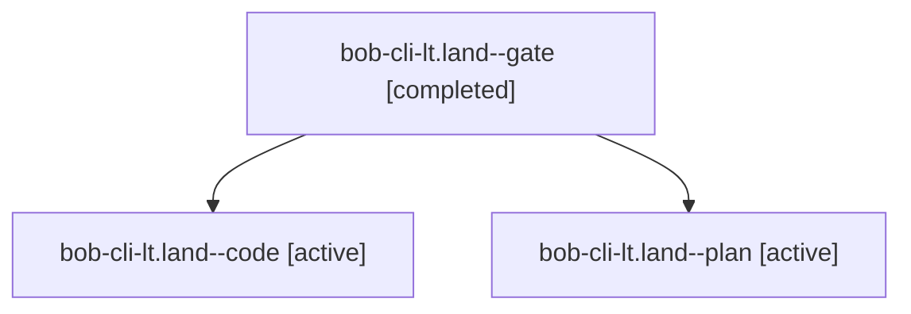

# Session: bob-cli-lt.land

[Agent Hoods](../README.md) / [bbugyi200](../users/bbugyi200/README.md) / [athena](../users/bbugyi200/machines/athena/README.md) / [bob-cli-lt](../users/bbugyi200/machines/athena/hoods/bob-cli-lt/README.md) / bob-cli-lt.land

Owner: `bbugyi200.athena` · Hood: `bob-cli-lt` · Members: 3 · Bead: [bob-cli-lt](https://github.com/bobs-org/bob-cli--beads/blob/main/pages/bob-cli-lt/README.md)

## Lineage

The diagram is an optional enhancement; the ordered table below contains the same lineage in accessible text.

| Role | Agent | State | Model / provider | Timing | Commits | Prompt | Chat |
|---|---|---|---|---|---:|---|---|
| gate | bob-cli-lt.land--gate | completed | opus / claude | 2026-11-16T04:22:45.322995+00:00 → 2026-11-16T04:22:59.076432+00:00 | 0 | — | [Chat](../agents/bbugyi200.athena.bob-cli-lt.land--gate/chat.md) |
| code | bob-cli-lt.land--code | active | grok-4.6 / grok | 2026-11-16T04:23:31.808259+00:00 | 0 | — | — |
| plan | bob-cli-lt.land--plan | active | opus / claude | 2026-11-16T03:45:01.368793+00:00 | [1](../agents/bbugyi200.athena.bob-cli-lt.land--plan/README.md#commits) | [Prompt](../agents/bbugyi200.athena.bob-cli-lt.land--plan/prompt.md) | [Chat](../agents/bbugyi200.athena.bob-cli-lt.land--plan/chat.md) |

## Commits

| Role | Repo | Commit | Subject | Committed |
|---|---|---|---|---|
| plan | bob-cli | [`2a6377d`](https://github.com/bobs-org/bob-cli/commit/2a6377dd717726cf9c0b2fc12d072011915f9680) | fix(bank): integrate bank setup writer and config findings with subscriptions | 2026-11-15 23:21:50 EST |

## Neighbors

| Agent | Relation | State |
|---|---|---|
| [bob-cli-lt.1](bbugyi200.athena.bob-cli-lt.1.md) (session · 5) | bob-cli-lt hood | completed 4, failed 1 |
| [bob-cli-lt.2](bbugyi200.athena.bob-cli-lt.2.md) (session · 3) | bob-cli-lt hood | completed 3 |
| [bob-cli-lt.3](../agents/bbugyi200.athena.bob-cli-lt.3/README.md) | bob-cli-lt hood | completed |
| [bob-cli-lt.4](bbugyi200.athena.bob-cli-lt.4.md) (session · 5) | bob-cli-lt hood | completed 4, failed 1 |
| [bob-cli-lt.5](bbugyi200.athena.bob-cli-lt.5.md) (session · 3) | bob-cli-lt hood | completed 3 |
| [bob-cli-lt.6](../agents/bbugyi200.athena.bob-cli-lt.6/README.md) | bob-cli-lt hood | completed |
| [bob-cli-lt.7](bbugyi200.athena.bob-cli-lt.7.md) (session · 7) | bob-cli-lt hood | completed 5, failed 2 |
| [bob-cli-lt.8](../agents/bbugyi200.athena.bob-cli-lt.8/README.md) | bob-cli-lt hood | completed |
