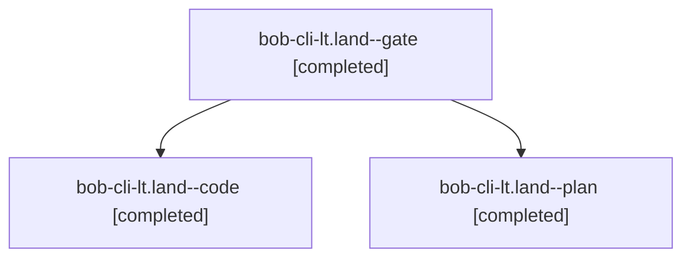

# Session: bob-cli-lt.land

[Agent Hoods](../README.md) / [bbugyi200](../users/bbugyi200/README.md) / [athena](../users/bbugyi200/machines/athena/README.md) / [bob-cli-lt](../users/bbugyi200/machines/athena/hoods/bob-cli-lt/README.md) / bob-cli-lt.land

Owner: `bbugyi200.athena` · Hood: `bob-cli-lt` · Members: 3 · Bead: [bob-cli-lt](https://github.com/bobs-org/bob-cli--beads/blob/main/pages/bob-cli-lt/README.md)

## Lineage



The diagram is an optional enhancement; the ordered table below contains the same lineage in accessible text.

| Role | Agent | State | Model / provider | Timing | Commits | Prompt | Chat |
|---|---|---|---|---|---:|---|---|
| <a id="member-gate"></a>gate | bob-cli-lt.land--gate | completed | opus / claude | 2026-11-16T04:22:45.322995+00:00 → 2026-11-16T04:22:59.076432+00:00 | 0 | — | [Chat](../agents/bbugyi200.athena.bob-cli-lt.land--gate/chat.md) |
| <a id="member-code"></a>code | bob-cli-lt.land--code | completed | grok-4.6 / grok | 2026-11-16T04:23:31.808259+00:00 → 2026-11-16T06:01:40.249133+00:00 | 0 | — | [Chat](../agents/bbugyi200.athena.bob-cli-lt.land--code/chat.md) |
| <a id="member-plan"></a>plan | bob-cli-lt.land--plan | completed | opus / claude | 2026-11-16T03:45:01.368793+00:00 → 2026-11-16T06:01:40.249133+00:00 | [1](../agents/bbugyi200.athena.bob-cli-lt.land--plan/README.md#commits) | [Prompt](../agents/bbugyi200.athena.bob-cli-lt.land--plan/prompt.md) | [Chat](../agents/bbugyi200.athena.bob-cli-lt.land--plan/chat.md) |

## Commits

| Role | Repo | Commit | Subject | Committed |
|---|---|---|---|---|
| plan | bob-cli | [`2a6377d`](https://github.com/bobs-org/bob-cli/commit/2a6377dd717726cf9c0b2fc12d072011915f9680) | fix(bank): integrate bank setup writer and config findings with subscriptions | 2026-11-15 23:21:50 EST |

## Variables

| Role | Variable | Value |
|---|---|---|
| code | `artifacts` | \[{bead: bob-cli-lt, kind: file, label: Bank setup e2e JSON report (bob-cli-lt land, pass), path: /home/bryan/.sase/artifacts/agents/gh\_bobs-org\_\_bob-cli/20261115232306/setup-e2e-report-32476c73585f.j… |

#### artifacts

**Role:** `code`

```yaml
- bead: bob-cli-lt
  kind: file
  label: Bank setup e2e JSON report (bob-cli-lt land, pass)
  path: /home/bryan/.sase/artifacts/agents/gh_bobs-org__bob-cli/20261115232306/setup-e2e-report-32476c73585f.json
  ref: file:explicit:4cdec0f9211442a7aa403d0c
  source_path: /tmp/lt-land-artifacts/setup-e2e-report.json
- bead: bob-cli-lt
  kind: file
  label: Existing bank UI e2e JSON report on land tree (bob-cli-lt)
  path: /home/bryan/.sase/artifacts/agents/gh_bobs-org__bob-cli/20261115232306/bank-ui-e2e-report-1060fe3803a2.json
  ref: file:explicit:8438a3d51b740dbde9b7279d
  source_path: /tmp/lt-land-artifacts/bank-ui-e2e-report.json
- bead: bob-cli-lt
  kind: file
  label: Existing bank UI e2e JSON report on clean HEAD 99e3410
  path: /home/bryan/.sase/artifacts/agents/gh_bobs-org__bob-cli/20261115232306/bank-ui-e2e-clean-report-1ed5e42a9684.json
  ref: file:explicit:dcbd88a2e076072c3f1870b4
  source_path: /tmp/lt-land-artifacts/bank-ui-e2e-clean-report.json
- bead: bob-cli-lt
  kind: image
  label: invalid-fence screenshot on land tree: month heading, no error card
  path: /home/bryan/.sase/artifacts/agents/gh_bobs-org__bob-cli/20261115232306/invalid-fence-6d02419c0522.png
  ref: file:explicit:96340422e29c8b25d79f1c8b
  source_path: /tmp/lt-land-artifacts/invalid-fence.png
- bead: bob-cli-lt
  kind: image
  label: Setup header collapsed ~375px light
  path: /home/bryan/.sase/artifacts/agents/gh_bobs-org__bob-cli/20261115232306/setup-collapsed-375-light-174faac30796.png
  ref: file:explicit:51dcaec4621d8cc79bf46edf
  source_path: /tmp/lt-land-artifacts/setup-collapsed-375-light.png
- bead: bob-cli-lt
  kind: image
  label: Setup header expanded ~375px light
  path: /home/bryan/.sase/artifacts/agents/gh_bobs-org__bob-cli/20261115232306/setup-expanded-375-light-909056fc26a7.png
  ref: file:explicit:976c7d21c1017143dc5b1f4a
  source_path: /tmp/lt-land-artifacts/setup-expanded-375-light.png
- bead: bob-cli-lt
  kind: image
  label: Setup header invalid ~375px light
  path: /home/bryan/.sase/artifacts/agents/gh_bobs-org__bob-cli/20261115232306/setup-invalid-375-light-c258d6d6f271.png
  ref: file:explicit:34f11fe48e65ea73984d0fc5
  source_path: /tmp/lt-land-artifacts/setup-invalid-375-light.png
- bead: bob-cli-lt
  kind: image
  label: Bank Setup card Categories tab
  path: /home/bryan/.sase/artifacts/agents/gh_bobs-org__bob-cli/20261115232306/setup-card-categories-83a7bf30ee7a.png
  ref: file:explicit:c84c975f7194e212fe16ea75
  source_path: /tmp/lt-land-artifacts/setup-card-categories.png
- bead: bob-cli-lt
  kind: image
  label: Category card New category stage
  path: /home/bryan/.sase/artifacts/agents/gh_bobs-org__bob-cli/20261115232306/setup-category-new-d0d414a6a347.png
  ref: file:explicit:0a0b622c742c4650208a3952
  source_path: /tmp/lt-land-artifacts/setup-category-new.png
```

Values are truncated for display; see each member's agent meta.json for the full values.

## Neighbors

| Agent | Relation | State |
|---|---|---|
| [bob-cli-lt.1](bbugyi200.athena.bob-cli-lt.1.md) (session · 5) | bob-cli-lt hood | completed 4, failed 1 |
| [bob-cli-lt.2](bbugyi200.athena.bob-cli-lt.2.md) (session · 3) | bob-cli-lt hood | completed 3 |
| [bob-cli-lt.3](../agents/bbugyi200.athena.bob-cli-lt.3/README.md) | bob-cli-lt hood | completed |
| [bob-cli-lt.4](bbugyi200.athena.bob-cli-lt.4.md) (session · 5) | bob-cli-lt hood | completed 4, failed 1 |
| [bob-cli-lt.5](bbugyi200.athena.bob-cli-lt.5.md) (session · 3) | bob-cli-lt hood | completed 3 |
| [bob-cli-lt.6](../agents/bbugyi200.athena.bob-cli-lt.6/README.md) | bob-cli-lt hood | completed |
| [bob-cli-lt.7](bbugyi200.athena.bob-cli-lt.7.md) (session · 7) | bob-cli-lt hood | completed 5, failed 2 |
| [bob-cli-lt.8](../agents/bbugyi200.athena.bob-cli-lt.8/README.md) | bob-cli-lt hood | completed |
