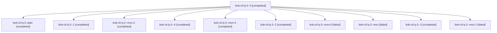

# Session: bob-cli-ly.3

[Agent Hoods](../README.md) / [bbugyi200](../users/bbugyi200/README.md) / [athena](../users/bbugyi200/machines/athena/README.md) / [bob-cli-ly](../users/bbugyi200/machines/athena/hoods/bob-cli-ly/README.md) / bob-cli-ly.3

Owner: `bbugyi200.athena` · Hood: `bob-cli-ly` · Members: 11 · Bead: [bob-cli-ly.3](https://github.com/bobs-org/bob-cli--beads/blob/main/pages/bob-cli-ly/bob-cli-ly.3.md)

## Lineage

The diagram is an optional enhancement; the ordered table below contains the same lineage in accessible text.

| Role | Agent | State | Model / provider | Timing | Commits | Prompt | Chat |
|---|---|---|---|---|---:|---|---|
| 5 | bob-cli-ly.3--5 | completed | gpt-6-luna / codex | 2026-11-16T00:24:41.502719+00:00 → 2026-11-16T00:28:01.057035+00:00 | 0 | [Prompt](../agents/bbugyi200.athena.bob-cli-ly.3--5/prompt.md) | [Chat](../agents/bbugyi200.athena.bob-cli-ly.3--5/chat.md) |
| plan | bob-cli-ly.3--plan | completed | gpt-6-luna / codex | 2026-11-15T21:49:35.306326+00:00 → 2026-11-15T22:41:25.286242+00:00 | 0 | [Prompt](../agents/bbugyi200.athena.bob-cli-ly.3--plan/prompt.md) | [Chat](../agents/bbugyi200.athena.bob-cli-ly.3--plan/chat.md) |
| 1 | bob-cli-ly.3--1 | completed | gpt-6-luna / codex | 2026-11-15T23:03:02.519948+00:00 → 2026-11-15T23:09:50.372999+00:00 | 0 | [Prompt](../agents/bbugyi200.athena.bob-cli-ly.3--1/prompt.md) | [Chat](../agents/bbugyi200.athena.bob-cli-ly.3--1/chat.md) |
| mon-2 | bob-cli-ly.3--mon-2 | completed | gpt-6-luna / codex | 2026-11-15T23:46:46.711035+00:00 → 2026-11-16T00:15:29.613416+00:00 | 0 | — | [Chat](../agents/bbugyi200.athena.bob-cli-ly.3--mon-2/chat.md) |
| 4 | bob-cli-ly.3--4 | completed | gpt-6-luna / codex | 2026-11-16T00:16:18.011167+00:00 → 2026-11-16T00:22:13.997897+00:00 | 0 | [Prompt](../agents/bbugyi200.athena.bob-cli-ly.3--4/prompt.md) | [Chat](../agents/bbugyi200.athena.bob-cli-ly.3--4/chat.md) |
| mon-3 | bob-cli-ly.3--mon-3 | completed | gpt-6-luna / codex | 2026-11-16T00:20:41.806469+00:00 → 2026-11-16T00:24:07.269016+00:00 | 0 | — | [Chat](../agents/bbugyi200.athena.bob-cli-ly.3--mon-3/chat.md) |
| 2 | bob-cli-ly.3--2 | completed | gpt-6-luna / codex | 2026-11-15T23:12:26.010419+00:00 → 2026-11-15T23:16:07.385653+00:00 | 0 | [Prompt](../agents/bbugyi200.athena.bob-cli-ly.3--2/prompt.md) | [Chat](../agents/bbugyi200.athena.bob-cli-ly.3--2/chat.md) |
| mon-0 | bob-cli-ly.3--mon-0 | failed | gpt-6-luna / codex | 2026-11-15T23:08:26.691713+00:00 → 2026-11-15T23:11:47.056365+00:00 | 0 | — | [Chat](../agents/bbugyi200.athena.bob-cli-ly.3--mon-0/chat.md) |
| mon | bob-cli-ly.3--mon | failed | gpt-6-luna / codex | 2026-11-15T22:38:50.917574+00:00 → 2026-11-15T23:02:35.369399+00:00 | 0 | — | [Chat](../agents/bbugyi200.athena.bob-cli-ly.3--mon/chat.md) |
| 3 | bob-cli-ly.3--3 | completed | gpt-6-luna / codex | 2026-11-15T23:41:03.039037+00:00 → 2026-11-15T23:48:19.862841+00:00 | 0 | [Prompt](../agents/bbugyi200.athena.bob-cli-ly.3--3/prompt.md) | [Chat](../agents/bbugyi200.athena.bob-cli-ly.3--3/chat.md) |
| mon-1 | bob-cli-ly.3--mon-1 | failed | gpt-6-luna / codex | 2026-11-15T23:15:04.576188+00:00 → 2026-11-15T23:40:10.555439+00:00 | 0 | — | [Chat](../agents/bbugyi200.athena.bob-cli-ly.3--mon-1/chat.md) |

## Neighbors

| Agent | Relation | State |
|---|---|---|
| [bob-cli-ly.1](../agents/bbugyi200.athena.bob-cli-ly.1/README.md) | bob-cli-ly hood | completed |
| [bob-cli-ly.2](../agents/bbugyi200.athena.bob-cli-ly.2/README.md) | bob-cli-ly hood | waiting |
| [bob-cli-ly.4](../agents/bbugyi200.athena.bob-cli-ly.4/README.md) | bob-cli-ly hood | waiting |
| [bob-cli-ly.5](../agents/bbugyi200.athena.bob-cli-ly.5/README.md) | bob-cli-ly hood | waiting |
| [bob-cli-ly.land](../agents/bbugyi200.athena.bob-cli-ly.land/README.md) | bob-cli-ly hood | waiting |
