# Session: bob-cli-ly.4

[Agent Hoods](../README.md) / [bbugyi200](../users/bbugyi200/README.md) / [athena](../users/bbugyi200/machines/athena/README.md) / [bob-cli-ly](../users/bbugyi200/machines/athena/hoods/bob-cli-ly/README.md) / bob-cli-ly.4

Owner: `bbugyi200.athena` · Hood: `bob-cli-ly` · Members: 19 · Bead: [bob-cli-ly.4](https://github.com/bobs-org/bob-cli--beads/blob/main/pages/bob-cli-ly/bob-cli-ly.4.md)

## Lineage

```mermaid
flowchart TD
  n0["bob-cli-ly.4--plan [completed]"]
  n1["bob-cli-ly.4--mon-0 [failed]"]
  n0 --> n1
  n2["bob-cli-ly.4--mon-6 [failed]"]
  n0 --> n2
  n3["bob-cli-ly.4--mon-4 [failed]"]
  n0 --> n3
  n4["bob-cli-ly.4--5 [completed]"]
  n0 --> n4
  n5["bob-cli-ly.4--mon-8 [active]"]
  n0 --> n5
  n6["bob-cli-ly.4--mon-1 [failed]"]
  n0 --> n6
  n7["bob-cli-ly.4--7 [completed]"]
  n0 --> n7
  n8["bob-cli-ly.4--8 [completed]"]
  n0 --> n8
  n9["bob-cli-ly.4--mon-2 [failed]"]
  n0 --> n9
  n10["bob-cli-ly.4--1 [completed]"]
  n0 --> n10
  n11["bob-cli-ly.4--mon-3 [failed]"]
  n0 --> n11
  n12["bob-cli-ly.4--mon-7 [failed]"]
  n0 --> n12
  n13["bob-cli-ly.4--6 [completed]"]
  n0 --> n13
  n14["bob-cli-ly.4--mon-5 [failed]"]
  n0 --> n14
  n15["bob-cli-ly.4--3 [completed]"]
  n0 --> n15
  n16["bob-cli-ly.4--4 [completed]"]
  n0 --> n16
  n17["bob-cli-ly.4--2 [completed]"]
  n0 --> n17
  n18["bob-cli-ly.4--mon [failed]"]
  n0 --> n18
```

The diagram is an optional enhancement; the ordered table below contains the same lineage in accessible text.

| Role | Agent | State | Model / provider | Timing | Commits | Prompt | Chat |
|---|---|---|---|---|---:|---|---|
| plan | bob-cli-ly.4--plan | completed | gpt-6-luna / codex | 2026-11-16T02:09:23.305087+00:00 → 2026-11-16T03:16:33.441387+00:00 | 0 | [Prompt](../agents/bbugyi200.athena.bob-cli-ly.4--plan/prompt.md) | [Chat](../agents/bbugyi200.athena.bob-cli-ly.4--plan/chat.md) |
| mon-0 | bob-cli-ly.4--mon-0 | failed | gpt-6-luna / codex | 2026-11-16T03:12:42.378923+00:00 → 2026-11-16T03:18:04.989526+00:00 | 0 | — | [Chat](../agents/bbugyi200.athena.bob-cli-ly.4--mon-0/chat.md) |
| mon-6 | bob-cli-ly.4--mon-6 | failed | gpt-6-luna / codex | 2026-11-16T05:33:32.679693+00:00 → 2026-11-16T05:56:38.044899+00:00 | 0 | — | [Chat](../agents/bbugyi200.athena.bob-cli-ly.4--mon-6/chat.md) |
| mon-4 | bob-cli-ly.4--mon-4 | failed | gpt-6-luna / codex | 2026-11-16T04:27:50.413779+00:00 → 2026-11-16T04:49:55.419527+00:00 | 0 | — | [Chat](../agents/bbugyi200.athena.bob-cli-ly.4--mon-4/chat.md) |
| 5 | bob-cli-ly.4--5 | completed | gpt-6-luna / codex | 2026-11-16T04:50:56.105400+00:00 → 2026-11-16T04:58:58.695870+00:00 | 0 | [Prompt](../agents/bbugyi200.athena.bob-cli-ly.4--5/prompt.md) | [Chat](../agents/bbugyi200.athena.bob-cli-ly.4--5/chat.md) |
| mon-8 | bob-cli-ly.4--mon-8 | active | gpt-6-luna / codex | 2026-11-16T06:44:12.375168+00:00 | 0 | — | — |
| mon-1 | bob-cli-ly.4--mon-1 | failed | gpt-6-luna / codex | 2026-11-16T03:36:05.040962+00:00 → 2026-11-16T03:39:18.393168+00:00 | 0 | — | [Chat](../agents/bbugyi200.athena.bob-cli-ly.4--mon-1/chat.md) |
| 7 | bob-cli-ly.4--7 | completed | gpt-6-luna / codex | 2026-11-16T05:58:33.957949+00:00 → 2026-11-16T06:11:51.587626+00:00 | 0 | [Prompt](../agents/bbugyi200.athena.bob-cli-ly.4--7/prompt.md) | [Chat](../agents/bbugyi200.athena.bob-cli-ly.4--7/chat.md) |
| 8 | bob-cli-ly.4--8 | completed | gpt-6-luna / codex | 2026-11-16T06:38:46.221008+00:00 → 2026-11-16T07:08:49.317415+00:00 | 0 | [Prompt](../agents/bbugyi200.athena.bob-cli-ly.4--8/prompt.md) | [Chat](../agents/bbugyi200.athena.bob-cli-ly.4--8/chat.md) |
| mon-2 | bob-cli-ly.4--mon-2 | failed | gpt-6-luna / codex | 2026-11-16T03:50:51.257947+00:00 → 2026-11-16T03:59:22.288673+00:00 | 0 | — | [Chat](../agents/bbugyi200.athena.bob-cli-ly.4--mon-2/chat.md) |
| 1 | bob-cli-ly.4--1 | completed | gpt-6-luna / codex | 2026-11-16T03:18:54.051072+00:00 → 2026-11-16T03:36:59.283096+00:00 | 0 | [Prompt](../agents/bbugyi200.athena.bob-cli-ly.4--1/prompt.md) | [Chat](../agents/bbugyi200.athena.bob-cli-ly.4--1/chat.md) |
| mon-3 | bob-cli-ly.4--mon-3 | failed | gpt-6-luna / codex | 2026-11-16T04:07:32.314549+00:00 → 2026-11-16T04:18:03.036556+00:00 | 0 | — | [Chat](../agents/bbugyi200.athena.bob-cli-ly.4--mon-3/chat.md) |
| mon-7 | bob-cli-ly.4--mon-7 | failed | gpt-6-luna / codex | 2026-11-16T06:09:21.184738+00:00 → 2026-11-16T06:38:15.942345+00:00 | 0 | — | [Chat](../agents/bbugyi200.athena.bob-cli-ly.4--mon-7/chat.md) |
| 6 | bob-cli-ly.4--6 | completed | gpt-6-luna / codex | 2026-11-16T05:21:14.197747+00:00 → 2026-11-16T05:36:28.330738+00:00 | 0 | [Prompt](../agents/bbugyi200.athena.bob-cli-ly.4--6/prompt.md) | [Chat](../agents/bbugyi200.athena.bob-cli-ly.4--6/chat.md) |
| mon-5 | bob-cli-ly.4--mon-5 | failed | gpt-6-luna / codex | 2026-11-16T04:56:53.517048+00:00 → 2026-11-16T05:19:52.480570+00:00 | 0 | — | [Chat](../agents/bbugyi200.athena.bob-cli-ly.4--mon-5/chat.md) |
| 3 | bob-cli-ly.4--3 | completed | gpt-6-luna / codex | 2026-11-16T04:00:12.363489+00:00 → 2026-11-16T04:09:02.499587+00:00 | 0 | [Prompt](../agents/bbugyi200.athena.bob-cli-ly.4--3/prompt.md) | [Chat](../agents/bbugyi200.athena.bob-cli-ly.4--3/chat.md) |
| 4 | bob-cli-ly.4--4 | completed | gpt-6-luna / codex | 2026-11-16T04:18:42.773400+00:00 → 2026-11-16T04:30:12.715246+00:00 | 0 | [Prompt](../agents/bbugyi200.athena.bob-cli-ly.4--4/prompt.md) | [Chat](../agents/bbugyi200.athena.bob-cli-ly.4--4/chat.md) |
| 2 | bob-cli-ly.4--2 | completed | gpt-6-luna / codex | 2026-11-16T03:40:07.691641+00:00 → 2026-11-16T03:52:12.703083+00:00 | 0 | [Prompt](../agents/bbugyi200.athena.bob-cli-ly.4--2/prompt.md) | [Chat](../agents/bbugyi200.athena.bob-cli-ly.4--2/chat.md) |
| mon | bob-cli-ly.4--mon | failed | gpt-6-luna / codex | 2026-11-16T03:11:40.631797+00:00 → 2026-11-16T03:11:41.271891+00:00 | 0 | — | — |

## Neighbors

| Agent | Relation | State |
|---|---|---|
| [bob-cli-ly.1](../agents/bbugyi200.athena.bob-cli-ly.1/README.md) | bob-cli-ly hood | completed |
| [bob-cli-ly.2](../agents/bbugyi200.athena.bob-cli-ly.2/README.md) | bob-cli-ly hood | completed |
| [bob-cli-ly.3](bbugyi200.athena.bob-cli-ly.3.md) (session · 11) | bob-cli-ly hood | completed 8, failed 3 |
| [bob-cli-ly.5](../agents/bbugyi200.athena.bob-cli-ly.5/README.md) | bob-cli-ly hood | waiting |
| [bob-cli-ly.land](../agents/bbugyi200.athena.bob-cli-ly.land/README.md) | bob-cli-ly hood | waiting |
