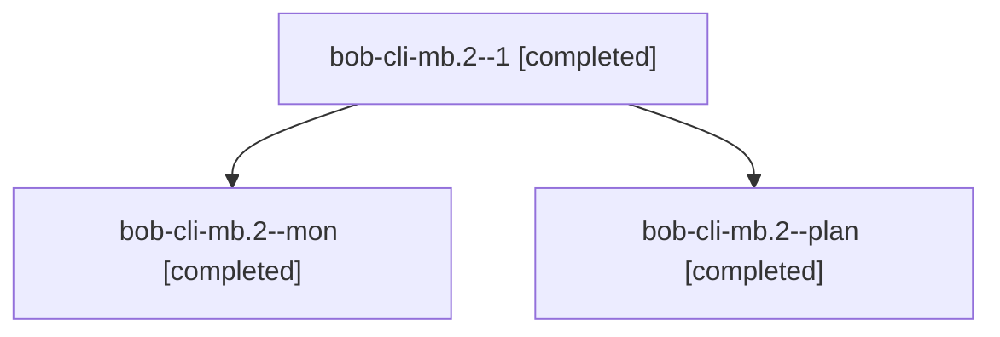

# Session: bob-cli-mb.2

[Agent Hoods](../README.md) / [bbugyi200](../users/bbugyi200/README.md) / [athena](../users/bbugyi200/machines/athena/README.md) / [bob-cli-mb](../users/bbugyi200/machines/athena/hoods/bob-cli-mb/README.md) / bob-cli-mb.2

Owner: `bbugyi200.athena` · Hood: `bob-cli-mb` · Members: 3 · Bead: [bob-cli-mb.2](https://github.com/bobs-org/bob-cli--beads/blob/main/pages/bob-cli-mb/bob-cli-mb.2.md)

## Lineage

The diagram is an optional enhancement; the ordered table below contains the same lineage in accessible text.

| Role | Agent | State | Model / provider | Timing | Commits | Prompt | Chat |
|---|---|---|---|---|---:|---|---|
| 1 | bob-cli-mb.2--1 | completed | gpt-6-luna / codex | 2026-11-16T16:30:02.879878+00:00 → 2026-11-16T16:37:31.953493+00:00 | [1](../agents/bbugyi200.athena.bob-cli-mb.2--1/README.md#commits) | [Prompt](../agents/bbugyi200.athena.bob-cli-mb.2--1/prompt.md) | [Chat](../agents/bbugyi200.athena.bob-cli-mb.2--1/chat.md) |
| mon | bob-cli-mb.2--mon | completed | gpt-6-luna / codex | 2026-11-16T16:21:05.093398+00:00 → 2026-11-16T16:29:27.652844+00:00 | 0 | — | [Chat](../agents/bbugyi200.athena.bob-cli-mb.2--mon/chat.md) |
| plan | bob-cli-mb.2--plan | completed | gpt-6-luna / codex | 2026-11-16T16:11:16.825157+00:00 → 2026-11-16T16:21:42.778504+00:00 | 0 | [Prompt](../agents/bbugyi200.athena.bob-cli-mb.2--plan/prompt.md) | [Chat](../agents/bbugyi200.athena.bob-cli-mb.2--plan/chat.md) |

## Commits

| Role | Repo | Commit | Subject | Committed |
|---|---|---|---|---|
| 1 | bob-cli | [`b73cf56`](https://github.com/bobs-org/bob-cli/commit/b73cf56f5fec9b4de6e95c9e326c6f6970e1d8f6) | feat(capture): prioritize living vault link suggestions | 2026-11-16 11:37:03 EST |

## Neighbors

| Agent | Relation | State |
|---|---|---|
| [bob-cli-mb.1](../agents/bbugyi200.athena.bob-cli-mb.1/README.md) | bob-cli-mb hood | completed |
| [bob-cli-mb.3](bbugyi200.athena.bob-cli-mb.3.md) (session · 5) | bob-cli-mb hood | completed 5 |
| [bob-cli-mb.4](bbugyi200.athena.bob-cli-mb.4.md) (session · 2) | bob-cli-mb hood | active 1, completed 1 |
| [bob-cli-mb.5](../agents/bbugyi200.athena.bob-cli-mb.5/README.md) | bob-cli-mb hood | completed |
| [bob-cli-mb.land](../agents/bbugyi200.athena.bob-cli-mb.land/README.md) | bob-cli-mb hood | active |
