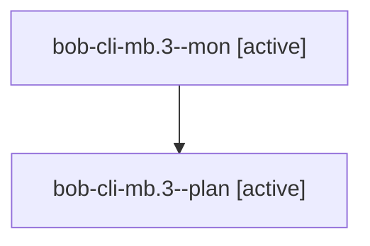

# Session: bob-cli-mb.3

[Agent Hoods](../README.md) / [bbugyi200](../users/bbugyi200/README.md) / [athena](../users/bbugyi200/machines/athena/README.md) / [bob-cli-mb](../users/bbugyi200/machines/athena/hoods/bob-cli-mb/README.md) / bob-cli-mb.3

Owner: `bbugyi200.athena` · Hood: `bob-cli-mb` · Members: 2 · Bead: [bob-cli-mb.3](https://github.com/bobs-org/bob-cli--beads/blob/main/pages/bob-cli-mb/bob-cli-mb.3.md)

## Lineage

The diagram is an optional enhancement; the ordered table below contains the same lineage in accessible text.

| Role | Agent | State | Model / provider | Timing | Commits | Prompt | Chat |
|---|---|---|---|---|---:|---|---|
| mon | bob-cli-mb.3--mon | active | muse-spark-1.3-contributor / muse | 2026-11-16T15:39:56.418238+00:00 | 0 | — | — |
| plan | bob-cli-mb.3--plan | active | muse-spark-1.3-contributor / muse | 2026-11-16T15:16:59.966221+00:00 | 0 | [Prompt](../agents/bbugyi200.athena.bob-cli-mb.3--plan/prompt.md) | [Chat](../agents/bbugyi200.athena.bob-cli-mb.3--plan/chat.md) |

## Neighbors

| Agent | Relation | State |
|---|---|---|
| [bob-cli-mb.1](../agents/bbugyi200.athena.bob-cli-mb.1/README.md) | bob-cli-mb hood | active |
| [bob-cli-mb.2](../agents/bbugyi200.athena.bob-cli-mb.2/README.md) | bob-cli-mb hood | active |
| [bob-cli-mb.4](../agents/bbugyi200.athena.bob-cli-mb.4/README.md) | bob-cli-mb hood | active |
| [bob-cli-mb.5](../agents/bbugyi200.athena.bob-cli-mb.5/README.md) | bob-cli-mb hood | completed |
| [bob-cli-mb.land](../agents/bbugyi200.athena.bob-cli-mb.land/README.md) | bob-cli-mb hood | active |
