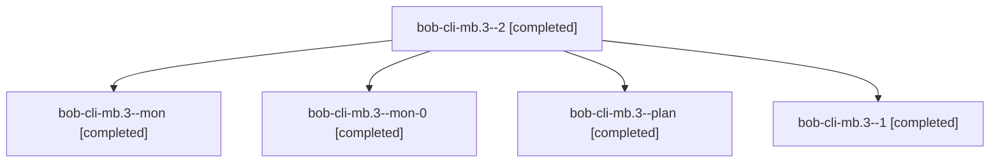

# Session: bob-cli-mb.3

[Agent Hoods](../README.md) / [bbugyi200](../users/bbugyi200/README.md) / [athena](../users/bbugyi200/machines/athena/README.md) / [bob-cli-mb](../users/bbugyi200/machines/athena/hoods/bob-cli-mb/README.md) / bob-cli-mb.3

Owner: `bbugyi200.athena` · Hood: `bob-cli-mb` · Members: 5 · Bead: [bob-cli-mb.3](https://github.com/bobs-org/bob-cli--beads/blob/main/pages/bob-cli-mb/bob-cli-mb.3.md)

## Lineage

The diagram is an optional enhancement; the ordered table below contains the same lineage in accessible text.

| Role | Agent | State | Model / provider | Timing | Commits | Prompt | Chat |
|---|---|---|---|---|---:|---|---|
| 2 | bob-cli-mb.3--2 | completed | muse-spark-1.3-contributor / muse | 2026-11-16T16:40:36.066986+00:00 → 2026-11-16T16:42:13.223381+00:00 | 0 | [Prompt](../agents/bbugyi200.athena.bob-cli-mb.3--2/prompt.md) | [Chat](../agents/bbugyi200.athena.bob-cli-mb.3--2/chat.md) |
| mon | bob-cli-mb.3--mon | completed | muse-spark-1.3-contributor / muse | 2026-11-16T15:39:56.418238+00:00 → 2026-11-16T16:11:14.660901+00:00 | 0 | — | [Chat](../agents/bbugyi200.athena.bob-cli-mb.3--mon/chat.md) |
| mon-0 | bob-cli-mb.3--mon-0 | completed | muse-spark-1.3-contributor / muse | 2026-11-16T16:14:06.399601+00:00 → 2026-11-16T16:39:55.791668+00:00 | 0 | — | [Chat](../agents/bbugyi200.athena.bob-cli-mb.3--mon-0/chat.md) |
| plan | bob-cli-mb.3--plan | completed | muse-spark-1.3-contributor / muse | 2026-11-16T15:16:59.966221+00:00 → 2026-11-16T15:43:37.293890+00:00 | 0 | [Prompt](../agents/bbugyi200.athena.bob-cli-mb.3--plan/prompt.md) | [Chat](../agents/bbugyi200.athena.bob-cli-mb.3--plan/chat.md) |
| 1 | bob-cli-mb.3--1 | completed | muse-spark-1.3-contributor / muse | 2026-11-16T16:11:51.755547+00:00 → 2026-11-16T16:16:00.216214+00:00 | 0 | [Prompt](../agents/bbugyi200.athena.bob-cli-mb.3--1/prompt.md) | [Chat](../agents/bbugyi200.athena.bob-cli-mb.3--1/chat.md) |

## Neighbors

| Agent | Relation | State |
|---|---|---|
| [bob-cli-mb.1](../agents/bbugyi200.athena.bob-cli-mb.1/README.md) | bob-cli-mb hood | completed |
| [bob-cli-mb.2](bbugyi200.athena.bob-cli-mb.2.md) (session · 3) | bob-cli-mb hood | completed 3 |
| [bob-cli-mb.4](bbugyi200.athena.bob-cli-mb.4.md) (session · 2) | bob-cli-mb hood | active 1, completed 1 |
| [bob-cli-mb.5](../agents/bbugyi200.athena.bob-cli-mb.5/README.md) | bob-cli-mb hood | completed |
| [bob-cli-mb.land](../agents/bbugyi200.athena.bob-cli-mb.land/README.md) | bob-cli-mb hood | active |
