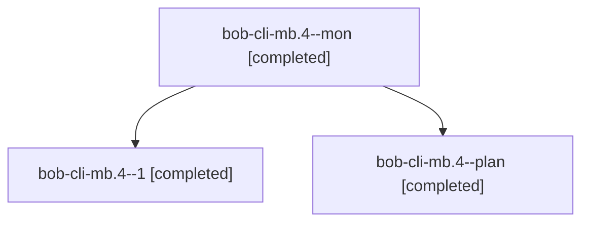

# Session: bob-cli-mb.4

[Agent Hoods](../README.md) / [bbugyi200](../users/bbugyi200/README.md) / [athena](../users/bbugyi200/machines/athena/README.md) / [bob-cli-mb](../users/bbugyi200/machines/athena/hoods/bob-cli-mb/README.md) / bob-cli-mb.4

Owner: `bbugyi200.athena` · Hood: `bob-cli-mb` · Members: 3 · Bead: [bob-cli-mb.4](https://github.com/bobs-org/bob-cli--beads/blob/main/pages/bob-cli-mb/bob-cli-mb.4.md)

## Lineage

The diagram is an optional enhancement; the ordered table below contains the same lineage in accessible text.

| Role | Agent | State | Model / provider | Timing | Commits | Prompt | Chat |
|---|---|---|---|---|---:|---|---|
| mon | bob-cli-mb.4--mon | completed | grok-4.6 / grok | 2026-11-16T17:25:50.637670+00:00 → 2026-11-16T17:49:29.666139+00:00 | 0 | — | [Chat](../agents/bbugyi200.athena.bob-cli-mb.4--mon/chat.md) |
| 1 | bob-cli-mb.4--1 | completed | grok-4.6 / grok | 2026-11-16T17:50:12.257352+00:00 → 2026-11-16T17:51:18.603472+00:00 | 0 | [Prompt](../agents/bbugyi200.athena.bob-cli-mb.4--1/prompt.md) | [Chat](../agents/bbugyi200.athena.bob-cli-mb.4--1/chat.md) |
| plan | bob-cli-mb.4--plan | completed | grok-4.6 / grok | 2026-11-16T16:43:27.379111+00:00 → 2026-11-16T17:27:25.910098+00:00 | 0 | [Prompt](../agents/bbugyi200.athena.bob-cli-mb.4--plan/prompt.md) | [Chat](../agents/bbugyi200.athena.bob-cli-mb.4--plan/chat.md) |

## Neighbors

| Agent | Relation | State |
|---|---|---|
| [bob-cli-mb.1](../agents/bbugyi200.athena.bob-cli-mb.1/README.md) | bob-cli-mb hood | completed |
| [bob-cli-mb.2](bbugyi200.athena.bob-cli-mb.2.md) (session · 3) | bob-cli-mb hood | completed 3 |
| [bob-cli-mb.3](bbugyi200.athena.bob-cli-mb.3.md) (session · 5) | bob-cli-mb hood | completed 5 |
| [bob-cli-mb.5](../agents/bbugyi200.athena.bob-cli-mb.5/README.md) | bob-cli-mb hood | completed |
| [bob-cli-mb.land](bbugyi200.athena.bob-cli-mb.land.md) (session · 3) | bob-cli-mb hood | completed 3 |
