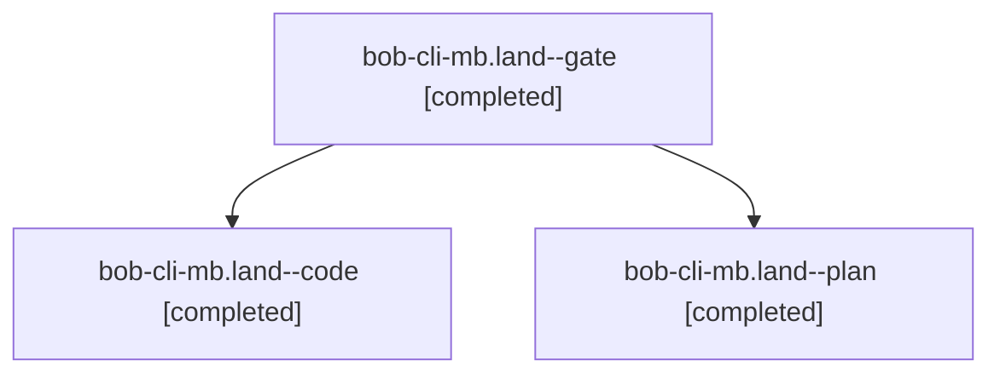

# Session: bob-cli-mb.land

[Agent Hoods](../README.md) / [bbugyi200](../users/bbugyi200/README.md) / [athena](../users/bbugyi200/machines/athena/README.md) / [bob-cli-mb](../users/bbugyi200/machines/athena/hoods/bob-cli-mb/README.md) / bob-cli-mb.land

Owner: `bbugyi200.athena` · Hood: `bob-cli-mb` · Members: 3 · Bead: [bob-cli-mb](https://github.com/bobs-org/bob-cli--beads/blob/main/pages/bob-cli-mb/README.md)

## Lineage

The diagram is an optional enhancement; the ordered table below contains the same lineage in accessible text.

| Role | Agent | State | Model / provider | Timing | Commits | Prompt | Chat |
|---|---|---|---|---|---:|---|---|
| gate | bob-cli-mb.land--gate | completed | opus / claude | 2026-11-16T18:03:03.756212+00:00 → 2026-11-16T18:03:12.895300+00:00 | 0 | — | [Chat](../agents/bbugyi200.athena.bob-cli-mb.land--gate/chat.md) |
| code | bob-cli-mb.land--code | completed | grok-4.6 / grok | 2026-11-16T18:04:04.576760+00:00 → 2026-11-16T18:27:27.867216+00:00 | [1](../agents/bbugyi200.athena.bob-cli-mb.land--code/README.md#commits) | — | [Chat](../agents/bbugyi200.athena.bob-cli-mb.land--code/chat.md) |
| plan | bob-cli-mb.land--plan | completed | opus / claude | 2026-11-16T17:53:41.649437+00:00 → 2026-11-16T18:27:27.867216+00:00 | 0 | [Prompt](../agents/bbugyi200.athena.bob-cli-mb.land--plan/prompt.md) | [Chat](../agents/bbugyi200.athena.bob-cli-mb.land--plan/chat.md) |

## Commits

| Role | Repo | Commit | Subject | Committed |
|---|---|---|---|---|
| code | bob-cli | [`0510aaf`](https://github.com/bobs-org/bob-cli/commit/0510aaf0e997ca97c10919ec21214b362a1b8c12) | docs(capture): document living-first \[\[ suggestions and cover the tier partition | 2026-11-16 13:26:16 EST |

## Neighbors

| Agent | Relation | State |
|---|---|---|
| [bob-cli-mb.1](../agents/bbugyi200.athena.bob-cli-mb.1/README.md) | bob-cli-mb hood | completed |
| [bob-cli-mb.2](bbugyi200.athena.bob-cli-mb.2.md) (session · 3) | bob-cli-mb hood | completed 3 |
| [bob-cli-mb.3](bbugyi200.athena.bob-cli-mb.3.md) (session · 5) | bob-cli-mb hood | completed 5 |
| [bob-cli-mb.4](bbugyi200.athena.bob-cli-mb.4.md) (session · 3) | bob-cli-mb hood | completed 3 |
| [bob-cli-mb.5](../agents/bbugyi200.athena.bob-cli-mb.5/README.md) | bob-cli-mb hood | completed |
