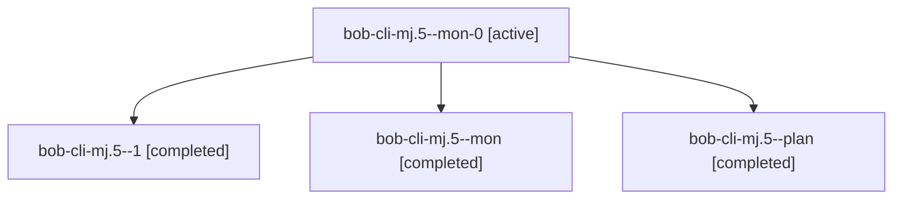

# Session: bob-cli-mj.5

[Agent Hoods](../README.md) / [bbugyi200](../users/bbugyi200/README.md) / [athena](../users/bbugyi200/machines/athena/README.md) / [bob-cli-mj](../users/bbugyi200/machines/athena/hoods/bob-cli-mj/README.md) / bob-cli-mj.5

Owner: `bbugyi200.athena` · Hood: `bob-cli-mj` · Members: 4 · Bead: [bob-cli-mj.5](https://github.com/bobs-org/bob-cli--beads/blob/main/pages/bob-cli-mj/bob-cli-mj.5.md)

## Lineage

The diagram is an optional enhancement; the ordered table below contains the same lineage in accessible text.

| Role | Agent | State | Model / provider | Timing | Commits | Prompt | Chat |
|---|---|---|---|---|---:|---|---|
| mon-0 | bob-cli-mj.5--mon-0 | active | grok-4.6 / grok | 2026-11-17T00:58:05.105707+00:00 | 0 | — | — |
| 1 | bob-cli-mj.5--1 | completed | grok-4.6 / grok | 2026-11-17T00:54:45.650215+00:00 → 2026-11-17T00:59:55.965774+00:00 | 0 | [Prompt](../agents/bbugyi200.athena.bob-cli-mj.5--1/prompt.md) | [Chat](../agents/bbugyi200.athena.bob-cli-mj.5--1/chat.md) |
| mon | bob-cli-mj.5--mon | completed | grok-4.6 / grok | 2026-11-17T00:28:11.362453+00:00 → 2026-11-17T00:54:02.525818+00:00 | 0 | — | [Chat](../agents/bbugyi200.athena.bob-cli-mj.5--mon/chat.md) |
| plan | bob-cli-mj.5--plan | completed | grok-4.6 / grok | 2026-11-16T23:34:55.452789+00:00 → 2026-11-17T00:29:19.516684+00:00 | 0 | [Prompt](../agents/bbugyi200.athena.bob-cli-mj.5--plan/prompt.md) | [Chat](../agents/bbugyi200.athena.bob-cli-mj.5--plan/chat.md) |

## Neighbors

| Agent | Relation | State |
|---|---|---|
| [bob-cli-mj.1](../agents/bbugyi200.athena.bob-cli-mj.1/README.md) | bob-cli-mj hood | completed |
| [bob-cli-mj.2](../agents/bbugyi200.athena.bob-cli-mj.2/README.md) | bob-cli-mj hood | completed |
| [bob-cli-mj.3](../agents/bbugyi200.athena.bob-cli-mj.3/README.md) | bob-cli-mj hood | completed |
| [bob-cli-mj.4](../agents/bbugyi200.athena.bob-cli-mj.4/README.md) | bob-cli-mj hood | waiting |
| [bob-cli-mj.6](../agents/bbugyi200.athena.bob-cli-mj.6/README.md) | bob-cli-mj hood | waiting |
| [bob-cli-mj.land](../agents/bbugyi200.athena.bob-cli-mj.land/README.md) | bob-cli-mj hood | waiting |
