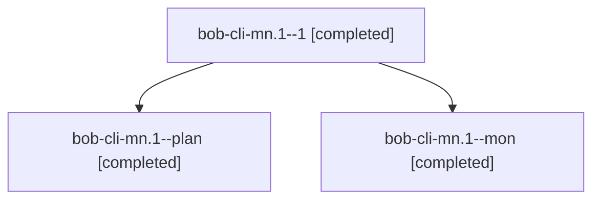

# Session: bob-cli-mn.1

[Agent Hoods](../README.md) / [bbugyi200](../users/bbugyi200/README.md) / [athena](../users/bbugyi200/machines/athena/README.md) / [bob-cli-mn](../users/bbugyi200/machines/athena/hoods/bob-cli-mn/README.md) / bob-cli-mn.1

Owner: `bbugyi200.athena` · Hood: `bob-cli-mn` · Members: 3 · Bead: [bob-cli-mn.1](https://github.com/bobs-org/bob-cli--beads/blob/main/pages/bob-cli-mn/bob-cli-mn.1.md)

## Lineage

The diagram is an optional enhancement; the ordered table below contains the same lineage in accessible text.

| Role | Agent | State | Model / provider | Timing | Commits | Prompt | Chat |
|---|---|---|---|---|---:|---|---|
| 1 | bob-cli-mn.1--1 | completed | grok-4.6 / grok | 2026-11-17T12:19:25.711703+00:00 → 2026-11-17T12:27:16.929169+00:00 | [1](../agents/bbugyi200.athena.bob-cli-mn.1--1/README.md#commits) | [Prompt](../agents/bbugyi200.athena.bob-cli-mn.1--1/prompt.md) | [Chat](../agents/bbugyi200.athena.bob-cli-mn.1--1/chat.md) |
| plan | bob-cli-mn.1--plan | completed | grok-4.6 / grok | 2026-11-17T11:46:26.272418+00:00 → 2026-11-17T12:12:47.589676+00:00 | 0 | [Prompt](../agents/bbugyi200.athena.bob-cli-mn.1--plan/prompt.md) | [Chat](../agents/bbugyi200.athena.bob-cli-mn.1--plan/chat.md) |
| mon | bob-cli-mn.1--mon | completed | grok-4.6 / grok | 2026-11-17T12:11:04.803786+00:00 → 2026-11-17T12:19:25.952165+00:00 | 0 | — | [Chat](../agents/bbugyi200.athena.bob-cli-mn.1--mon/chat.md) |

## Commits

| Role | Repo | Commit | Subject | Committed |
|---|---|---|---|---|
| 1 | bob-cli | [`f692478`](https://github.com/bobs-org/bob-cli/commit/f6924787fa43424d6fb217261adf264debbf2272) | feat(capture): keep / literal after album routes | 2026-11-17 07:26:42 EST |

## Neighbors

| Agent | Relation | State |
|---|---|---|
| [bob-cli-mn.2](bbugyi200.athena.bob-cli-mn.2.md) (session · 5) | bob-cli-mn hood | active 1, completed 2, failed 2 |
| [bob-cli-mn.land](../agents/bbugyi200.athena.bob-cli-mn.land/README.md) | bob-cli-mn hood | waiting |
