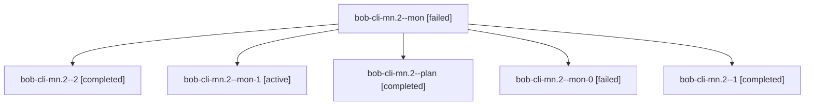

# Session: bob-cli-mn.2

[Agent Hoods](../README.md) / [bbugyi200](../users/bbugyi200/README.md) / [athena](../users/bbugyi200/machines/athena/README.md) / [bob-cli-mn](../users/bbugyi200/machines/athena/hoods/bob-cli-mn/README.md) / bob-cli-mn.2

Owner: `bbugyi200.athena` · Hood: `bob-cli-mn` · Members: 6 · Bead: [bob-cli-mn.2](https://github.com/bobs-org/bob-cli--beads/blob/main/pages/bob-cli-mn/bob-cli-mn.2.md)

## Lineage

The diagram is an optional enhancement; the ordered table below contains the same lineage in accessible text.

| Role | Agent | State | Model / provider | Timing | Commits | Prompt | Chat |
|---|---|---|---|---|---:|---|---|
| mon | bob-cli-mn.2--mon | failed | grok-4.6 / grok | 2026-11-17T13:12:30.598318+00:00 → 2026-11-17T13:39:01.939356+00:00 | 0 | — | [Chat](../agents/bbugyi200.athena.bob-cli-mn.2--mon/chat.md) |
| 2 | bob-cli-mn.2--2 | completed | grok-4.6 / grok | 2026-11-17T14:23:28.164485+00:00 → 2026-11-17T14:32:45.864921+00:00 | 0 | [Prompt](../agents/bbugyi200.athena.bob-cli-mn.2--2/prompt.md) | [Chat](../agents/bbugyi200.athena.bob-cli-mn.2--2/chat.md) |
| mon-1 | bob-cli-mn.2--mon-1 | active | grok-4.6 / grok | 2026-11-17T14:31:33.303285+00:00 | 0 | — | — |
| plan | bob-cli-mn.2--plan | completed | grok-4.6 / grok | 2026-11-17T12:27:46.145054+00:00 → 2026-11-17T13:13:57.853764+00:00 | 0 | [Prompt](../agents/bbugyi200.athena.bob-cli-mn.2--plan/prompt.md) | [Chat](../agents/bbugyi200.athena.bob-cli-mn.2--plan/chat.md) |
| mon-0 | bob-cli-mn.2--mon-0 | failed | grok-4.6 / grok | 2026-11-17T14:20:22.573925+00:00 → 2026-11-17T14:23:28.517889+00:00 | 0 | — | [Chat](../agents/bbugyi200.athena.bob-cli-mn.2--mon-0/chat.md) |
| 1 | bob-cli-mn.2--1 | completed | grok-4.6 / grok | 2026-11-17T13:39:01.571027+00:00 → 2026-11-17T14:21:33.660539+00:00 | 0 | [Prompt](../agents/bbugyi200.athena.bob-cli-mn.2--1/prompt.md) | [Chat](../agents/bbugyi200.athena.bob-cli-mn.2--1/chat.md) |

## Neighbors

| Agent | Relation | State |
|---|---|---|
| [bob-cli-mn.1](bbugyi200.athena.bob-cli-mn.1.md) (session · 3) | bob-cli-mn hood | completed 3 |
| [bob-cli-mn.land](../agents/bbugyi200.athena.bob-cli-mn.land/README.md) | bob-cli-mn hood | waiting |
