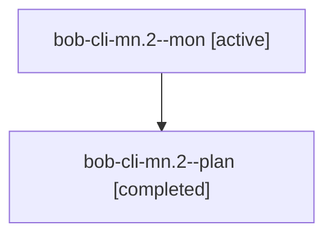

# Session: bob-cli-mn.2

[Agent Hoods](../README.md) / [bbugyi200](../users/bbugyi200/README.md) / [athena](../users/bbugyi200/machines/athena/README.md) / [bob-cli-mn](../users/bbugyi200/machines/athena/hoods/bob-cli-mn/README.md) / bob-cli-mn.2

Owner: `bbugyi200.athena` · Hood: `bob-cli-mn` · Members: 2 · Bead: [bob-cli-mn.2](https://github.com/bobs-org/bob-cli--beads/blob/main/pages/bob-cli-mn/bob-cli-mn.2.md)

## Lineage

The diagram is an optional enhancement; the ordered table below contains the same lineage in accessible text.

| Role | Agent | State | Model / provider | Timing | Commits | Prompt | Chat |
|---|---|---|---|---|---:|---|---|
| mon | bob-cli-mn.2--mon | active | grok-4.6 / grok | 2026-11-17T13:12:30.598318+00:00 | 0 | — | — |
| plan | bob-cli-mn.2--plan | completed | grok-4.6 / grok | 2026-11-17T12:27:46.145054+00:00 → 2026-11-17T13:13:57.853764+00:00 | 0 | [Prompt](../agents/bbugyi200.athena.bob-cli-mn.2--plan/prompt.md) | [Chat](../agents/bbugyi200.athena.bob-cli-mn.2--plan/chat.md) |

## Neighbors

| Agent | Relation | State |
|---|---|---|
| [bob-cli-mn.1](bbugyi200.athena.bob-cli-mn.1.md) (session · 3) | bob-cli-mn hood | completed 3 |
| [bob-cli-mn.land](../agents/bbugyi200.athena.bob-cli-mn.land/README.md) | bob-cli-mn hood | waiting |
