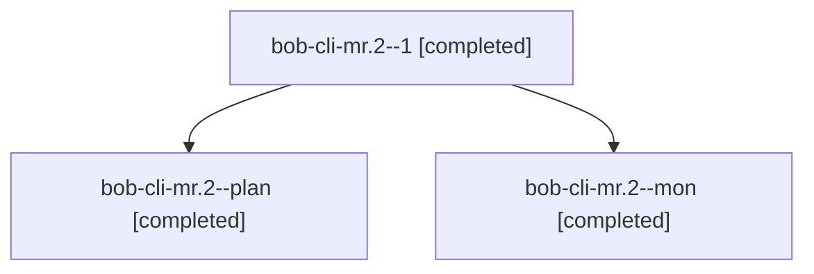

# Session: bob-cli-mr.2

[Agent Hoods](../README.md) / [bbugyi200](../users/bbugyi200/README.md) / [athena](../users/bbugyi200/machines/athena/README.md) / [bob-cli-mr](../users/bbugyi200/machines/athena/hoods/bob-cli-mr/README.md) / bob-cli-mr.2

Owner: `bbugyi200.athena` · Hood: `bob-cli-mr` · Members: 3 · Bead: [bob-cli-mr.2](https://github.com/bobs-org/bob-cli--beads/blob/main/pages/bob-cli-mr/bob-cli-mr.2.md)

## Lineage

The diagram is an optional enhancement; the ordered table below contains the same lineage in accessible text.

| Role | Agent | State | Model / provider | Timing | Commits | Prompt | Chat |
|---|---|---|---|---|---:|---|---|
| 1 | bob-cli-mr.2--1 | completed | grok-4.6 / grok | 2026-11-17T16:55:45.689245+00:00 → 2026-11-17T17:05:00.909563+00:00 | [1](../agents/bbugyi200.athena.bob-cli-mr.2--1/README.md#commits) | [Prompt](../agents/bbugyi200.athena.bob-cli-mr.2--1/prompt.md) | [Chat](../agents/bbugyi200.athena.bob-cli-mr.2--1/chat.md) |
| plan | bob-cli-mr.2--plan | completed | grok-4.6 / grok | 2026-11-17T16:32:19.800986+00:00 → 2026-11-17T16:46:19.689047+00:00 | 0 | [Prompt](../agents/bbugyi200.athena.bob-cli-mr.2--plan/prompt.md) | [Chat](../agents/bbugyi200.athena.bob-cli-mr.2--plan/chat.md) |
| mon | bob-cli-mr.2--mon | completed | grok-4.6 / grok | 2026-11-17T16:45:19.915819+00:00 → 2026-11-17T16:55:46.066964+00:00 | 0 | — | [Chat](../agents/bbugyi200.athena.bob-cli-mr.2--mon/chat.md) |

## Commits

| Role | Repo | Commit | Subject | Committed |
|---|---|---|---|---|
| 1 | bob-cli | [`b0bddbb`](https://github.com/bobs-org/bob-cli/commit/b0bddbb98247331181bd0c9f6aa3ed07e6f6541e) | fix(capture): never promote closed or archived prerequisites | 2026-11-17 12:04:33 EST |

## Neighbors

| Agent | Relation | State |
|---|---|---|
| [bob-cli-mr.1](../agents/bbugyi200.athena.bob-cli-mr.1/README.md) | bob-cli-mr hood | completed |
| [bob-cli-mr.3](bbugyi200.athena.bob-cli-mr.3.md) (session · 3) | bob-cli-mr hood | active 1, completed 2 |
| [bob-cli-mr.3.1.1](../agents/bbugyi200.athena.bob-cli-mr.3.1.1/README.md) | bob-cli-mr hood | completed |
| [bob-cli-mr.3.1.2](bbugyi200.athena.bob-cli-mr.3.1.2.md) (session · 5) | bob-cli-mr hood | completed 4, failed 1 |
| [bob-cli-mr.3.1.3](bbugyi200.athena.bob-cli-mr.3.1.3.md) (session · 3) | bob-cli-mr hood | completed 3 |
| [bob-cli-mr.3.1.land](bbugyi200.athena.bob-cli-mr.3.1.land.md) (session · 3) | bob-cli-mr hood | completed 3 |
| [bob-cli-mr.land](bbugyi200.athena.bob-cli-mr.land.md) (session · 3) | bob-cli-mr hood | active 2, completed 1 |
