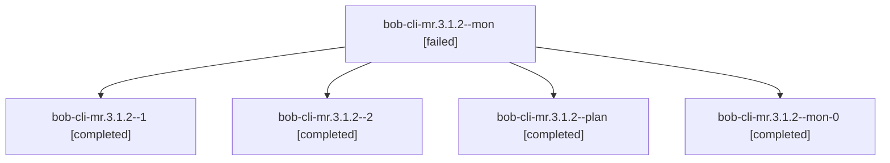

# Session: bob-cli-mr.3.1.2

[Agent Hoods](../README.md) / [bbugyi200](../users/bbugyi200/README.md) / [athena](../users/bbugyi200/machines/athena/README.md) / [bob-cli-mr](../users/bbugyi200/machines/athena/hoods/bob-cli-mr/README.md) / bob-cli-mr.3.1.2

Owner: `bbugyi200.athena` · Hood: `bob-cli-mr` · Members: 5 · Bead: [bob-cli-mr.3.1.2](https://github.com/bobs-org/bob-cli--beads/blob/main/pages/bob-cli-mr/bob-cli-mr.3.1.2.md)

## Lineage

The diagram is an optional enhancement; the ordered table below contains the same lineage in accessible text.

| Role | Agent | State | Model / provider | Timing | Commits | Prompt | Chat |
|---|---|---|---|---|---:|---|---|
| mon | bob-cli-mr.3.1.2--mon | failed | grok-4.6 / grok | 2026-11-17T18:59:06.455782+00:00 → 2026-11-17T19:09:51.991821+00:00 | 0 | — | [Chat](../agents/bbugyi200.athena.bob-cli-mr.3.1.2--mon/chat.md) |
| 1 | bob-cli-mr.3.1.2--1 | completed | grok-4.6 / grok | 2026-11-17T19:09:51.593050+00:00 → 2026-11-17T19:26:32.644617+00:00 | 0 | [Prompt](../agents/bbugyi200.athena.bob-cli-mr.3.1.2--1/prompt.md) | [Chat](../agents/bbugyi200.athena.bob-cli-mr.3.1.2--1/chat.md) |
| 2 | bob-cli-mr.3.1.2--2 | completed | grok-4.6 / grok | 2026-11-17T19:38:23.853991+00:00 → 2026-11-17T19:54:28.710480+00:00 | [1](../agents/bbugyi200.athena.bob-cli-mr.3.1.2--2/README.md#commits) | [Prompt](../agents/bbugyi200.athena.bob-cli-mr.3.1.2--2/prompt.md) | [Chat](../agents/bbugyi200.athena.bob-cli-mr.3.1.2--2/chat.md) |
| plan | bob-cli-mr.3.1.2--plan | completed | grok-4.6 / grok | 2026-11-17T18:00:50.220939+00:00 → 2026-11-17T19:00:07.605982+00:00 | 0 | [Prompt](../agents/bbugyi200.athena.bob-cli-mr.3.1.2--plan/prompt.md) | [Chat](../agents/bbugyi200.athena.bob-cli-mr.3.1.2--plan/chat.md) |
| mon-0 | bob-cli-mr.3.1.2--mon-0 | completed | grok-4.6 / grok | 2026-11-17T19:24:56.088913+00:00 → 2026-11-17T19:37:06.310249+00:00 | 0 | — | [Chat](../agents/bbugyi200.athena.bob-cli-mr.3.1.2--mon-0/chat.md) |

## Commits

| Role | Repo | Commit | Subject | Committed |
|---|---|---|---|---|
| 2 | bob-cli | [`3236cee`](https://github.com/bobs-org/bob-cli/commit/3236ceefaa690c2c9aa8d935db0de7b1a2c11ce1) | feat(scan): apply prepared full scans inside a bounded lock window | 2026-11-17 14:53:36 EST |

## Neighbors

| Agent | Relation | State |
|---|---|---|
| [bob-cli-mr.3](bbugyi200.athena.bob-cli-mr.3.md) (session · 3) | ancestor | active 1, completed 2 |
| [bob-cli-mr.3.1.1](../agents/bbugyi200.athena.bob-cli-mr.3.1.1/README.md) | bob-cli-mr.3.1 hood | completed |
| [bob-cli-mr.3.1.3](../agents/bbugyi200.athena.bob-cli-mr.3.1.3/README.md) | bob-cli-mr.3.1 hood | waiting |
| [bob-cli-mr.3.1.land](../agents/bbugyi200.athena.bob-cli-mr.3.1.land/README.md) | bob-cli-mr.3.1 hood | waiting |
| [bob-cli-mr.1](../agents/bbugyi200.athena.bob-cli-mr.1/README.md) | bob-cli-mr hood | completed |
| [bob-cli-mr.2](bbugyi200.athena.bob-cli-mr.2.md) (session · 3) | bob-cli-mr hood | completed 3 |
| [bob-cli-mr.land](../agents/bbugyi200.athena.bob-cli-mr.land/README.md) | bob-cli-mr hood | waiting |
