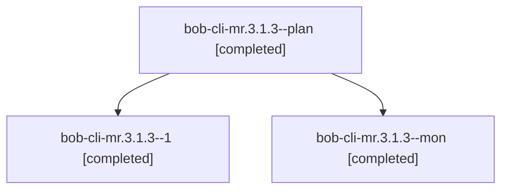

# Session: bob-cli-mr.3.1.3

[Agent Hoods](../README.md) / [bbugyi200](../users/bbugyi200/README.md) / [athena](../users/bbugyi200/machines/athena/README.md) / [bob-cli-mr](../users/bbugyi200/machines/athena/hoods/bob-cli-mr/README.md) / bob-cli-mr.3.1.3

Owner: `bbugyi200.athena` · Hood: `bob-cli-mr` · Members: 3 · Bead: [bob-cli-mr.3.1.3](https://github.com/bobs-org/bob-cli--beads/blob/main/pages/bob-cli-mr/bob-cli-mr.3.1.3.md)

## Lineage

The diagram is an optional enhancement; the ordered table below contains the same lineage in accessible text.

| Role | Agent | State | Model / provider | Timing | Commits | Prompt | Chat |
|---|---|---|---|---|---:|---|---|
| plan | bob-cli-mr.3.1.3--plan | completed | grok-4.6 / grok | 2026-11-17T19:54:59.104759+00:00 → 2026-11-17T20:33:12.240191+00:00 | 0 | [Prompt](../agents/bbugyi200.athena.bob-cli-mr.3.1.3--plan/prompt.md) | [Chat](../agents/bbugyi200.athena.bob-cli-mr.3.1.3--plan/chat.md) |
| 1 | bob-cli-mr.3.1.3--1 | completed | grok-4.6 / grok | 2026-11-17T20:40:10.316804+00:00 → 2026-11-17T20:56:54.478028+00:00 | [1](../agents/bbugyi200.athena.bob-cli-mr.3.1.3--1/README.md#commits) | [Prompt](../agents/bbugyi200.athena.bob-cli-mr.3.1.3--1/prompt.md) | [Chat](../agents/bbugyi200.athena.bob-cli-mr.3.1.3--1/chat.md) |
| mon | bob-cli-mr.3.1.3--mon | completed | grok-4.6 / grok | 2026-11-17T20:32:07.705358+00:00 → 2026-11-17T20:40:10.734686+00:00 | 0 | — | [Chat](../agents/bbugyi200.athena.bob-cli-mr.3.1.3--mon/chat.md) |

## Commits

| Role | Repo | Commit | Subject | Committed |
|---|---|---|---|---|
| 1 | bob-cli | [`6c409ab`](https://github.com/bobs-org/bob-cli/commit/6c409ab287f79994ac5fc257c0d47f9fc4ed273c) | test(ref): prove narrow scan lock-window interleavings | 2026-11-17 15:56:23 EST |

## Neighbors

| Agent | Relation | State |
|---|---|---|
| [bob-cli-mr.3](bbugyi200.athena.bob-cli-mr.3.md) (session · 3) | ancestor | active 1, completed 2 |
| [bob-cli-mr.3.1.1](../agents/bbugyi200.athena.bob-cli-mr.3.1.1/README.md) | bob-cli-mr.3.1 hood | completed |
| [bob-cli-mr.3.1.2](bbugyi200.athena.bob-cli-mr.3.1.2.md) (session · 5) | bob-cli-mr.3.1 hood | completed 4, failed 1 |
| [bob-cli-mr.3.1.land](bbugyi200.athena.bob-cli-mr.3.1.land.md) (session · 3) | bob-cli-mr.3.1 hood | completed 3 |
| [bob-cli-mr.1](../agents/bbugyi200.athena.bob-cli-mr.1/README.md) | bob-cli-mr hood | completed |
| [bob-cli-mr.2](bbugyi200.athena.bob-cli-mr.2.md) (session · 3) | bob-cli-mr hood | completed 3 |
| [bob-cli-mr.land](bbugyi200.athena.bob-cli-mr.land.md) (session · 9) | bob-cli-mr hood | active 1, completed 7, failed 1 |
