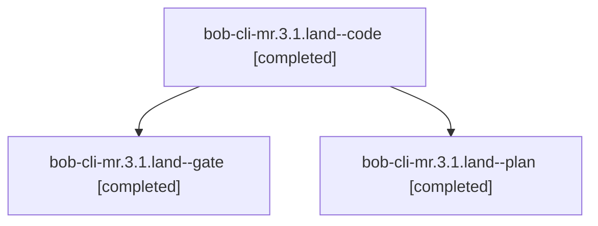

# Session: bob-cli-mr.3.1.land

[Agent Hoods](../README.md) / [bbugyi200](../users/bbugyi200/README.md) / [athena](../users/bbugyi200/machines/athena/README.md) / [bob-cli-mr](../users/bbugyi200/machines/athena/hoods/bob-cli-mr/README.md) / bob-cli-mr.3.1.land

Owner: `bbugyi200.athena` · Hood: `bob-cli-mr` · Members: 3 · Bead: [bob-cli-mr.3.1](https://github.com/bobs-org/bob-cli--beads/blob/main/pages/bob-cli-mr/bob-cli-mr.3.1.md)

## Lineage



The diagram is an optional enhancement; the ordered table below contains the same lineage in accessible text.

| Role | Agent | State | Model / provider | Timing | Commits | Prompt | Chat |
|---|---|---|---|---|---:|---|---|
| <a id="member-code"></a>code | bob-cli-mr.3.1.land--code | completed | muse-spark-1.3-contributor / muse | 2026-11-17T21:10:13.945366+00:00 → 2026-11-17T22:25:10.360651+00:00 | [1](../agents/bbugyi200.athena.bob-cli-mr.3.1.land--code/README.md#commits) | — | [Chat](../agents/bbugyi200.athena.bob-cli-mr.3.1.land--code/chat.md) |
| <a id="member-gate"></a>gate | bob-cli-mr.3.1.land--gate | completed | gpt-6-astra / codex | 2026-11-17T21:09:23.825293+00:00 → 2026-11-17T21:09:33.118152+00:00 | 0 | — | [Chat](../agents/bbugyi200.athena.bob-cli-mr.3.1.land--gate/chat.md) |
| <a id="member-plan"></a>plan | bob-cli-mr.3.1.land--plan | completed | gpt-6-astra / codex | 2026-11-17T20:57:15.701653+00:00 → 2026-11-17T22:25:10.360651+00:00 | 0 | [Prompt](../agents/bbugyi200.athena.bob-cli-mr.3.1.land--plan/prompt.md) | [Chat](../agents/bbugyi200.athena.bob-cli-mr.3.1.land--plan/chat.md) |

## Commits

| Role | Repo | Commit | Subject | Committed |
|---|---|---|---|---|
| code | — | `0e83df4` | feat(scan): finish highlights scan lock-window landing repairs | 2026-11-17 17:23:08 EST |

## Variables

| Role | Variable | Value |
|---|---|---|
| plan | `artifacts` | \[{bead: bob-cli-mr.3.1, kind: file, label: Deterministic scan landing reproducer, path: /home/bryan/.sase/artifacts/agents/gh\_bobs-org\_\_bob-cli/20261117121551/mr31\_scan\_repro-547397a411a9.py, ref: fi… |

#### artifacts

**Role:** `plan`

```yaml
- bead: bob-cli-mr.3.1
  kind: file
  label: Deterministic scan landing reproducer
  path: /home/bryan/.sase/artifacts/agents/gh_bobs-org__bob-cli/20261117121551/mr31_scan_repro-547397a411a9.py
  ref: file:explicit:c5c3f5771f7e66352b19542a
  source_path: /tmp/mr31_scan_repro.py
- bead: bob-cli-mr.3.1
  kind: file
  label: Scan landing reproduction results at 6c409ab2
  path: /home/bryan/.sase/artifacts/agents/gh_bobs-org__bob-cli/20261117121551/mr31_scan_repro_result-d19641945e8e.txt
  ref: file:explicit:7aa8ba853d55aee2765444f5
  source_path: /tmp/mr31_scan_repro_result.txt
```

Values are truncated for display; see each member's agent meta.json for the full values.

## Neighbors

| Agent | Relation | State |
|---|---|---|
| [bob-cli-mr.3](bbugyi200.athena.bob-cli-mr.3.md) (session · 3) | ancestor | completed 2, dismissed 1 |
| [bob-cli-mr.3.1.1](../agents/bbugyi200.athena.bob-cli-mr.3.1.1/README.md) | bob-cli-mr.3.1 hood | completed |
| [bob-cli-mr.3.1.2](bbugyi200.athena.bob-cli-mr.3.1.2.md) (session · 5) | bob-cli-mr.3.1 hood | completed 4, failed 1 |
| [bob-cli-mr.3.1.3](bbugyi200.athena.bob-cli-mr.3.1.3.md) (session · 3) | bob-cli-mr.3.1 hood | completed 3 |
| [bob-cli-mr.1](../agents/bbugyi200.athena.bob-cli-mr.1/README.md) | bob-cli-mr hood | completed |
| [bob-cli-mr.2](bbugyi200.athena.bob-cli-mr.2.md) (session · 3) | bob-cli-mr hood | completed 3 |
| [bob-cli-mr.land](bbugyi200.athena.bob-cli-mr.land.md) (session · 9) | bob-cli-mr hood | completed 8, failed 1 |
