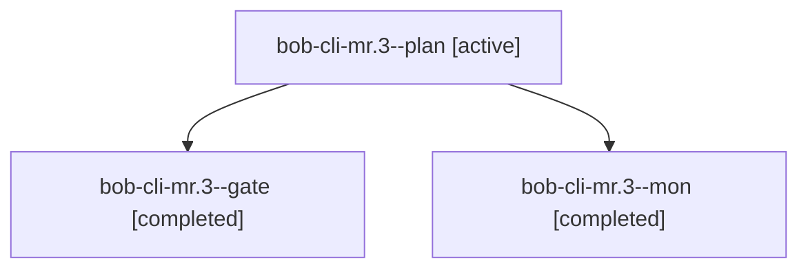

# Session: bob-cli-mr.3

[Agent Hoods](../README.md) / [bbugyi200](../users/bbugyi200/README.md) / [athena](../users/bbugyi200/machines/athena/README.md) / [bob-cli-mr](../users/bbugyi200/machines/athena/hoods/bob-cli-mr/README.md) / bob-cli-mr.3

Owner: `bbugyi200.athena` · Hood: `bob-cli-mr` · Members: 3 · Bead: [bob-cli-mr.3](https://github.com/bobs-org/bob-cli--beads/blob/main/pages/bob-cli-mr/bob-cli-mr.3.md)

## Lineage

The diagram is an optional enhancement; the ordered table below contains the same lineage in accessible text.

| Role | Agent | State | Model / provider | Timing | Commits | Prompt | Chat |
|---|---|---|---|---|---:|---|---|
| plan | bob-cli-mr.3--plan | active | gpt-6-astra / codex | 2026-11-17T17:05:07.110871+00:00 → 2026-11-17T17:14:08.100170+00:00 | 0 | [Prompt](../agents/bbugyi200.athena.bob-cli-mr.3--plan/prompt.md) | [Chat](../agents/bbugyi200.athena.bob-cli-mr.3--plan/chat.md) |
| gate | bob-cli-mr.3--gate | completed | gpt-6-astra / codex | 2026-11-17T17:13:51.008841+00:00 → 2026-11-17T17:14:02.553378+00:00 | 0 | — | [Chat](../agents/bbugyi200.athena.bob-cli-mr.3--gate/chat.md) |
| mon | bob-cli-mr.3--mon | completed | gpt-6-astra / codex | 2026-11-17T17:14:01.415244+00:00 → 2026-11-17T17:17:05.801304+00:00 | 0 | — | [Chat](../agents/bbugyi200.athena.bob-cli-mr.3--mon/chat.md) |

## Neighbors

| Agent | Relation | State |
|---|---|---|
| [bob-cli-mr.3.1.1](../agents/bbugyi200.athena.bob-cli-mr.3.1.1/README.md) | descendant | completed |
| [bob-cli-mr.3.1.2](bbugyi200.athena.bob-cli-mr.3.1.2.md) (session · 5) | descendant | completed 4, failed 1 |
| [bob-cli-mr.3.1.3](bbugyi200.athena.bob-cli-mr.3.1.3.md) (session · 3) | descendant | completed 3 |
| [bob-cli-mr.3.1.land](bbugyi200.athena.bob-cli-mr.3.1.land.md) (session · 3) | descendant | completed 3 |
| [bob-cli-mr.1](../agents/bbugyi200.athena.bob-cli-mr.1/README.md) | bob-cli-mr hood | completed |
| [bob-cli-mr.2](bbugyi200.athena.bob-cli-mr.2.md) (session · 3) | bob-cli-mr hood | completed 3 |
| [bob-cli-mr.land](bbugyi200.athena.bob-cli-mr.land.md) (session · 9) | bob-cli-mr hood | completed 8, failed 1 |
