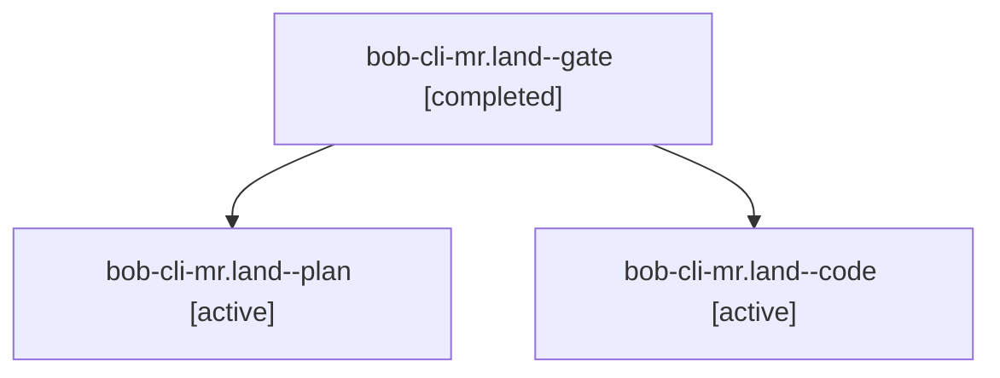

# Session: bob-cli-mr.land

[Agent Hoods](../README.md) / [bbugyi200](../users/bbugyi200/README.md) / [athena](../users/bbugyi200/machines/athena/README.md) / [bob-cli-mr](../users/bbugyi200/machines/athena/hoods/bob-cli-mr/README.md) / bob-cli-mr.land

Owner: `bbugyi200.athena` · Hood: `bob-cli-mr` · Members: 3 · Bead: [bob-cli-mr](https://github.com/bobs-org/bob-cli--beads/blob/main/pages/bob-cli-mr/README.md)

## Lineage



The diagram is an optional enhancement; the ordered table below contains the same lineage in accessible text.

| Role | Agent | State | Model / provider | Timing | Commits | Prompt | Chat |
|---|---|---|---|---|---:|---|---|
| <a id="member-gate"></a>gate | bob-cli-mr.land--gate | completed | gpt-6-astra / codex | 2026-11-17T22:36:01.652233+00:00 → 2026-11-17T22:36:09.392368+00:00 | 0 | — | [Chat](../agents/bbugyi200.athena.bob-cli-mr.land--gate/chat.md) |
| <a id="member-plan"></a>plan | bob-cli-mr.land--plan | active | gpt-6-astra / codex | 2026-11-17T22:22:08.015953+00:00 | 0 | [Prompt](../agents/bbugyi200.athena.bob-cli-mr.land--plan/prompt.md) | [Chat](../agents/bbugyi200.athena.bob-cli-mr.land--plan/chat.md) |
| <a id="member-code"></a>code | bob-cli-mr.land--code | active | grok-4.6 / grok | 2026-11-17T22:36:46.273692+00:00 | 0 | — | — |

## Variables

| Role | Variable | Value |
|---|---|---|
| plan | `artifacts` | \[{bead: bob-cli-mr, kind: file, label: T1 landing isolated TextBundle read-set race probe, path: /home/bryan/.sase/artifacts/agents/gh\_bobs-org\_\_bob-cli/20261117111759/bob-cli-mr-readset-probe-f913de… |

#### artifacts

**Role:** `plan`

```yaml
- bead: bob-cli-mr
  kind: file
  label: T1 landing isolated TextBundle read-set race probe
  path: /home/bryan/.sase/artifacts/agents/gh_bobs-org__bob-cli/20261117111759/bob-cli-mr-readset-probe-f913de4b6c4f.py
  ref: file:explicit:bd831c44f897f151df7fe929
  source_path: /tmp/bob-cli-mr-readset-probe.py
- bead: bob-cli-mr
  kind: file
  label: T1 landing current-commit TextBundle race results
  path: /home/bryan/.sase/artifacts/agents/gh_bobs-org__bob-cli/20261117111759/bob-cli-mr-readset-probe-9804cd631a19.log
  ref: file:explicit:1b54ca1c1f7d772c943b7307
  source_path: /tmp/bob-cli-mr-readset-probe.log
- bead: bob-cli-mr
  kind: markdown
  label: Validated T2 draft for the T1 repair coder to propose after closeout
  path: /home/bryan/.sase/artifacts/agents/gh_bobs-org__bob-cli/20261117111759/sase_plan_backlog_triage_t2-59d988c38942.md
  ref: file:explicit:e68e1976353c86235b1d0e23
  source_path: /tmp/sase_plan_backlog_triage_t2.md
```

Values are truncated for display; see each member's agent meta.json for the full values.

## Neighbors

| Agent | Relation | State |
|---|---|---|
| [bob-cli-mr.1](../agents/bbugyi200.athena.bob-cli-mr.1/README.md) | bob-cli-mr hood | completed |
| [bob-cli-mr.2](bbugyi200.athena.bob-cli-mr.2.md) (session · 3) | bob-cli-mr hood | completed 3 |
| [bob-cli-mr.3](bbugyi200.athena.bob-cli-mr.3.md) (session · 3) | bob-cli-mr hood | active 1, completed 2 |
| [bob-cli-mr.3.1.1](../agents/bbugyi200.athena.bob-cli-mr.3.1.1/README.md) | bob-cli-mr hood | completed |
| [bob-cli-mr.3.1.2](bbugyi200.athena.bob-cli-mr.3.1.2.md) (session · 5) | bob-cli-mr hood | completed 4, failed 1 |
| [bob-cli-mr.3.1.3](bbugyi200.athena.bob-cli-mr.3.1.3.md) (session · 3) | bob-cli-mr hood | completed 3 |
| [bob-cli-mr.3.1.land](bbugyi200.athena.bob-cli-mr.3.1.land.md) (session · 3) | bob-cli-mr hood | completed 3 |
