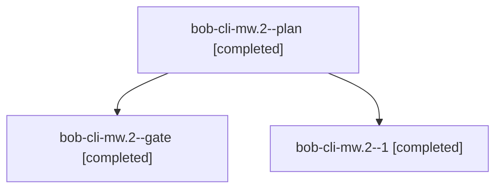

# Session: bob-cli-mw.2

[Agent Hoods](../README.md) / [bbugyi200](../users/bbugyi200/README.md) / [athena](../users/bbugyi200/machines/athena/README.md) / [bob-cli-mw](../users/bbugyi200/machines/athena/hoods/bob-cli-mw/README.md) / bob-cli-mw.2

Owner: `bbugyi200.athena` · Hood: `bob-cli-mw` · Members: 3 · Bead: [bob-cli-mw.2](https://github.com/bobs-org/bob-cli--beads/blob/main/pages/bob-cli-mw/bob-cli-mw.2.md)

## Lineage

The diagram is an optional enhancement; the ordered table below contains the same lineage in accessible text.

| Role | Agent | State | Model / provider | Timing | Commits | Prompt | Chat |
|---|---|---|---|---|---:|---|---|
| plan | bob-cli-mw.2--plan | completed | gpt-6-luna / codex | 2026-11-17T23:16:06.411376+00:00 → 2026-11-17T23:24:16.432146+00:00 | 0 | [Prompt](../agents/bbugyi200.athena.bob-cli-mw.2--plan/prompt.md) | [Chat](../agents/bbugyi200.athena.bob-cli-mw.2--plan/chat.md) |
| gate | bob-cli-mw.2--gate | completed | gpt-6-luna / codex | 2026-11-17T23:41:06.403368+00:00 → 2026-11-17T23:42:04.424543+00:00 | 0 | — | [Chat](../agents/bbugyi200.athena.bob-cli-mw.2--gate/chat.md) |
| 1 | bob-cli-mw.2--1 | completed | gpt-6-luna / codex | 2026-11-17T23:43:07.394316+00:00 → 2026-11-17T23:46:39.079887+00:00 | 0 | [Prompt](../agents/bbugyi200.athena.bob-cli-mw.2--1/prompt.md) | [Chat](../agents/bbugyi200.athena.bob-cli-mw.2--1/chat.md) |

## Neighbors

| Agent | Relation | State |
|---|---|---|
| [bob-cli-mw.1](../agents/bbugyi200.athena.bob-cli-mw.1/README.md) | bob-cli-mw hood | completed |
| [bob-cli-mw.3](../agents/bbugyi200.athena.bob-cli-mw.3/README.md) | bob-cli-mw hood | completed |
| [bob-cli-mw.4](../agents/bbugyi200.athena.bob-cli-mw.4/README.md) | bob-cli-mw hood | completed |
| [bob-cli-mw.land](bbugyi200.athena.bob-cli-mw.land.md) (session · 42) | bob-cli-mw hood | active 1, completed 22, failed 19 |
