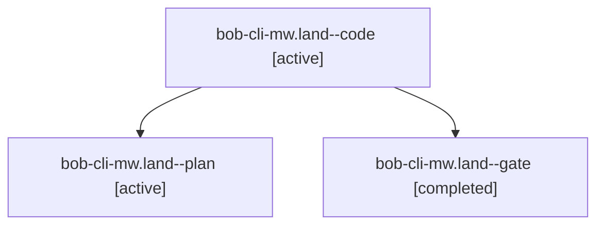

# Session: bob-cli-mw.land

[Agent Hoods](../README.md) / [bbugyi200](../users/bbugyi200/README.md) / [athena](../users/bbugyi200/machines/athena/README.md) / [bob-cli-mw](../users/bbugyi200/machines/athena/hoods/bob-cli-mw/README.md) / bob-cli-mw.land

Owner: `bbugyi200.athena` · Hood: `bob-cli-mw` · Members: 3 · Bead: [bob-cli-mw](https://github.com/bobs-org/bob-cli--beads/blob/main/pages/bob-cli-mw/README.md)

## Lineage

The diagram is an optional enhancement; the ordered table below contains the same lineage in accessible text.

| Role | Agent | State | Model / provider | Timing | Commits | Prompt | Chat |
|---|---|---|---|---|---:|---|---|
| code | bob-cli-mw.land--code | active | gpt-6-luna / codex | 2026-11-17T23:58:44.383749+00:00 | 0 | — | — |
| plan | bob-cli-mw.land--plan | active | gpt-6-astra / codex | 2026-11-17T23:47:16.390859+00:00 | 0 | [Prompt](../agents/bbugyi200.athena.bob-cli-mw.land--plan/prompt.md) | [Chat](../agents/bbugyi200.athena.bob-cli-mw.land--plan/chat.md) |
| gate | bob-cli-mw.land--gate | completed | gpt-6-astra / codex | 2026-11-17T23:58:03.744672+00:00 → 2026-11-17T23:58:11.728512+00:00 | 0 | — | [Chat](../agents/bbugyi200.athena.bob-cli-mw.land--gate/chat.md) |

## Neighbors

| Agent | Relation | State |
|---|---|---|
| [bob-cli-mw.1](../agents/bbugyi200.athena.bob-cli-mw.1/README.md) | bob-cli-mw hood | completed |
| [bob-cli-mw.2](bbugyi200.athena.bob-cli-mw.2.md) (session · 3) | bob-cli-mw hood | completed 3 |
| [bob-cli-mw.3](../agents/bbugyi200.athena.bob-cli-mw.3/README.md) | bob-cli-mw hood | completed |
| [bob-cli-mw.4](../agents/bbugyi200.athena.bob-cli-mw.4/README.md) | bob-cli-mw hood | completed |
