# Session: bob-cli-mw.land

[Agent Hoods](../README.md) / [bbugyi200](../users/bbugyi200/README.md) / [athena](../users/bbugyi200/machines/athena/README.md) / [bob-cli-mw](../users/bbugyi200/machines/athena/hoods/bob-cli-mw/README.md) / bob-cli-mw.land

Owner: `bbugyi200.athena` · Hood: `bob-cli-mw` · Members: 42 · Bead: [bob-cli-mw](https://github.com/bobs-org/bob-cli--beads/blob/main/pages/bob-cli-mw/README.md)

## Lineage

```mermaid
flowchart TD
  n0["bob-cli-mw.land--d [completed]"]
  n1["bob-cli-mw.land--1 [completed]"]
  n0 --> n1
  n2["bob-cli-mw.land--5 [completed]"]
  n0 --> n2
  n3["bob-cli-mw.land--code [completed]"]
  n0 --> n3
  n4["bob-cli-mw.land--i [completed]"]
  n0 --> n4
  n5["bob-cli-mw.land--b [completed]"]
  n0 --> n5
  n6["bob-cli-mw.land--mon-2 [failed]"]
  n0 --> n6
  n7["bob-cli-mw.land--8 [completed]"]
  n0 --> n7
  n8["bob-cli-mw.land--9 [completed]"]
  n0 --> n8
  n9["bob-cli-mw.land--mon-b [failed]"]
  n0 --> n9
  n10["bob-cli-mw.land--3 [completed]"]
  n0 --> n10
  n11["bob-cli-mw.land--e [completed]"]
  n0 --> n11
  n12["bob-cli-mw.land--plan [completed]"]
  n0 --> n12
  n13["bob-cli-mw.land--g [completed]"]
  n0 --> n13
  n14["bob-cli-mw.land--2 [completed]"]
  n0 --> n14
  n15["bob-cli-mw.land--mon [failed]"]
  n0 --> n15
  n16["bob-cli-mw.land--6 [completed]"]
  n0 --> n16
  n17["bob-cli-mw.land--mon-6 [failed]"]
  n0 --> n17
  n18["bob-cli-mw.land--mon-i [active]"]
  n0 --> n18
  n19["bob-cli-mw.land--mon-1 [failed]"]
  n0 --> n19
  n20["bob-cli-mw.land--h [completed]"]
  n0 --> n20
  n21["bob-cli-mw.land--7 [completed]"]
  n0 --> n21
  n22["bob-cli-mw.land--mon-4 [failed]"]
  n0 --> n22
  n23["bob-cli-mw.land--mon-9 [failed]"]
  n0 --> n23
  n24["bob-cli-mw.land--mon-d [failed]"]
  n0 --> n24
  n25["bob-cli-mw.land--mon-3 [failed]"]
  n0 --> n25
  n26["bob-cli-mw.land--f [completed]"]
  n0 --> n26
  n27["bob-cli-mw.land--4 [completed]"]
  n0 --> n27
  n28["bob-cli-mw.land--mon-8 [failed]"]
  n0 --> n28
  n29["bob-cli-mw.land--mon-7 [failed]"]
  n0 --> n29
  n30["bob-cli-mw.land--mon-h [failed]"]
  n0 --> n30
  n31["bob-cli-mw.land--mon-a [failed]"]
  n0 --> n31
  n32["bob-cli-mw.land--mon-5 [failed]"]
  n0 --> n32
  n33["bob-cli-mw.land--mon-f [failed]"]
  n0 --> n33
  n34["bob-cli-mw.land--c [completed]"]
  n0 --> n34
  n35["bob-cli-mw.land--mon-e [failed]"]
  n0 --> n35
  n36["bob-cli-mw.land--mon-0 [failed]"]
  n0 --> n36
  n37["bob-cli-mw.land--j [completed]"]
  n0 --> n37
  n38["bob-cli-mw.land--mon-c [failed]"]
  n0 --> n38
  n39["bob-cli-mw.land--gate [completed]"]
  n0 --> n39
  n40["bob-cli-mw.land--mon-g [failed]"]
  n0 --> n40
  n41["bob-cli-mw.land--a [completed]"]
  n0 --> n41
```

The diagram is an optional enhancement; the ordered table below contains the same lineage in accessible text.

| Role | Agent | State | Model / provider | Timing | Commits | Prompt | Chat |
|---|---|---|---|---|---:|---|---|
| d | bob-cli-mw.land--d | completed | gpt-6-luna / codex | 2026-11-18T05:11:07.164480+00:00 → 2026-11-18T05:14:29.711517+00:00 | 0 | [Prompt](../agents/bbugyi200.athena.bob-cli-mw.land--d/prompt.md) | [Chat](../agents/bbugyi200.athena.bob-cli-mw.land--d/chat.md) |
| 1 | bob-cli-mw.land--1 | completed | gpt-6-luna / codex | 2026-11-18T00:43:35.758808+00:00 → 2026-11-18T00:49:03.254045+00:00 | 0 | [Prompt](../agents/bbugyi200.athena.bob-cli-mw.land--1/prompt.md) | [Chat](../agents/bbugyi200.athena.bob-cli-mw.land--1/chat.md) |
| 5 | bob-cli-mw.land--5 | completed | gpt-6-luna / codex | 2026-11-18T02:26:57.656433+00:00 → 2026-11-18T02:33:13.328219+00:00 | 0 | [Prompt](../agents/bbugyi200.athena.bob-cli-mw.land--5/prompt.md) | [Chat](../agents/bbugyi200.athena.bob-cli-mw.land--5/chat.md) |
| code | bob-cli-mw.land--code | completed | gpt-6-luna / codex | 2026-11-17T23:58:44.383749+00:00 → 2026-11-18T00:33:29.665766+00:00 | 0 | — | [Chat](../agents/bbugyi200.athena.bob-cli-mw.land--code/chat.md) |
| i | bob-cli-mw.land--i | completed | gpt-6-luna / codex | 2026-11-18T11:28:42.861467+00:00 → 2026-11-18T11:34:05.686317+00:00 | 0 | [Prompt](../agents/bbugyi200.athena.bob-cli-mw.land--i/prompt.md) | [Chat](../agents/bbugyi200.athena.bob-cli-mw.land--i/chat.md) |
| b | bob-cli-mw.land--b | completed | gpt-6-luna / codex | 2026-11-18T04:30:25.513142+00:00 → 2026-11-18T04:34:48.194018+00:00 | 0 | [Prompt](../agents/bbugyi200.athena.bob-cli-mw.land--b/prompt.md) | [Chat](../agents/bbugyi200.athena.bob-cli-mw.land--b/chat.md) |
| mon-2 | bob-cli-mw.land--mon-2 | failed | gpt-6-luna / codex | 2026-11-18T01:40:51.132468+00:00 → 2026-11-18T01:59:18.576423+00:00 | 0 | — | [Chat](../agents/bbugyi200.athena.bob-cli-mw.land--mon-2/chat.md) |
| 8 | bob-cli-mw.land--8 | completed | gpt-6-luna / codex | 2026-11-18T03:27:12.001902+00:00 → 2026-11-18T03:30:13.879086+00:00 | 0 | [Prompt](../agents/bbugyi200.athena.bob-cli-mw.land--8/prompt.md) | [Chat](../agents/bbugyi200.athena.bob-cli-mw.land--8/chat.md) |
| 9 | bob-cli-mw.land--9 | completed | gpt-6-luna / codex | 2026-11-18T03:46:01.824468+00:00 → 2026-11-18T03:50:00.471167+00:00 | 0 | [Prompt](../agents/bbugyi200.athena.bob-cli-mw.land--9/prompt.md) | [Chat](../agents/bbugyi200.athena.bob-cli-mw.land--9/chat.md) |
| mon-b | bob-cli-mw.land--mon-b | failed | gpt-6-luna / codex | 2026-11-18T04:54:13.753253+00:00 → 2026-11-18T05:11:07.661762+00:00 | 0 | — | [Chat](../agents/bbugyi200.athena.bob-cli-mw.land--mon-b/chat.md) |
| 3 | bob-cli-mw.land--3 | completed | gpt-6-luna / codex | 2026-11-18T01:30:15.871082+00:00 → 2026-11-18T01:41:47.355265+00:00 | 0 | [Prompt](../agents/bbugyi200.athena.bob-cli-mw.land--3/prompt.md) | [Chat](../agents/bbugyi200.athena.bob-cli-mw.land--3/chat.md) |
| e | bob-cli-mw.land--e | completed | gpt-6-luna / codex | 2026-11-18T05:29:25.425826+00:00 → 2026-11-18T05:34:16.127297+00:00 | 0 | [Prompt](../agents/bbugyi200.athena.bob-cli-mw.land--e/prompt.md) | [Chat](../agents/bbugyi200.athena.bob-cli-mw.land--e/chat.md) |
| plan | bob-cli-mw.land--plan | completed | gpt-6-astra / codex | 2026-11-17T23:47:16.390859+00:00 → 2026-11-18T00:33:29.665766+00:00 | 0 | [Prompt](../agents/bbugyi200.athena.bob-cli-mw.land--plan/prompt.md) | [Chat](../agents/bbugyi200.athena.bob-cli-mw.land--plan/chat.md) |
| g | bob-cli-mw.land--g | completed | gpt-6-luna / codex | 2026-11-18T10:28:34.148822+00:00 → 2026-11-18T10:35:32.188152+00:00 | 0 | [Prompt](../agents/bbugyi200.athena.bob-cli-mw.land--g/prompt.md) | [Chat](../agents/bbugyi200.athena.bob-cli-mw.land--g/chat.md) |
| 2 | bob-cli-mw.land--2 | completed | gpt-6-luna / codex | 2026-11-18T01:05:19.064372+00:00 → 2026-11-18T01:14:39.833125+00:00 | 0 | [Prompt](../agents/bbugyi200.athena.bob-cli-mw.land--2/prompt.md) | [Chat](../agents/bbugyi200.athena.bob-cli-mw.land--2/chat.md) |
| mon | bob-cli-mw.land--mon | failed | gpt-6-luna / codex | 2026-11-18T00:32:26.506742+00:00 → 2026-11-18T00:43:35.811749+00:00 | 0 | — | [Chat](../agents/bbugyi200.athena.bob-cli-mw.land--mon/chat.md) |
| 6 | bob-cli-mw.land--6 | completed | gpt-6-luna / codex | 2026-11-18T02:46:34.297055+00:00 → 2026-11-18T03:02:07.039135+00:00 | 0 | [Prompt](../agents/bbugyi200.athena.bob-cli-mw.land--6/prompt.md) | [Chat](../agents/bbugyi200.athena.bob-cli-mw.land--6/chat.md) |
| mon-6 | bob-cli-mw.land--mon-6 | failed | gpt-6-luna / codex | 2026-11-18T03:11:22.926558+00:00 → 2026-11-18T03:27:12.400780+00:00 | 0 | — | [Chat](../agents/bbugyi200.athena.bob-cli-mw.land--mon-6/chat.md) |
| mon-i | bob-cli-mw.land--mon-i | active | gpt-6-luna / codex | 2026-11-18T11:55:18.228846+00:00 | 0 | — | — |
| mon-1 | bob-cli-mw.land--mon-1 | failed | gpt-6-luna / codex | 2026-11-18T01:13:20.178250+00:00 → 2026-11-18T01:30:16.309413+00:00 | 0 | — | [Chat](../agents/bbugyi200.athena.bob-cli-mw.land--mon-1/chat.md) |
| h | bob-cli-mw.land--h | completed | gpt-6-luna / codex | 2026-11-18T10:52:18.836127+00:00 → 2026-11-18T10:56:58.942734+00:00 | 0 | [Prompt](../agents/bbugyi200.athena.bob-cli-mw.land--h/prompt.md) | [Chat](../agents/bbugyi200.athena.bob-cli-mw.land--h/chat.md) |
| 7 | bob-cli-mw.land--7 | completed | gpt-6-luna / codex | 2026-11-18T03:08:38.179371+00:00 → 2026-11-18T03:12:25.616072+00:00 | 0 | [Prompt](../agents/bbugyi200.athena.bob-cli-mw.land--7/prompt.md) | [Chat](../agents/bbugyi200.athena.bob-cli-mw.land--7/chat.md) |
| mon-4 | bob-cli-mw.land--mon-4 | failed | gpt-6-luna / codex | 2026-11-18T02:32:02.281810+00:00 → 2026-11-18T02:46:34.499814+00:00 | 0 | — | [Chat](../agents/bbugyi200.athena.bob-cli-mw.land--mon-4/chat.md) |
| mon-9 | bob-cli-mw.land--mon-9 | failed | gpt-6-luna / codex | 2026-11-18T04:11:16.828186+00:00 → 2026-11-18T04:30:06.060467+00:00 | 0 | — | [Chat](../agents/bbugyi200.athena.bob-cli-mw.land--mon-9/chat.md) |
| mon-d | bob-cli-mw.land--mon-d | failed | gpt-6-luna / codex | 2026-11-18T05:33:38.483244+00:00 → 2026-11-18T06:20:34.882285+00:00 | 0 | — | [Chat](../agents/bbugyi200.athena.bob-cli-mw.land--mon-d/chat.md) |
| mon-3 | bob-cli-mw.land--mon-3 | failed | gpt-6-luna / codex | 2026-11-18T02:09:48.664261+00:00 → 2026-11-18T02:26:58.094693+00:00 | 0 | — | [Chat](../agents/bbugyi200.athena.bob-cli-mw.land--mon-3/chat.md) |
| f | bob-cli-mw.land--f | completed | gpt-6-luna / codex | 2026-11-18T06:20:44.384566+00:00 → 2026-11-18T06:27:18.349857+00:00 | 0 | [Prompt](../agents/bbugyi200.athena.bob-cli-mw.land--f/prompt.md) | [Chat](../agents/bbugyi200.athena.bob-cli-mw.land--f/chat.md) |
| 4 | bob-cli-mw.land--4 | completed | gpt-6-luna / codex | 2026-11-18T01:59:40.433167+00:00 → 2026-11-18T02:10:59.236785+00:00 | 0 | [Prompt](../agents/bbugyi200.athena.bob-cli-mw.land--4/prompt.md) | [Chat](../agents/bbugyi200.athena.bob-cli-mw.land--4/chat.md) |
| mon-8 | bob-cli-mw.land--mon-8 | failed | gpt-6-luna / codex | 2026-11-18T03:49:14.233580+00:00 → 2026-11-18T04:06:46.388708+00:00 | 0 | — | [Chat](../agents/bbugyi200.athena.bob-cli-mw.land--mon-8/chat.md) |
| mon-7 | bob-cli-mw.land--mon-7 | failed | gpt-6-luna / codex | 2026-11-18T03:29:30.480696+00:00 → 2026-11-18T03:46:02.337824+00:00 | 0 | — | [Chat](../agents/bbugyi200.athena.bob-cli-mw.land--mon-7/chat.md) |
| mon-h | bob-cli-mw.land--mon-h | failed | gpt-6-luna / codex | 2026-11-18T11:33:20.784895+00:00 → 2026-11-18T11:46:52.812063+00:00 | 0 | — | [Chat](../agents/bbugyi200.athena.bob-cli-mw.land--mon-h/chat.md) |
| mon-a | bob-cli-mw.land--mon-a | failed | gpt-6-luna / codex | 2026-11-18T04:33:41.531121+00:00 → 2026-11-18T04:50:33.783801+00:00 | 0 | — | [Chat](../agents/bbugyi200.athena.bob-cli-mw.land--mon-a/chat.md) |
| mon-5 | bob-cli-mw.land--mon-5 | failed | gpt-6-luna / codex | 2026-11-18T03:00:53.825191+00:00 → 2026-11-18T03:08:38.470303+00:00 | 0 | — | [Chat](../agents/bbugyi200.athena.bob-cli-mw.land--mon-5/chat.md) |
| mon-f | bob-cli-mw.land--mon-f | failed | gpt-6-luna / codex | 2026-11-18T10:34:36.801891+00:00 → 2026-11-18T10:52:19.234671+00:00 | 0 | — | [Chat](../agents/bbugyi200.athena.bob-cli-mw.land--mon-f/chat.md) |
| c | bob-cli-mw.land--c | completed | gpt-6-luna / codex | 2026-11-18T04:50:33.342933+00:00 → 2026-11-18T04:55:08.621908+00:00 | 0 | [Prompt](../agents/bbugyi200.athena.bob-cli-mw.land--c/prompt.md) | [Chat](../agents/bbugyi200.athena.bob-cli-mw.land--c/chat.md) |
| mon-e | bob-cli-mw.land--mon-e | failed | gpt-6-luna / codex | 2026-11-18T06:26:04.528410+00:00 → 2026-11-18T10:28:34.348171+00:00 | 0 | — | [Chat](../agents/bbugyi200.athena.bob-cli-mw.land--mon-e/chat.md) |
| mon-0 | bob-cli-mw.land--mon-0 | failed | gpt-6-luna / codex | 2026-11-18T00:48:03.085424+00:00 → 2026-11-18T01:05:19.543611+00:00 | 0 | — | [Chat](../agents/bbugyi200.athena.bob-cli-mw.land--mon-0/chat.md) |
| j | bob-cli-mw.land--j | completed | gpt-6-luna / codex | 2026-11-18T11:46:52.590138+00:00 → 2026-11-18T11:57:53.556775+00:00 | [1](../agents/bbugyi200.athena.bob-cli-mw.land--j/README.md#commits) | [Prompt](../agents/bbugyi200.athena.bob-cli-mw.land--j/prompt.md) | [Chat](../agents/bbugyi200.athena.bob-cli-mw.land--j/chat.md) |
| mon-c | bob-cli-mw.land--mon-c | failed | gpt-6-luna / codex | 2026-11-18T05:13:49.958561+00:00 → 2026-11-18T05:29:25.645170+00:00 | 0 | — | [Chat](../agents/bbugyi200.athena.bob-cli-mw.land--mon-c/chat.md) |
| gate | bob-cli-mw.land--gate | completed | gpt-6-astra / codex | 2026-11-17T23:58:03.744672+00:00 → 2026-11-17T23:58:11.728512+00:00 | 0 | — | [Chat](../agents/bbugyi200.athena.bob-cli-mw.land--gate/chat.md) |
| mon-g | bob-cli-mw.land--mon-g | failed | gpt-6-luna / codex | 2026-11-18T10:56:05.433342+00:00 → 2026-11-18T11:28:43.339150+00:00 | 0 | — | [Chat](../agents/bbugyi200.athena.bob-cli-mw.land--mon-g/chat.md) |
| a | bob-cli-mw.land--a | completed | gpt-6-luna / codex | 2026-11-18T04:06:45.911496+00:00 → 2026-11-18T04:12:06.215853+00:00 | 0 | [Prompt](../agents/bbugyi200.athena.bob-cli-mw.land--a/prompt.md) | [Chat](../agents/bbugyi200.athena.bob-cli-mw.land--a/chat.md) |

## Commits

| Role | Repo | Commit | Subject | Committed |
|---|---|---|---|---|
| j | bob-cli | [`ce6425f`](https://github.com/bobs-org/bob-cli/commit/ce6425f55773dda9342c7ba4078917222c6259bc) | feat(daily-headline): carry headline report integration | 2026-11-18 06:57:06 EST |

## Neighbors

| Agent | Relation | State |
|---|---|---|
| [bob-cli-mw.1](../agents/bbugyi200.athena.bob-cli-mw.1/README.md) | bob-cli-mw hood | completed |
| [bob-cli-mw.2](bbugyi200.athena.bob-cli-mw.2.md) (session · 3) | bob-cli-mw hood | completed 3 |
| [bob-cli-mw.3](../agents/bbugyi200.athena.bob-cli-mw.3/README.md) | bob-cli-mw hood | completed |
| [bob-cli-mw.4](../agents/bbugyi200.athena.bob-cli-mw.4/README.md) | bob-cli-mw hood | completed |
