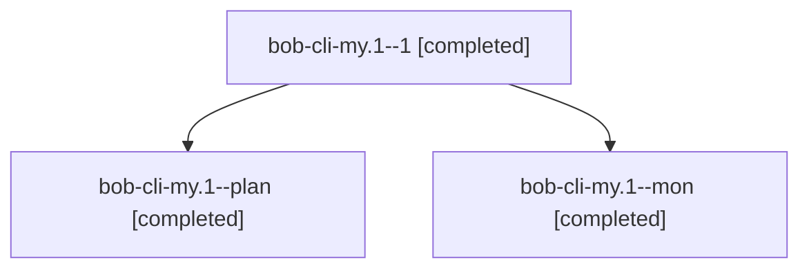

# Session: bob-cli-my.1

[Agent Hoods](../README.md) / [bbugyi200](../users/bbugyi200/README.md) / [athena](../users/bbugyi200/machines/athena/README.md) / [bob-cli-my](../users/bbugyi200/machines/athena/hoods/bob-cli-my/README.md) / bob-cli-my.1

Owner: `bbugyi200.athena` · Hood: `bob-cli-my` · Members: 3 · Bead: [bob-cli-my.1](https://github.com/bobs-org/bob-cli--beads/blob/main/pages/bob-cli-my/bob-cli-my.1.md)

## Lineage

The diagram is an optional enhancement; the ordered table below contains the same lineage in accessible text.

| Role | Agent | State | Model / provider | Timing | Commits | Prompt | Chat |
|---|---|---|---|---|---:|---|---|
| 1 | bob-cli-my.1--1 | completed | gpt-6-luna / codex | 2026-11-18T00:55:59.626025+00:00 → 2026-11-18T01:19:36.600272+00:00 | [1](../agents/bbugyi200.athena.bob-cli-my.1--1/README.md#commits) | [Prompt](../agents/bbugyi200.athena.bob-cli-my.1--1/prompt.md) | [Chat](../agents/bbugyi200.athena.bob-cli-my.1--1/chat.md) |
| plan | bob-cli-my.1--plan | completed | gpt-6-luna / codex | 2026-11-18T00:20:53.121489+00:00 → 2026-11-18T00:45:40.399532+00:00 | 0 | [Prompt](../agents/bbugyi200.athena.bob-cli-my.1--plan/prompt.md) | [Chat](../agents/bbugyi200.athena.bob-cli-my.1--plan/chat.md) |
| mon | bob-cli-my.1--mon | completed | gpt-6-luna / codex | 2026-11-18T00:44:17.722584+00:00 → 2026-11-18T00:55:59.874552+00:00 | 0 | — | [Chat](../agents/bbugyi200.athena.bob-cli-my.1--mon/chat.md) |

## Commits

| Role | Repo | Commit | Subject | Committed |
|---|---|---|---|---|
| 1 | bob-cli | [`9950a3d`](https://github.com/bobs-org/bob-cli/commit/9950a3d4f4c4793774308587696929fb22502e32) | fix(capture): refuse ambiguous notebook bullets | 2026-11-17 20:18:53 EST |

## Neighbors

| Agent | Relation | State |
|---|---|---|
| [bob-cli-my.2](../agents/bbugyi200.athena.bob-cli-my.2/README.md) | bob-cli-my hood | completed |
| [bob-cli-my.3](../agents/bbugyi200.athena.bob-cli-my.3/README.md) | bob-cli-my hood | waiting |
| [bob-cli-my.4](../agents/bbugyi200.athena.bob-cli-my.4/README.md) | bob-cli-my hood | waiting |
| [bob-cli-my.land](../agents/bbugyi200.athena.bob-cli-my.land/README.md) | bob-cli-my hood | waiting |
