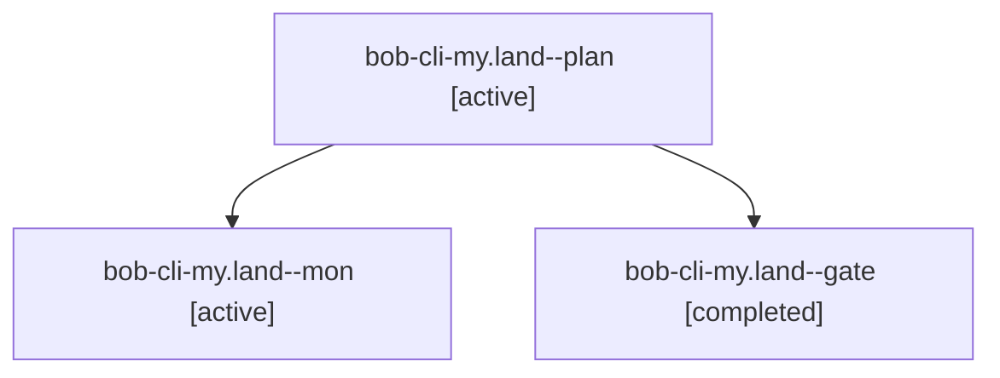

# Session: bob-cli-my.land

[Agent Hoods](../README.md) / [bbugyi200](../users/bbugyi200/README.md) / [athena](../users/bbugyi200/machines/athena/README.md) / [bob-cli-my](../users/bbugyi200/machines/athena/hoods/bob-cli-my/README.md) / bob-cli-my.land

Owner: `bbugyi200.athena` · Hood: `bob-cli-my` · Members: 3 · Bead: [bob-cli-my](https://github.com/bobs-org/bob-cli--beads/blob/main/pages/bob-cli-my/README.md)

## Lineage

The diagram is an optional enhancement; the ordered table below contains the same lineage in accessible text.

| Role | Agent | State | Model / provider | Timing | Commits | Prompt | Chat |
|---|---|---|---|---|---:|---|---|
| plan | bob-cli-my.land--plan | active | gpt-6-astra / codex | 2026-11-18T03:03:54.839757+00:00 → 2026-11-18T03:21:26.662103+00:00 | 0 | [Prompt](../agents/bbugyi200.athena.bob-cli-my.land--plan/prompt.md) | [Chat](../agents/bbugyi200.athena.bob-cli-my.land--plan/chat.md) |
| mon | bob-cli-my.land--mon | active | gpt-6-astra / codex | 2026-11-18T03:21:07.588725+00:00 | 0 | — | — |
| gate | bob-cli-my.land--gate | completed | gpt-6-astra / codex | 2026-11-18T03:20:44.019662+00:00 → 2026-11-18T03:21:12.174495+00:00 | 0 | — | [Chat](../agents/bbugyi200.athena.bob-cli-my.land--gate/chat.md) |

## Neighbors

| Agent | Relation | State |
|---|---|---|
| [bob-cli-my.1](bbugyi200.athena.bob-cli-my.1.md) (session · 3) | bob-cli-my hood | completed 3 |
| [bob-cli-my.2](../agents/bbugyi200.athena.bob-cli-my.2/README.md) | bob-cli-my hood | completed |
| [bob-cli-my.3](../agents/bbugyi200.athena.bob-cli-my.3/README.md) | bob-cli-my hood | completed |
| [bob-cli-my.4](../agents/bbugyi200.athena.bob-cli-my.4/README.md) | bob-cli-my hood | completed |
