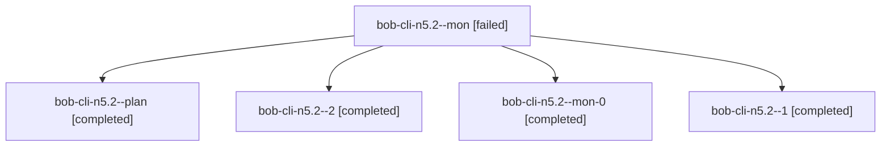

# Session: bob-cli-n5.2

[Agent Hoods](../README.md) / [bbugyi200](../users/bbugyi200/README.md) / [athena](../users/bbugyi200/machines/athena/README.md) / [bob-cli-n5](../users/bbugyi200/machines/athena/hoods/bob-cli-n5/README.md) / bob-cli-n5.2

Owner: `bbugyi200.athena` · Hood: `bob-cli-n5` · Members: 5 · Bead: [bob-cli-n5.2](https://github.com/bobs-org/bob-cli--beads/blob/main/pages/bob-cli-n5/bob-cli-n5.2.md)

## Lineage

The diagram is an optional enhancement; the ordered table below contains the same lineage in accessible text.

| Role | Agent | State | Model / provider | Timing | Commits | Prompt | Chat |
|---|---|---|---|---|---:|---|---|
| mon | bob-cli-n5.2--mon | failed | gpt-6-luna / codex | 2026-11-18T04:26:20.277101+00:00 → 2026-11-18T04:39:53.846200+00:00 | 0 | — | [Chat](../agents/bbugyi200.athena.bob-cli-n5.2--mon/chat.md) |
| plan | bob-cli-n5.2--plan | completed | gpt-6-luna / codex | 2026-11-18T03:43:48.039089+00:00 → 2026-11-18T04:27:46.846692+00:00 | 0 | [Prompt](../agents/bbugyi200.athena.bob-cli-n5.2--plan/prompt.md) | [Chat](../agents/bbugyi200.athena.bob-cli-n5.2--plan/chat.md) |
| 2 | bob-cli-n5.2--2 | completed | gpt-6-luna / codex | 2026-11-18T05:02:13.929652+00:00 → 2026-11-18T05:04:32.529076+00:00 | [1](../agents/bbugyi200.athena.bob-cli-n5.2--2/README.md#commits) | [Prompt](../agents/bbugyi200.athena.bob-cli-n5.2--2/prompt.md) | [Chat](../agents/bbugyi200.athena.bob-cli-n5.2--2/chat.md) |
| mon-0 | bob-cli-n5.2--mon-0 | completed | gpt-6-luna / codex | 2026-11-18T04:51:02.470141+00:00 → 2026-11-18T05:02:14.180985+00:00 | 0 | — | [Chat](../agents/bbugyi200.athena.bob-cli-n5.2--mon-0/chat.md) |
| 1 | bob-cli-n5.2--1 | completed | gpt-6-luna / codex | 2026-11-18T04:40:08.579047+00:00 → 2026-11-18T04:52:11.798695+00:00 | 0 | [Prompt](../agents/bbugyi200.athena.bob-cli-n5.2--1/prompt.md) | [Chat](../agents/bbugyi200.athena.bob-cli-n5.2--1/chat.md) |

## Commits

| Role | Repo | Commit | Subject | Committed |
|---|---|---|---|---|
| 2 | bob-cli | [`f2a6179`](https://github.com/bobs-org/bob-cli/commit/f2a61792ad1c1cae50d9fd0cbc6ba97994c689ec) | fix(capture): guard unknown short options | 2026-11-18 00:03:48 EST |

## Neighbors

| Agent | Relation | State |
|---|---|---|
| [bob-cli-n5.1](../agents/bbugyi200.athena.bob-cli-n5.1/README.md) | bob-cli-n5 hood | completed |
| [bob-cli-n5.3](../agents/bbugyi200.athena.bob-cli-n5.3/README.md) | bob-cli-n5 hood | completed |
| [bob-cli-n5.4](../agents/bbugyi200.athena.bob-cli-n5.4/README.md) | bob-cli-n5 hood | completed |
| [bob-cli-n5.5](../agents/bbugyi200.athena.bob-cli-n5.5/README.md) | bob-cli-n5 hood | completed |
| [bob-cli-n5.land](../agents/bbugyi200.athena.bob-cli-n5.land/README.md) | bob-cli-n5 hood | waiting |
