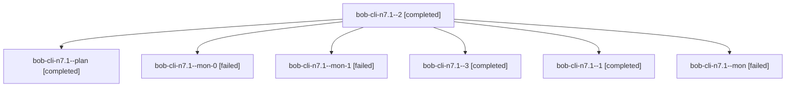

# Session: bob-cli-n7.1

[Agent Hoods](../README.md) / [bbugyi200](../users/bbugyi200/README.md) / [athena](../users/bbugyi200/machines/athena/README.md) / [bob-cli-n7](../users/bbugyi200/machines/athena/hoods/bob-cli-n7/README.md) / bob-cli-n7.1

Owner: `bbugyi200.athena` · Hood: `bob-cli-n7` · Members: 7 · Bead: [bob-cli-n7.1](https://github.com/bobs-org/bob-cli--beads/blob/main/pages/bob-cli-n7/bob-cli-n7.1.md)

## Lineage

The diagram is an optional enhancement; the ordered table below contains the same lineage in accessible text.

| Role | Agent | State | Model / provider | Timing | Commits | Prompt | Chat |
|---|---|---|---|---|---:|---|---|
| 2 | bob-cli-n7.1--2 | completed | gpt-6-luna / codex | 2026-11-18T08:17:35.697565+00:00 → 2026-11-18T08:20:42.594374+00:00 | 0 | [Prompt](../agents/bbugyi200.athena.bob-cli-n7.1--2/prompt.md) | [Chat](../agents/bbugyi200.athena.bob-cli-n7.1--2/chat.md) |
| plan | bob-cli-n7.1--plan | completed | gpt-6-luna / codex | 2026-11-18T06:57:41.439094+00:00 → 2026-11-18T07:22:37.536359+00:00 | 0 | [Prompt](../agents/bbugyi200.athena.bob-cli-n7.1--plan/prompt.md) | [Chat](../agents/bbugyi200.athena.bob-cli-n7.1--plan/chat.md) |
| mon-0 | bob-cli-n7.1--mon-0 | failed | gpt-6-luna / codex | 2026-11-18T08:15:36.482954+00:00 → 2026-11-18T08:17:35.750185+00:00 | 0 | — | [Chat](../agents/bbugyi200.athena.bob-cli-n7.1--mon-0/chat.md) |
| mon-1 | bob-cli-n7.1--mon-1 | failed | gpt-6-luna / codex | 2026-11-18T08:19:46.004679+00:00 → 2026-11-18T09:05:20.242430+00:00 | 0 | — | [Chat](../agents/bbugyi200.athena.bob-cli-n7.1--mon-1/chat.md) |
| 3 | bob-cli-n7.1--3 | completed | gpt-6-luna / codex | 2026-11-18T09:05:19.986465+00:00 → 2026-11-18T09:11:11.586756+00:00 | [1](../agents/bbugyi200.athena.bob-cli-n7.1--3/README.md#commits) | [Prompt](../agents/bbugyi200.athena.bob-cli-n7.1--3/prompt.md) | [Chat](../agents/bbugyi200.athena.bob-cli-n7.1--3/chat.md) |
| 1 | bob-cli-n7.1--1 | completed | gpt-6-luna / codex | 2026-11-18T08:09:06.175022+00:00 → 2026-11-18T08:16:27.806428+00:00 | 0 | [Prompt](../agents/bbugyi200.athena.bob-cli-n7.1--1/prompt.md) | [Chat](../agents/bbugyi200.athena.bob-cli-n7.1--1/chat.md) |
| mon | bob-cli-n7.1--mon | failed | gpt-6-luna / codex | 2026-11-18T07:21:40.503202+00:00 → 2026-11-18T08:09:06.371006+00:00 | 0 | — | [Chat](../agents/bbugyi200.athena.bob-cli-n7.1--mon/chat.md) |

## Commits

| Role | Repo | Commit | Subject | Committed |
|---|---|---|---|---|
| 3 | bob-cli | [`509d857`](https://github.com/bobs-org/bob-cli/commit/509d8572b50c753743ee5082d566e7c9adf342e5) | test(collision): normalize filesystem-sensitive cases for macOS | 2026-11-18 04:10:47 EST |

## Neighbors

| Agent | Relation | State |
|---|---|---|
| [bob-cli-n7.2](bbugyi200.athena.bob-cli-n7.2.md) (session · 3) | bob-cli-n7 hood | completed 2, failed 1 |
| [bob-cli-n7.3](bbugyi200.athena.bob-cli-n7.3.md) (session · 3) | bob-cli-n7 hood | completed 2, failed 1 |
| [bob-cli-n7.4](bbugyi200.athena.bob-cli-n7.4.md) (session · 3) | bob-cli-n7 hood | completed 2, failed 1 |
| [bob-cli-n7.land](bbugyi200.athena.bob-cli-n7.land.md) (session · 3) | bob-cli-n7 hood | active 2, completed 1 |
