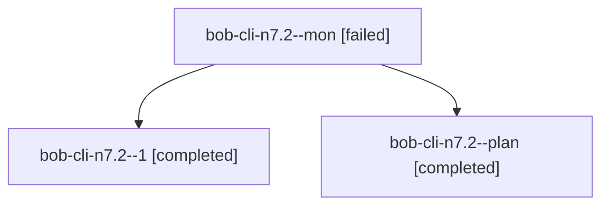

# Session: bob-cli-n7.2

[Agent Hoods](../README.md) / [bbugyi200](../users/bbugyi200/README.md) / [athena](../users/bbugyi200/machines/athena/README.md) / [bob-cli-n7](../users/bbugyi200/machines/athena/hoods/bob-cli-n7/README.md) / bob-cli-n7.2

Owner: `bbugyi200.athena` · Hood: `bob-cli-n7` · Members: 3 · Bead: [bob-cli-n7.2](https://github.com/bobs-org/bob-cli--beads/blob/main/pages/bob-cli-n7/bob-cli-n7.2.md)

## Lineage

The diagram is an optional enhancement; the ordered table below contains the same lineage in accessible text.

| Role | Agent | State | Model / provider | Timing | Commits | Prompt | Chat |
|---|---|---|---|---|---:|---|---|
| mon | bob-cli-n7.2--mon | failed | muse-spark-1.3-contributor / muse | 2026-11-18T12:48:31.192542+00:00 → 2026-11-18T13:43:09.260264+00:00 | 0 | — | [Chat](../agents/bbugyi200.athena.bob-cli-n7.2--mon/chat.md) |
| 1 | bob-cli-n7.2--1 | completed | muse-spark-1.3-contributor / muse | 2026-11-18T13:43:10.787610+00:00 → 2026-11-18T14:01:11.188461+00:00 | 0 | [Prompt](../agents/bbugyi200.athena.bob-cli-n7.2--1/prompt.md) | [Chat](../agents/bbugyi200.athena.bob-cli-n7.2--1/chat.md) |
| plan | bob-cli-n7.2--plan | completed | muse-spark-1.3-contributor / muse | 2026-11-18T12:26:42.206807+00:00 → 2026-11-18T12:55:55.571500+00:00 | [1](../agents/bbugyi200.athena.bob-cli-n7.2--plan/README.md#commits) | [Prompt](../agents/bbugyi200.athena.bob-cli-n7.2--plan/prompt.md) | [Chat](../agents/bbugyi200.athena.bob-cli-n7.2--plan/chat.md) |

## Commits

| Role | Repo | Commit | Subject | Committed |
|---|---|---|---|---|
| plan | bob-cli | [`1f6cc7b`](https://github.com/bobs-org/bob-cli/commit/1f6cc7bedbeb6786202d9e003dad3b1cbccd4911) | fix(note-catalog): canonicalize library roots for symlinked vaults | 2026-11-18 07:55:27 EST |

## Neighbors

| Agent | Relation | State |
|---|---|---|
| [bob-cli-n7.1](bbugyi200.athena.bob-cli-n7.1.md) (session · 7) | bob-cli-n7 hood | completed 4, failed 3 |
| [bob-cli-n7.1](../agents/bbugyi200.athena.bob-cli-n7.1/README.md) | bob-cli-n7 hood | completed |
| [bob-cli-n7.3](bbugyi200.athena.bob-cli-n7.3.md) (session · 3) | bob-cli-n7 hood | completed 2, failed 1 |
| [bob-cli-n7.4](bbugyi200.athena.bob-cli-n7.4.md) (session · 3) | bob-cli-n7 hood | completed 2, failed 1 |
| [bob-cli-n7.land](bbugyi200.athena.bob-cli-n7.land.md) (session · 23) | bob-cli-n7 hood | active 1, completed 14, failed 8 |
