# Session: bob-cli-n7.land

[Agent Hoods](../README.md) / [bbugyi200](../users/bbugyi200/README.md) / [athena](../users/bbugyi200/machines/athena/README.md) / [bob-cli-n7](../users/bbugyi200/machines/athena/hoods/bob-cli-n7/README.md) / bob-cli-n7.land

Owner: `bbugyi200.athena` · Hood: `bob-cli-n7` · Members: 23 · Bead: [bob-cli-n7](https://github.com/bobs-org/bob-cli--beads/blob/main/pages/bob-cli-n7/README.md)

## Lineage

```mermaid
flowchart TD
  n0["bob-cli-n7.land--mon-1 [failed]"]
  n1["bob-cli-n7.land--mon-3 [completed]"]
  n0 --> n1
  n2["bob-cli-n7.land--mon-7 [failed]"]
  n0 --> n2
  n3["bob-cli-n7.land--mon-8 [completed]"]
  n0 --> n3
  n4["bob-cli-n7.land--plan [completed]"]
  n0 --> n4
  n5["bob-cli-n7.land--code [completed]"]
  n0 --> n5
  n6["bob-cli-n7.land--8 [completed]"]
  n0 --> n6
  n7["bob-cli-n7.land--mon-4 [failed]"]
  n0 --> n7
  n8["bob-cli-n7.land--9 [completed]"]
  n0 --> n8
  n9["bob-cli-n7.land--mon-2 [failed]"]
  n0 --> n9
  n10["bob-cli-n7.land--gate [completed]"]
  n0 --> n10
  n11["bob-cli-n7.land--3 [completed]"]
  n0 --> n11
  n12["bob-cli-n7.land--a [active]"]
  n0 --> n12
  n13["bob-cli-n7.land--mon [failed]"]
  n0 --> n13
  n14["bob-cli-n7.land--mon-0 [failed]"]
  n0 --> n14
  n15["bob-cli-n7.land--5 [completed]"]
  n0 --> n15
  n16["bob-cli-n7.land--6 [completed]"]
  n0 --> n16
  n17["bob-cli-n7.land--2 [completed]"]
  n0 --> n17
  n18["bob-cli-n7.land--1 [completed]"]
  n0 --> n18
  n19["bob-cli-n7.land--mon-6 [failed]"]
  n0 --> n19
  n20["bob-cli-n7.land--mon-5 [failed]"]
  n0 --> n20
  n21["bob-cli-n7.land--4 [completed]"]
  n0 --> n21
  n22["bob-cli-n7.land--7 [completed]"]
  n0 --> n22
```



The diagram is an optional enhancement; the ordered table below contains the same lineage in accessible text.

| Role | Agent | State | Model / provider | Timing | Commits | Prompt | Chat |
|---|---|---|---|---|---:|---|---|
| <a id="member-mon-1"></a>mon-1 | bob-cli-n7.land--mon-1 | failed | gpt-6-luna / codex | 2026-11-18T17:46:50.739501+00:00 → 2026-11-18T17:58:20.363638+00:00 | 0 | — | [Chat](../agents/bbugyi200.athena.bob-cli-n7.land--mon-1/chat.md) |
| <a id="member-mon-3"></a>mon-3 | bob-cli-n7.land--mon-3 | completed | gpt-6-luna / codex | 2026-11-18T18:23:13.900657+00:00 → 2026-11-18T18:58:32.957553+00:00 | 0 | — | [Chat](../agents/bbugyi200.athena.bob-cli-n7.land--mon-3/chat.md) |
| <a id="member-mon-7"></a>mon-7 | bob-cli-n7.land--mon-7 | failed | gpt-6-luna / codex | 2026-11-18T21:49:30.583549+00:00 → 2026-11-18T21:55:54.008660+00:00 | 0 | — | [Chat](../agents/bbugyi200.athena.bob-cli-n7.land--mon-7/chat.md) |
| <a id="member-mon-8"></a>mon-8 | bob-cli-n7.land--mon-8 | completed | gpt-6-luna / codex | 2026-11-18T22:06:31.135081+00:00 → 2026-11-18T22:51:22.001102+00:00 | 0 | — | [Chat](../agents/bbugyi200.athena.bob-cli-n7.land--mon-8/chat.md) |
| <a id="member-plan"></a>plan | bob-cli-n7.land--plan | completed | gpt-6-astra / codex | 2026-11-18T15:46:30.424330+00:00 → 2026-11-18T16:25:23.165975+00:00 | 0 | [Prompt](../agents/bbugyi200.athena.bob-cli-n7.land--plan/prompt.md) | [Chat](../agents/bbugyi200.athena.bob-cli-n7.land--plan/chat.md) |
| <a id="member-code"></a>code | bob-cli-n7.land--code | completed | gpt-6-luna / codex | 2026-11-18T15:58:16.142626+00:00 → 2026-11-18T16:25:23.165975+00:00 | 0 | — | [Chat](../agents/bbugyi200.athena.bob-cli-n7.land--code/chat.md) |
| <a id="member-8"></a>8 | bob-cli-n7.land--8 | completed | gpt-6-luna / codex | 2026-11-18T21:40:59.942392+00:00 → 2026-11-18T21:51:09.954300+00:00 | 0 | [Prompt](../agents/bbugyi200.athena.bob-cli-n7.land--8/prompt.md) | [Chat](../agents/bbugyi200.athena.bob-cli-n7.land--8/chat.md) |
| <a id="member-mon-4"></a>mon-4 | bob-cli-n7.land--mon-4 | failed | gpt-6-luna / codex | 2026-11-18T19:16:07.183224+00:00 → 2026-11-18T19:29:35.269479+00:00 | 0 | — | [Chat](../agents/bbugyi200.athena.bob-cli-n7.land--mon-4/chat.md) |
| <a id="member-9"></a>9 | bob-cli-n7.land--9 | completed | gpt-6-luna / codex | 2026-11-18T21:56:47.985704+00:00 → 2026-11-18T22:07:56.324816+00:00 | 0 | [Prompt](../agents/bbugyi200.athena.bob-cli-n7.land--9/prompt.md) | [Chat](../agents/bbugyi200.athena.bob-cli-n7.land--9/chat.md) |
| <a id="member-mon-2"></a>mon-2 | bob-cli-n7.land--mon-2 | failed | gpt-6-luna / codex | 2026-11-18T18:03:15.403525+00:00 → 2026-11-18T18:20:19.254609+00:00 | 0 | — | [Chat](../agents/bbugyi200.athena.bob-cli-n7.land--mon-2/chat.md) |
| <a id="member-gate"></a>gate | bob-cli-n7.land--gate | completed | gpt-6-astra / codex | 2026-11-18T15:56:52.114655+00:00 → 2026-11-18T15:57:00.179527+00:00 | 0 | — | [Chat](../agents/bbugyi200.athena.bob-cli-n7.land--gate/chat.md) |
| <a id="member-3"></a>3 | bob-cli-n7.land--3 | completed | gpt-6-luna / codex | 2026-11-18T17:58:20.053783+00:00 → 2026-11-18T18:05:17.712737+00:00 | 0 | [Prompt](../agents/bbugyi200.athena.bob-cli-n7.land--3/prompt.md) | [Chat](../agents/bbugyi200.athena.bob-cli-n7.land--3/chat.md) |
| <a id="member-a"></a>a | bob-cli-n7.land--a | active | gpt-6-luna / codex | 2026-11-18T22:51:21.846803+00:00 | [1](../agents/bbugyi200.athena.bob-cli-n7.land--a/README.md#commits) | [Prompt](../agents/bbugyi200.athena.bob-cli-n7.land--a/prompt.md) | — |
| <a id="member-mon"></a>mon | bob-cli-n7.land--mon | failed | gpt-6-luna / codex | 2026-11-18T16:24:20.805517+00:00 → 2026-11-18T17:15:25.779347+00:00 | 0 | — | [Chat](../agents/bbugyi200.athena.bob-cli-n7.land--mon/chat.md) |
| <a id="member-mon-0"></a>mon-0 | bob-cli-n7.land--mon-0 | failed | gpt-6-luna / codex | 2026-11-18T17:21:44.262251+00:00 → 2026-11-18T17:41:00.311460+00:00 | 0 | — | [Chat](../agents/bbugyi200.athena.bob-cli-n7.land--mon-0/chat.md) |
| <a id="member-5"></a>5 | bob-cli-n7.land--5 | completed | gpt-6-luna / codex | 2026-11-18T18:58:57.400141+00:00 → 2026-11-18T19:18:47.582371+00:00 | 0 | [Prompt](../agents/bbugyi200.athena.bob-cli-n7.land--5/prompt.md) | [Chat](../agents/bbugyi200.athena.bob-cli-n7.land--5/chat.md) |
| <a id="member-6"></a>6 | bob-cli-n7.land--6 | completed | gpt-6-luna / codex | 2026-11-18T19:29:34.783151+00:00 → 2026-11-18T19:49:11.269132+00:00 | 0 | [Prompt](../agents/bbugyi200.athena.bob-cli-n7.land--6/prompt.md) | [Chat](../agents/bbugyi200.athena.bob-cli-n7.land--6/chat.md) |
| <a id="member-2"></a>2 | bob-cli-n7.land--2 | completed | gpt-6-luna / codex | 2026-11-18T17:42:11.486965+00:00 → 2026-11-18T17:49:00.672891+00:00 | 0 | [Prompt](../agents/bbugyi200.athena.bob-cli-n7.land--2/prompt.md) | [Chat](../agents/bbugyi200.athena.bob-cli-n7.land--2/chat.md) |
| <a id="member-1"></a>1 | bob-cli-n7.land--1 | completed | gpt-6-luna / codex | 2026-11-18T17:15:25.272750+00:00 → 2026-11-18T17:23:22.303825+00:00 | 0 | [Prompt](../agents/bbugyi200.athena.bob-cli-n7.land--1/prompt.md) | [Chat](../agents/bbugyi200.athena.bob-cli-n7.land--1/chat.md) |
| <a id="member-mon-6"></a>mon-6 | bob-cli-n7.land--mon-6 | failed | gpt-6-luna / codex | 2026-11-18T20:51:06.017512+00:00 → 2026-11-18T21:40:08.418909+00:00 | 0 | — | [Chat](../agents/bbugyi200.athena.bob-cli-n7.land--mon-6/chat.md) |
| <a id="member-mon-5"></a>mon-5 | bob-cli-n7.land--mon-5 | failed | gpt-6-luna / codex | 2026-11-18T19:48:08.119106+00:00 → 2026-11-18T20:38:35.575110+00:00 | 0 | — | [Chat](../agents/bbugyi200.athena.bob-cli-n7.land--mon-5/chat.md) |
| <a id="member-4"></a>4 | bob-cli-n7.land--4 | completed | gpt-6-luna / codex | 2026-11-18T18:20:18.783501+00:00 → 2026-11-18T18:25:16.847434+00:00 | 0 | [Prompt](../agents/bbugyi200.athena.bob-cli-n7.land--4/prompt.md) | [Chat](../agents/bbugyi200.athena.bob-cli-n7.land--4/chat.md) |
| <a id="member-7"></a>7 | bob-cli-n7.land--7 | completed | gpt-6-luna / codex | 2026-11-18T20:38:35.168541+00:00 → 2026-11-18T20:52:43.959571+00:00 | 0 | [Prompt](../agents/bbugyi200.athena.bob-cli-n7.land--7/prompt.md) | [Chat](../agents/bbugyi200.athena.bob-cli-n7.land--7/chat.md) |

## Commits

| Role | Repo | Commit | Subject | Committed |
|---|---|---|---|---|
| a | bob-cli | [`b73f4aa`](https://github.com/bobs-org/bob-cli/commit/b73f4aad53c2190f96224eb68483343fd901d4d0) | fix(n7): complete T4 exact macOS verification | 2026-11-18 18:46:12 EST |

## Variables

| Role | Variable | Value |
|---|---|---|
| plan | `artifacts` | \[{kind: file, label: bob-cli-n7 landing: macOS compile timeout evidence, path: /home/bryan/.sase/artifacts/agents/gh\_bobs-org\_\_bob-cli/20261118015701/bob-cli-n7-timeout-evidence-dd68a3712644.txt, ref… |

#### artifacts

**Role:** `plan`

```yaml
- kind: file
  label: bob-cli-n7 landing: macOS compile timeout evidence
  path: /home/bryan/.sase/artifacts/agents/gh_bobs-org__bob-cli/20261118015701/bob-cli-n7-timeout-evidence-dd68a3712644.txt
  ref: file:explicit:5633c7224fa64f51f01da38a
  source_path: /tmp/bob-cli-n7-timeout-evidence.txt
```

Values are truncated for display; see each member's agent meta.json for the full values.

## Neighbors

| Agent | Relation | State |
|---|---|---|
| [bob-cli-n7.1](bbugyi200.athena.bob-cli-n7.1.md) (session · 7) | bob-cli-n7 hood | completed 4, failed 3 |
| [bob-cli-n7.1](../agents/bbugyi200.athena.bob-cli-n7.1/README.md) | bob-cli-n7 hood | completed |
| [bob-cli-n7.2](bbugyi200.athena.bob-cli-n7.2.md) (session · 3) | bob-cli-n7 hood | completed 2, failed 1 |
| [bob-cli-n7.3](bbugyi200.athena.bob-cli-n7.3.md) (session · 3) | bob-cli-n7 hood | completed 2, failed 1 |
| [bob-cli-n7.4](bbugyi200.athena.bob-cli-n7.4.md) (session · 3) | bob-cli-n7 hood | completed 2, failed 1 |
