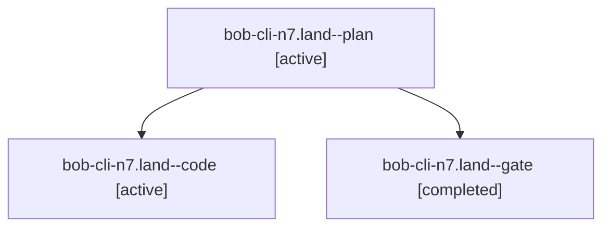

# Session: bob-cli-n7.land

[Agent Hoods](../README.md) / [bbugyi200](../users/bbugyi200/README.md) / [athena](../users/bbugyi200/machines/athena/README.md) / [bob-cli-n7](../users/bbugyi200/machines/athena/hoods/bob-cli-n7/README.md) / bob-cli-n7.land

Owner: `bbugyi200.athena` · Hood: `bob-cli-n7` · Members: 3 · Bead: [bob-cli-n7](https://github.com/bobs-org/bob-cli--beads/blob/main/pages/bob-cli-n7/README.md)

## Lineage



The diagram is an optional enhancement; the ordered table below contains the same lineage in accessible text.

| Role | Agent | State | Model / provider | Timing | Commits | Prompt | Chat |
|---|---|---|---|---|---:|---|---|
| <a id="member-plan"></a>plan | bob-cli-n7.land--plan | active | gpt-6-astra / codex | 2026-11-18T15:46:30.424330+00:00 | 0 | [Prompt](../agents/bbugyi200.athena.bob-cli-n7.land--plan/prompt.md) | [Chat](../agents/bbugyi200.athena.bob-cli-n7.land--plan/chat.md) |
| <a id="member-code"></a>code | bob-cli-n7.land--code | active | gpt-6-luna / codex | 2026-11-18T15:58:16.142626+00:00 | 0 | — | — |
| <a id="member-gate"></a>gate | bob-cli-n7.land--gate | completed | gpt-6-astra / codex | 2026-11-18T15:56:52.114655+00:00 → 2026-11-18T15:57:00.179527+00:00 | 0 | — | [Chat](../agents/bbugyi200.athena.bob-cli-n7.land--gate/chat.md) |

## Variables

| Role | Variable | Value |
|---|---|---|
| plan | `artifacts` | \[{kind: file, label: bob-cli-n7 landing: macOS compile timeout evidence, path: /home/bryan/.sase/artifacts/agents/gh\_bobs-org\_\_bob-cli/20261118015701/bob-cli-n7-timeout-evidence-dd68a3712644.txt, ref… |

#### artifacts

**Role:** `plan`

```yaml
- kind: file
  label: bob-cli-n7 landing: macOS compile timeout evidence
  path: /home/bryan/.sase/artifacts/agents/gh_bobs-org__bob-cli/20261118015701/bob-cli-n7-timeout-evidence-dd68a3712644.txt
  ref: file:explicit:5633c7224fa64f51f01da38a
  source_path: /tmp/bob-cli-n7-timeout-evidence.txt
```

Values are truncated for display; see each member's agent meta.json for the full values.

## Neighbors

| Agent | Relation | State |
|---|---|---|
| [bob-cli-n7.1](bbugyi200.athena.bob-cli-n7.1.md) (session · 7) | bob-cli-n7 hood | completed 4, failed 3 |
| [bob-cli-n7.1](../agents/bbugyi200.athena.bob-cli-n7.1/README.md) | bob-cli-n7 hood | completed |
| [bob-cli-n7.2](bbugyi200.athena.bob-cli-n7.2.md) (session · 3) | bob-cli-n7 hood | completed 2, failed 1 |
| [bob-cli-n7.3](bbugyi200.athena.bob-cli-n7.3.md) (session · 3) | bob-cli-n7 hood | completed 2, failed 1 |
| [bob-cli-n7.4](bbugyi200.athena.bob-cli-n7.4.md) (session · 3) | bob-cli-n7 hood | completed 2, failed 1 |
