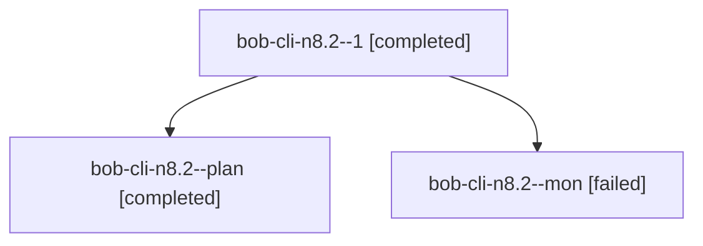

# Session: bob-cli-n8.2

[Agent Hoods](../README.md) / [bbugyi200](../users/bbugyi200/README.md) / [athena](../users/bbugyi200/machines/athena/README.md) / [bob-cli-n8](../users/bbugyi200/machines/athena/hoods/bob-cli-n8/README.md) / bob-cli-n8.2

Owner: `bbugyi200.athena` · Hood: `bob-cli-n8` · Members: 3 · Bead: [bob-cli-n8.2](https://github.com/bobs-org/bob-cli--beads/blob/main/pages/bob-cli-n8/bob-cli-n8.2.md)

## Lineage

The diagram is an optional enhancement; the ordered table below contains the same lineage in accessible text.

| Role | Agent | State | Model / provider | Timing | Commits | Prompt | Chat |
|---|---|---|---|---|---:|---|---|
| 1 | bob-cli-n8.2--1 | completed | gpt-6-luna / codex | 2026-11-18T15:21:07.283032+00:00 → 2026-11-18T15:32:26.931952+00:00 | 0 | [Prompt](../agents/bbugyi200.athena.bob-cli-n8.2--1/prompt.md) | [Chat](../agents/bbugyi200.athena.bob-cli-n8.2--1/chat.md) |
| plan | bob-cli-n8.2--plan | completed | gpt-6-luna / codex | 2026-11-18T14:49:52.585307+00:00 → 2026-11-18T15:14:19.546689+00:00 | 0 | [Prompt](../agents/bbugyi200.athena.bob-cli-n8.2--plan/prompt.md) | [Chat](../agents/bbugyi200.athena.bob-cli-n8.2--plan/chat.md) |
| mon | bob-cli-n8.2--mon | failed | gpt-6-luna / codex | 2026-11-18T15:13:23.105923+00:00 → 2026-11-18T15:19:44.801129+00:00 | 0 | — | [Chat](../agents/bbugyi200.athena.bob-cli-n8.2--mon/chat.md) |

## Neighbors

| Agent | Relation | State |
|---|---|---|
| [bob-cli-n8.1](../agents/bbugyi200.athena.bob-cli-n8.1/README.md) | bob-cli-n8 hood | completed |
| [bob-cli-n8.3](bbugyi200.athena.bob-cli-n8.3.md) (session · 5) | bob-cli-n8 hood | completed 4, failed 1 |
| [bob-cli-n8.4](../agents/bbugyi200.athena.bob-cli-n8.4/README.md) | bob-cli-n8 hood | completed |
| [bob-cli-n8.land](../agents/bbugyi200.athena.bob-cli-n8.land/README.md) | bob-cli-n8 hood | waiting |
