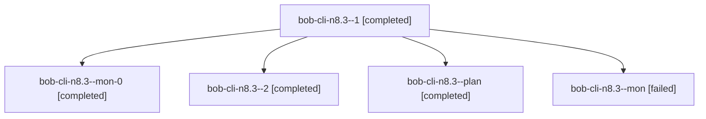

# Session: bob-cli-n8.3

[Agent Hoods](../README.md) / [bbugyi200](../users/bbugyi200/README.md) / [athena](../users/bbugyi200/machines/athena/README.md) / [bob-cli-n8](../users/bbugyi200/machines/athena/hoods/bob-cli-n8/README.md) / bob-cli-n8.3

Owner: `bbugyi200.athena` · Hood: `bob-cli-n8` · Members: 5 · Bead: [bob-cli-n8.3](https://github.com/bobs-org/bob-cli--beads/blob/main/pages/bob-cli-n8/bob-cli-n8.3.md)

## Lineage

The diagram is an optional enhancement; the ordered table below contains the same lineage in accessible text.

| Role | Agent | State | Model / provider | Timing | Commits | Prompt | Chat |
|---|---|---|---|---|---:|---|---|
| 1 | bob-cli-n8.3--1 | completed | gpt-6-luna / codex | 2026-11-18T15:22:58.736317+00:00 → 2026-11-18T15:36:42.698736+00:00 | 0 | [Prompt](../agents/bbugyi200.athena.bob-cli-n8.3--1/prompt.md) | [Chat](../agents/bbugyi200.athena.bob-cli-n8.3--1/chat.md) |
| mon-0 | bob-cli-n8.3--mon-0 | completed | gpt-6-luna / codex | 2026-11-18T15:35:42.288483+00:00 → 2026-11-18T16:09:38.951249+00:00 | 0 | — | [Chat](../agents/bbugyi200.athena.bob-cli-n8.3--mon-0/chat.md) |
| 2 | bob-cli-n8.3--2 | completed | gpt-6-luna / codex | 2026-11-18T16:09:38.600983+00:00 → 2026-11-18T16:12:24.897298+00:00 | 0 | [Prompt](../agents/bbugyi200.athena.bob-cli-n8.3--2/prompt.md) | [Chat](../agents/bbugyi200.athena.bob-cli-n8.3--2/chat.md) |
| plan | bob-cli-n8.3--plan | completed | gpt-6-luna / codex | 2026-11-18T14:50:03.763362+00:00 → 2026-11-18T15:01:23.583926+00:00 | 0 | [Prompt](../agents/bbugyi200.athena.bob-cli-n8.3--plan/prompt.md) | [Chat](../agents/bbugyi200.athena.bob-cli-n8.3--plan/chat.md) |
| mon | bob-cli-n8.3--mon | failed | gpt-6-luna / codex | 2026-11-18T15:00:27.842429+00:00 → 2026-11-18T15:21:58.817516+00:00 | 0 | — | [Chat](../agents/bbugyi200.athena.bob-cli-n8.3--mon/chat.md) |

## Neighbors

| Agent | Relation | State |
|---|---|---|
| [bob-cli-n8.1](../agents/bbugyi200.athena.bob-cli-n8.1/README.md) | bob-cli-n8 hood | completed |
| [bob-cli-n8.2](bbugyi200.athena.bob-cli-n8.2.md) (session · 3) | bob-cli-n8 hood | completed 2, failed 1 |
| [bob-cli-n8.4](../agents/bbugyi200.athena.bob-cli-n8.4/README.md) | bob-cli-n8 hood | waiting |
| [bob-cli-n8.land](../agents/bbugyi200.athena.bob-cli-n8.land/README.md) | bob-cli-n8 hood | waiting |
