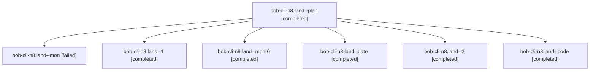

# Session: bob-cli-n8.land

[Agent Hoods](../README.md) / [bbugyi200](../users/bbugyi200/README.md) / [athena](../users/bbugyi200/machines/athena/README.md) / [bob-cli-n8](../users/bbugyi200/machines/athena/hoods/bob-cli-n8/README.md) / bob-cli-n8.land

Owner: `bbugyi200.athena` · Hood: `bob-cli-n8` · Members: 7 · Bead: [bob-cli-n8](https://github.com/bobs-org/bob-cli--beads/blob/main/pages/bob-cli-n8/README.md)

## Lineage

The diagram is an optional enhancement; the ordered table below contains the same lineage in accessible text.

| Role | Agent | State | Model / provider | Timing | Commits | Prompt | Chat |
|---|---|---|---|---|---:|---|---|
| plan | bob-cli-n8.land--plan | completed | gpt-6-astra / codex | 2026-11-18T16:24:57.438160+00:00 → 2026-11-18T17:11:16.673220+00:00 | 0 | [Prompt](../agents/bbugyi200.athena.bob-cli-n8.land--plan/prompt.md) | [Chat](../agents/bbugyi200.athena.bob-cli-n8.land--plan/chat.md) |
| mon | bob-cli-n8.land--mon | failed | gpt-6-luna / codex | 2026-11-18T17:09:16.582811+00:00 → 2026-11-18T17:16:12.860860+00:00 | 0 | — | [Chat](../agents/bbugyi200.athena.bob-cli-n8.land--mon/chat.md) |
| 1 | bob-cli-n8.land--1 | completed | gpt-6-luna / codex | 2026-11-18T17:16:12.273894+00:00 → 2026-11-18T17:39:03.211263+00:00 | 0 | [Prompt](../agents/bbugyi200.athena.bob-cli-n8.land--1/prompt.md) | [Chat](../agents/bbugyi200.athena.bob-cli-n8.land--1/chat.md) |
| mon-0 | bob-cli-n8.land--mon-0 | completed | gpt-6-luna / codex | 2026-11-18T17:37:02.445589+00:00 → 2026-11-18T18:06:27.650927+00:00 | 0 | — | [Chat](../agents/bbugyi200.athena.bob-cli-n8.land--mon-0/chat.md) |
| gate | bob-cli-n8.land--gate | completed | gpt-6-astra / codex | 2026-11-18T16:32:52.630850+00:00 → 2026-11-18T16:33:02.531216+00:00 | 0 | — | [Chat](../agents/bbugyi200.athena.bob-cli-n8.land--gate/chat.md) |
| 2 | bob-cli-n8.land--2 | completed | gpt-6-luna / codex | 2026-11-18T18:06:27.317776+00:00 → 2026-11-18T18:11:43.089815+00:00 | [1](../agents/bbugyi200.athena.bob-cli-n8.land--2/README.md#commits) | [Prompt](../agents/bbugyi200.athena.bob-cli-n8.land--2/prompt.md) | [Chat](../agents/bbugyi200.athena.bob-cli-n8.land--2/chat.md) |
| code | bob-cli-n8.land--code | completed | gpt-6-luna / codex | 2026-11-18T16:33:36.030349+00:00 → 2026-11-18T17:11:16.673220+00:00 | 0 | — | [Chat](../agents/bbugyi200.athena.bob-cli-n8.land--code/chat.md) |

## Commits

| Role | Repo | Commit | Subject | Committed |
|---|---|---|---|---|
| 2 | bob-cli | [`c02d405`](https://github.com/bobs-org/bob-cli/commit/c02d405da9126dadddf623014447e8a309ff7660) | feat(records): stage record walk neighbours atomically | 2026-11-18 12:49:59 EST |

## Neighbors

| Agent | Relation | State |
|---|---|---|
| [bob-cli-n8.1](../agents/bbugyi200.athena.bob-cli-n8.1/README.md) | bob-cli-n8 hood | completed |
| [bob-cli-n8.2](bbugyi200.athena.bob-cli-n8.2.md) (session · 3) | bob-cli-n8 hood | completed 2, failed 1 |
| [bob-cli-n8.3](bbugyi200.athena.bob-cli-n8.3.md) (session · 5) | bob-cli-n8 hood | completed 4, failed 1 |
| [bob-cli-n8.4](../agents/bbugyi200.athena.bob-cli-n8.4/README.md) | bob-cli-n8 hood | completed |
