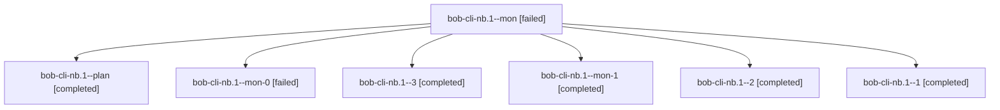

# Session: bob-cli-nb.1

[Agent Hoods](../README.md) / [bbugyi200](../users/bbugyi200/README.md) / [athena](../users/bbugyi200/machines/athena/README.md) / [bob-cli-nb](../users/bbugyi200/machines/athena/hoods/bob-cli-nb/README.md) / bob-cli-nb.1

Owner: `bbugyi200.athena` · Hood: `bob-cli-nb` · Members: 7 · Bead: [bob-cli-nb.1](https://github.com/bobs-org/bob-cli--beads/blob/main/pages/bob-cli-nb/bob-cli-nb.1.md)

## Lineage

The diagram is an optional enhancement; the ordered table below contains the same lineage in accessible text.

| Role | Agent | State | Model / provider | Timing | Commits | Prompt | Chat |
|---|---|---|---|---|---:|---|---|
| mon | bob-cli-nb.1--mon | failed | gpt-6-astra / codex | 2026-11-18T18:36:01.125289+00:00 → 2026-11-18T18:46:30.414958+00:00 | 0 | — | [Chat](../agents/bbugyi200.athena.bob-cli-nb.1--mon/chat.md) |
| plan | bob-cli-nb.1--plan | completed | gpt-6-astra / codex | 2026-11-18T18:12:34.010806+00:00 → 2026-11-18T18:36:51.455987+00:00 | 0 | [Prompt](../agents/bbugyi200.athena.bob-cli-nb.1--plan/prompt.md) | [Chat](../agents/bbugyi200.athena.bob-cli-nb.1--plan/chat.md) |
| mon-0 | bob-cli-nb.1--mon-0 | failed | gpt-6-astra / codex | 2026-11-18T18:49:46.666951+00:00 → 2026-11-18T19:54:47.882770+00:00 | 0 | — | [Chat](../agents/bbugyi200.athena.bob-cli-nb.1--mon-0/chat.md) |
| 3 | bob-cli-nb.1--3 | completed | gpt-6-astra / codex | 2026-11-18T20:54:13.902962+00:00 → 2026-11-18T21:11:58.925705+00:00 | [1](../agents/bbugyi200.athena.bob-cli-nb.1--3/README.md#commits) | [Prompt](../agents/bbugyi200.athena.bob-cli-nb.1--3/prompt.md) | [Chat](../agents/bbugyi200.athena.bob-cli-nb.1--3/chat.md) |
| mon-1 | bob-cli-nb.1--mon-1 | completed | gpt-6-astra / codex | 2026-11-18T19:57:15.942816+00:00 → 2026-11-18T20:54:13.913474+00:00 | 0 | — | [Chat](../agents/bbugyi200.athena.bob-cli-nb.1--mon-1/chat.md) |
| 2 | bob-cli-nb.1--2 | completed | gpt-6-astra / codex | 2026-11-18T19:54:47.634786+00:00 → 2026-11-18T19:57:51.106253+00:00 | 0 | [Prompt](../agents/bbugyi200.athena.bob-cli-nb.1--2/prompt.md) | [Chat](../agents/bbugyi200.athena.bob-cli-nb.1--2/chat.md) |
| 1 | bob-cli-nb.1--1 | completed | gpt-6-astra / codex | 2026-11-18T18:46:30.211964+00:00 → 2026-11-18T18:50:24.361908+00:00 | 0 | [Prompt](../agents/bbugyi200.athena.bob-cli-nb.1--1/prompt.md) | [Chat](../agents/bbugyi200.athena.bob-cli-nb.1--1/chat.md) |

## Commits

| Role | Repo | Commit | Subject | Committed |
|---|---|---|---|---|
| 3 | bob-cli | [`bb864f8`](https://github.com/bobs-org/bob-cli/commit/bb864f88f72f82c954b745b4ea14e0e5d724c0df) | feat(tick): add the ordered background work engine and CLI views | 2026-11-18 16:10:50 EST |

## Neighbors

| Agent | Relation | State |
|---|---|---|
| [bob-cli-nb.2](../agents/bbugyi200.athena.bob-cli-nb.2/README.md) | bob-cli-nb hood | completed |
| [bob-cli-nb.3](../agents/bbugyi200.athena.bob-cli-nb.3/README.md) | bob-cli-nb hood | completed |
| [bob-cli-nb.4](../agents/bbugyi200.athena.bob-cli-nb.4/README.md) | bob-cli-nb hood | waiting |
| [bob-cli-nb.5](../agents/bbugyi200.athena.bob-cli-nb.5/README.md) | bob-cli-nb hood | waiting |
| [bob-cli-nb.land](../agents/bbugyi200.athena.bob-cli-nb.land/README.md) | bob-cli-nb hood | waiting |
