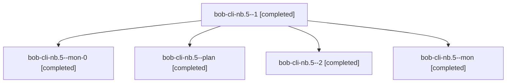

# Session: bob-cli-nb.5

[Agent Hoods](../README.md) / [bbugyi200](../users/bbugyi200/README.md) / [athena](../users/bbugyi200/machines/athena/README.md) / [bob-cli-nb](../users/bbugyi200/machines/athena/hoods/bob-cli-nb/README.md) / bob-cli-nb.5

Owner: `bbugyi200.athena` · Hood: `bob-cli-nb` · Members: 5 · Bead: [bob-cli-nb.5](https://github.com/bobs-org/bob-cli--beads/blob/main/pages/bob-cli-nb/bob-cli-nb.5.md)

## Lineage

The diagram is an optional enhancement; the ordered table below contains the same lineage in accessible text.

| Role | Agent | State | Model / provider | Timing | Commits | Prompt | Chat |
|---|---|---|---|---|---:|---|---|
| 1 | bob-cli-nb.5--1 | completed | muse-spark-1.3-contributor / muse | 2026-11-18T23:19:53.324083+00:00 → 2026-11-18T23:27:01.809393+00:00 | 0 | [Prompt](../agents/bbugyi200.athena.bob-cli-nb.5--1/prompt.md) | [Chat](../agents/bbugyi200.athena.bob-cli-nb.5--1/chat.md) |
| mon-0 | bob-cli-nb.5--mon-0 | completed | muse-spark-1.3-contributor / muse | 2026-11-18T23:25:40.759439+00:00 → 2026-11-18T23:28:08.860847+00:00 | 0 | — | [Chat](../agents/bbugyi200.athena.bob-cli-nb.5--mon-0/chat.md) |
| plan | bob-cli-nb.5--plan | completed | muse-spark-1.3-contributor / muse | 2026-11-18T22:19:37.285351+00:00 → 2026-11-18T22:28:55.030259+00:00 | 0 | [Prompt](../agents/bbugyi200.athena.bob-cli-nb.5--plan/prompt.md) | [Chat](../agents/bbugyi200.athena.bob-cli-nb.5--plan/chat.md) |
| 2 | bob-cli-nb.5--2 | completed | muse-spark-1.3-contributor / muse | 2026-11-18T23:28:08.452133+00:00 → 2026-11-18T23:31:35.669440+00:00 | [1](../agents/bbugyi200.athena.bob-cli-nb.5--2/README.md#commits) | [Prompt](../agents/bbugyi200.athena.bob-cli-nb.5--2/prompt.md) | [Chat](../agents/bbugyi200.athena.bob-cli-nb.5--2/chat.md) |
| mon | bob-cli-nb.5--mon | completed | muse-spark-1.3-contributor / muse | 2026-11-18T22:26:21.708082+00:00 → 2026-11-18T23:19:53.452951+00:00 | 0 | — | [Chat](../agents/bbugyi200.athena.bob-cli-nb.5--mon/chat.md) |

## Commits

| Role | Repo | Commit | Subject | Committed |
|---|---|---|---|---|
| 2 | bob-cli | [`a1e876c`](https://github.com/bobs-org/bob-cli/commit/a1e876cc80368d973f05a8c6c00cdab8743654dc) | docs(mac): describe bob-tick schedule replacing four cron jobs | 2026-11-18 18:30:40 EST |

## Neighbors

| Agent | Relation | State |
|---|---|---|
| [bob-cli-nb.1](bbugyi200.athena.bob-cli-nb.1.md) (session · 7) | bob-cli-nb hood | completed 5, failed 2 |
| [bob-cli-nb.2](../agents/bbugyi200.athena.bob-cli-nb.2/README.md) | bob-cli-nb hood | completed |
| [bob-cli-nb.3](../agents/bbugyi200.athena.bob-cli-nb.3/README.md) | bob-cli-nb hood | completed |
| [bob-cli-nb.4](../agents/bbugyi200.athena.bob-cli-nb.4/README.md) | bob-cli-nb hood | completed |
| [bob-cli-nb.land](../agents/bbugyi200.athena.bob-cli-nb.land/README.md) | bob-cli-nb hood | completed |
