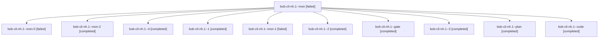

# Session: bob-cli-nh.1

[Agent Hoods](../README.md) / [bbugyi200](../users/bbugyi200/README.md) / [athena](../users/bbugyi200/machines/athena/README.md) / [bob-cli-nh](../users/bbugyi200/machines/athena/hoods/bob-cli-nh/README.md) / bob-cli-nh.1

Owner: `bbugyi200.athena` · Hood: `bob-cli-nh` · Members: 11 · Bead: [bob-cli-nh.1](https://github.com/bobs-org/bob-cli--beads/blob/main/pages/bob-cli-nh/bob-cli-nh.1.md)

## Lineage

The diagram is an optional enhancement; the ordered table below contains the same lineage in accessible text.

| Role | Agent | State | Model / provider | Timing | Commits | Prompt | Chat |
|---|---|---|---|---|---:|---|---|
| mon | bob-cli-nh.1--mon | failed | gpt-6-luna / codex | 2026-11-19T16:12:44.481748+00:00 → 2026-11-19T16:18:48.647230+00:00 | 0 | — | [Chat](../agents/bbugyi200.athena.bob-cli-nh.1--mon/chat.md) |
| mon-0 | bob-cli-nh.1--mon-0 | failed | gpt-6-luna / codex | 2026-11-19T16:26:23.269460+00:00 → 2026-11-19T16:33:11.775566+00:00 | 0 | — | [Chat](../agents/bbugyi200.athena.bob-cli-nh.1--mon-0/chat.md) |
| mon-2 | bob-cli-nh.1--mon-2 | completed | gpt-6-luna / codex | 2026-11-19T17:21:54.026513+00:00 → 2026-11-19T17:38:47.734501+00:00 | 0 | — | [Chat](../agents/bbugyi200.athena.bob-cli-nh.1--mon-2/chat.md) |
| 4 | bob-cli-nh.1--4 | completed | gpt-6-luna / codex | 2026-11-19T17:40:50.192840+00:00 → 2026-11-19T17:53:18.759058+00:00 | [1](../agents/bbugyi200.athena.bob-cli-nh.1--4/README.md#commits) | [Prompt](../agents/bbugyi200.athena.bob-cli-nh.1--4/prompt.md) | [Chat](../agents/bbugyi200.athena.bob-cli-nh.1--4/chat.md) |
| 1 | bob-cli-nh.1--1 | completed | gpt-6-luna / codex | 2026-11-19T16:18:48.189815+00:00 → 2026-11-19T16:27:59.573795+00:00 | 0 | [Prompt](../agents/bbugyi200.athena.bob-cli-nh.1--1/prompt.md) | [Chat](../agents/bbugyi200.athena.bob-cli-nh.1--1/chat.md) |
| mon-1 | bob-cli-nh.1--mon-1 | failed | gpt-6-luna / codex | 2026-11-19T16:42:59.148059+00:00 → 2026-11-19T16:55:18.819313+00:00 | 0 | — | [Chat](../agents/bbugyi200.athena.bob-cli-nh.1--mon-1/chat.md) |
| 2 | bob-cli-nh.1--2 | completed | gpt-6-luna / codex | 2026-11-19T16:33:11.666954+00:00 → 2026-11-19T16:44:14.717113+00:00 | 0 | [Prompt](../agents/bbugyi200.athena.bob-cli-nh.1--2/prompt.md) | [Chat](../agents/bbugyi200.athena.bob-cli-nh.1--2/chat.md) |
| gate | bob-cli-nh.1--gate | completed | gpt-6-astra / codex | 2026-11-19T14:43:45.697550+00:00 → 2026-11-19T14:43:52.248308+00:00 | 0 | — | [Chat](../agents/bbugyi200.athena.bob-cli-nh.1--gate/chat.md) |
| 3 | bob-cli-nh.1--3 | completed | gpt-6-luna / codex | 2026-11-19T16:55:22.182902+00:00 → 2026-11-19T17:24:46.407320+00:00 | 0 | [Prompt](../agents/bbugyi200.athena.bob-cli-nh.1--3/prompt.md) | [Chat](../agents/bbugyi200.athena.bob-cli-nh.1--3/chat.md) |
| plan | bob-cli-nh.1--plan | completed | gpt-6-astra / codex | 2026-11-19T14:37:27.441120+00:00 → 2026-11-19T16:13:52.517160+00:00 | 0 | [Prompt](../agents/bbugyi200.athena.bob-cli-nh.1--plan/prompt.md) | [Chat](../agents/bbugyi200.athena.bob-cli-nh.1--plan/chat.md) |
| code | bob-cli-nh.1--code | completed | gpt-6-luna / codex | 2026-11-19T14:44:39.928939+00:00 → 2026-11-19T16:13:52.517160+00:00 | 0 | — | [Chat](../agents/bbugyi200.athena.bob-cli-nh.1--code/chat.md) |

## Commits

| Role | Repo | Commit | Subject | Committed |
|---|---|---|---|---|
| 4 | bob-cli | [`e7aa392`](https://github.com/bobs-org/bob-cli/commit/e7aa392d688ea250ada1a6d732e3f27ed0e67c9c) | feat(intentions): add unified fields contract and readers | 2026-11-19 12:52:40 EST |

## Neighbors

| Agent | Relation | State |
|---|---|---|
| [bob-cli-nh.2](bbugyi200.athena.bob-cli-nh.2.md) (session · 3) | bob-cli-nh hood | completed 3 |
| [bob-cli-nh.2](../agents/bbugyi200.athena.bob-cli-nh.2/README.md) | bob-cli-nh hood | completed |
| [bob-cli-nh.3](bbugyi200.athena.bob-cli-nh.3.md) (session · 5) | bob-cli-nh hood | completed 5 |
| [bob-cli-nh.4](bbugyi200.athena.bob-cli-nh.4.md) (session · 3) | bob-cli-nh hood | active 1, completed 2 |
| [bob-cli-nh.4.1.1](bbugyi200.athena.bob-cli-nh.4.1.1.md) (session · 7) | bob-cli-nh hood | completed 5, failed 2 |
| [bob-cli-nh.4.1.2](../agents/bbugyi200.athena.bob-cli-nh.4.1.2/README.md) | bob-cli-nh hood | completed |
| [bob-cli-nh.4.1.3](../agents/bbugyi200.athena.bob-cli-nh.4.1.3/README.md) | bob-cli-nh hood | completed |
| [bob-cli-nh.4.1.4](bbugyi200.athena.bob-cli-nh.4.1.4.md) (session · 9) | bob-cli-nh hood | completed 5, failed 4 |
| [bob-cli-nh.4.1.land](bbugyi200.athena.bob-cli-nh.4.1.land.md) (session · 3) | bob-cli-nh hood | active 2, completed 1 |
| [bob-cli-nh.5](../agents/bbugyi200.athena.bob-cli-nh.5/README.md) | bob-cli-nh hood | completed |
| [bob-cli-nh.6](bbugyi200.athena.bob-cli-nh.6.md) (session · 3) | bob-cli-nh hood | active 1, completed 2 |
| [bob-cli-nh.6.1.1](bbugyi200.athena.bob-cli-nh.6.1.1.md) (session · 3) | bob-cli-nh hood | completed 3 |
| [bob-cli-nh.6.1.1](../agents/bbugyi200.athena.bob-cli-nh.6.1.1/README.md) | bob-cli-nh hood | completed |
| [bob-cli-nh.6.1.2](bbugyi200.athena.bob-cli-nh.6.1.2.md) (session · 5) | bob-cli-nh hood | completed 2, failed 3 |
| [bob-cli-nh.6.1.2](../agents/bbugyi200.athena.bob-cli-nh.6.1.2/README.md) | bob-cli-nh hood | completed |
| [bob-cli-nh.6.1.3](bbugyi200.athena.bob-cli-nh.6.1.3.md) (session · 7) | bob-cli-nh hood | completed 4, failed 3 |
| [bob-cli-nh.6.1.land](bbugyi200.athena.bob-cli-nh.6.1.land.md) (session · 4) | bob-cli-nh hood | active 3, completed 1 |
| [bob-cli-nh.7](../agents/bbugyi200.athena.bob-cli-nh.7/README.md) | bob-cli-nh hood | waiting |
| [bob-cli-nh.8](../agents/bbugyi200.athena.bob-cli-nh.8/README.md) | bob-cli-nh hood | waiting |
| [bob-cli-nh.9](../agents/bbugyi200.athena.bob-cli-nh.9/README.md) | bob-cli-nh hood | waiting |
| [bob-cli-nh.land](../agents/bbugyi200.athena.bob-cli-nh.land/README.md) | bob-cli-nh hood | waiting |
