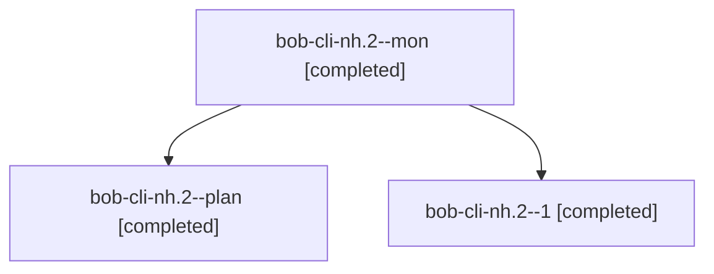

# Session: bob-cli-nh.2

[Agent Hoods](../README.md) / [bbugyi200](../users/bbugyi200/README.md) / [athena](../users/bbugyi200/machines/athena/README.md) / [bob-cli-nh](../users/bbugyi200/machines/athena/hoods/bob-cli-nh/README.md) / bob-cli-nh.2

Owner: `bbugyi200.athena` · Hood: `bob-cli-nh` · Members: 3 · Bead: [bob-cli-nh.2](https://github.com/bobs-org/bob-cli--beads/blob/main/pages/bob-cli-nh/bob-cli-nh.2.md)

## Lineage

The diagram is an optional enhancement; the ordered table below contains the same lineage in accessible text.

| Role | Agent | State | Model / provider | Timing | Commits | Prompt | Chat |
|---|---|---|---|---|---:|---|---|
| mon | bob-cli-nh.2--mon | completed | gpt-6-luna / codex | 2026-11-19T18:52:15.323948+00:00 → 2026-11-19T19:04:24.895924+00:00 | 0 | — | [Chat](../agents/bbugyi200.athena.bob-cli-nh.2--mon/chat.md) |
| plan | bob-cli-nh.2--plan | completed | gpt-6-luna / codex | 2026-11-19T17:54:10.466904+00:00 → 2026-11-19T18:54:51.333101+00:00 | 0 | [Prompt](../agents/bbugyi200.athena.bob-cli-nh.2--plan/prompt.md) | [Chat](../agents/bbugyi200.athena.bob-cli-nh.2--plan/chat.md) |
| 1 | bob-cli-nh.2--1 | completed | gpt-6-luna / codex | 2026-11-19T19:06:27.334347+00:00 → 2026-11-19T19:13:37.898176+00:00 | [1](../agents/bbugyi200.athena.bob-cli-nh.2--1/README.md#commits) | [Prompt](../agents/bbugyi200.athena.bob-cli-nh.2--1/prompt.md) | [Chat](../agents/bbugyi200.athena.bob-cli-nh.2--1/chat.md) |

## Commits

| Role | Repo | Commit | Subject | Committed |
|---|---|---|---|---|
| 1 | bob-cli | [`a0b91a8`](https://github.com/bobs-org/bob-cli/commit/a0b91a8dfcc27a24d35a6c13989559d7fc594450) | feat(periods): add guarded intention updates | 2026-11-19 14:12:26 EST |
| — | bob-cli | [`d84956c`](https://github.com/bobs-org/bob-cli/commit/d84956cc99792d370eaebe98466c677671a3bf1f) | docs(glossary): regenerate reference glossary | 2026-11-19 15:09:12 EST |

## Neighbors

| Agent | Relation | State |
|---|---|---|
| [bob-cli-nh.1](bbugyi200.athena.bob-cli-nh.1.md) (session · 11) | bob-cli-nh hood | completed 8, failed 3 |
| [bob-cli-nh.3](bbugyi200.athena.bob-cli-nh.3.md) (session · 5) | bob-cli-nh hood | completed 5 |
| [bob-cli-nh.4](bbugyi200.athena.bob-cli-nh.4.md) (session · 3) | bob-cli-nh hood | active 1, completed 2 |
| [bob-cli-nh.4.1.1](bbugyi200.athena.bob-cli-nh.4.1.1.md) (session · 7) | bob-cli-nh hood | completed 5, failed 2 |
| [bob-cli-nh.4.1.2](../agents/bbugyi200.athena.bob-cli-nh.4.1.2/README.md) | bob-cli-nh hood | completed |
| [bob-cli-nh.4.1.3](../agents/bbugyi200.athena.bob-cli-nh.4.1.3/README.md) | bob-cli-nh hood | completed |
| [bob-cli-nh.4.1.4](bbugyi200.athena.bob-cli-nh.4.1.4.md) (session · 9) | bob-cli-nh hood | completed 5, failed 4 |
| [bob-cli-nh.4.1.land](bbugyi200.athena.bob-cli-nh.4.1.land.md) (session · 3) | bob-cli-nh hood | active 2, completed 1 |
| [bob-cli-nh.5](../agents/bbugyi200.athena.bob-cli-nh.5/README.md) | bob-cli-nh hood | completed |
| [bob-cli-nh.6](bbugyi200.athena.bob-cli-nh.6.md) (session · 3) | bob-cli-nh hood | active 1, completed 2 |
| [bob-cli-nh.6.1.1](bbugyi200.athena.bob-cli-nh.6.1.1.md) (session · 3) | bob-cli-nh hood | completed 3 |
| [bob-cli-nh.6.1.1](../agents/bbugyi200.athena.bob-cli-nh.6.1.1/README.md) | bob-cli-nh hood | completed |
| [bob-cli-nh.6.1.2](bbugyi200.athena.bob-cli-nh.6.1.2.md) (session · 5) | bob-cli-nh hood | completed 2, failed 3 |
| [bob-cli-nh.6.1.2](../agents/bbugyi200.athena.bob-cli-nh.6.1.2/README.md) | bob-cli-nh hood | completed |
| [bob-cli-nh.6.1.3](bbugyi200.athena.bob-cli-nh.6.1.3.md) (session · 7) | bob-cli-nh hood | completed 4, failed 3 |
| [bob-cli-nh.6.1.land](bbugyi200.athena.bob-cli-nh.6.1.land.md) (session · 4) | bob-cli-nh hood | active 3, completed 1 |
| [bob-cli-nh.7](../agents/bbugyi200.athena.bob-cli-nh.7/README.md) | bob-cli-nh hood | waiting |
| [bob-cli-nh.8](../agents/bbugyi200.athena.bob-cli-nh.8/README.md) | bob-cli-nh hood | waiting |
| [bob-cli-nh.9](../agents/bbugyi200.athena.bob-cli-nh.9/README.md) | bob-cli-nh hood | waiting |
| [bob-cli-nh.land](../agents/bbugyi200.athena.bob-cli-nh.land/README.md) | bob-cli-nh hood | waiting |
