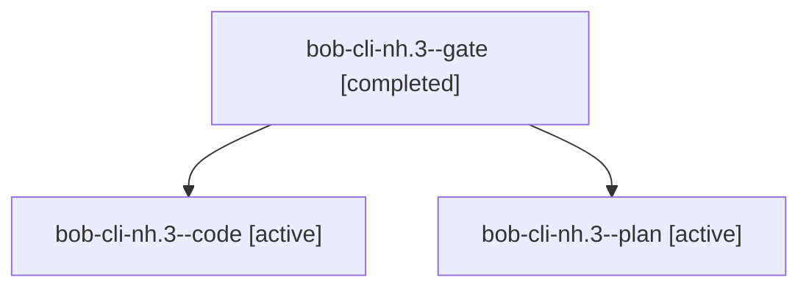

# Session: bob-cli-nh.3

[Agent Hoods](../README.md) / [bbugyi200](../users/bbugyi200/README.md) / [athena](../users/bbugyi200/machines/athena/README.md) / [bob-cli-nh](../users/bbugyi200/machines/athena/hoods/bob-cli-nh/README.md) / bob-cli-nh.3

Owner: `bbugyi200.athena` · Hood: `bob-cli-nh` · Members: 3 · Bead: [bob-cli-nh.3](https://github.com/bobs-org/bob-cli--beads/blob/main/pages/bob-cli-nh/bob-cli-nh.3.md)

## Lineage

The diagram is an optional enhancement; the ordered table below contains the same lineage in accessible text.

| Role | Agent | State | Model / provider | Timing | Commits | Prompt | Chat |
|---|---|---|---|---|---:|---|---|
| gate | bob-cli-nh.3--gate | completed | gpt-6-astra / codex | 2026-11-19T18:00:10.006913+00:00 → 2026-11-19T18:00:18.920308+00:00 | 0 | — | [Chat](../agents/bbugyi200.athena.bob-cli-nh.3--gate/chat.md) |
| code | bob-cli-nh.3--code | active | muse-spark-1.3-contributor / muse | 2026-11-19T18:02:55.412036+00:00 | 0 | — | — |
| plan | bob-cli-nh.3--plan | active | gpt-6-astra / codex | 2026-11-19T17:53:56.555610+00:00 | 0 | [Prompt](../agents/bbugyi200.athena.bob-cli-nh.3--plan/prompt.md) | [Chat](../agents/bbugyi200.athena.bob-cli-nh.3--plan/chat.md) |

## Neighbors

| Agent | Relation | State |
|---|---|---|
| [bob-cli-nh.1](bbugyi200.athena.bob-cli-nh.1.md) (session · 11) | bob-cli-nh hood | completed 8, failed 3 |
| [bob-cli-nh.2](bbugyi200.athena.bob-cli-nh.2.md) (session · 3) | bob-cli-nh hood | completed 3 |
| [bob-cli-nh.4](bbugyi200.athena.bob-cli-nh.4.md) (session · 3) | bob-cli-nh hood | active 1, completed 2 |
| [bob-cli-nh.4.1.1](bbugyi200.athena.bob-cli-nh.4.1.1.md) (session · 5) | bob-cli-nh hood | active 1, completed 2, failed 2 |
| [bob-cli-nh.4.1.2](../agents/bbugyi200.athena.bob-cli-nh.4.1.2/README.md) | bob-cli-nh hood | waiting |
| [bob-cli-nh.4.1.3](../agents/bbugyi200.athena.bob-cli-nh.4.1.3/README.md) | bob-cli-nh hood | waiting |
| [bob-cli-nh.4.1.4](../agents/bbugyi200.athena.bob-cli-nh.4.1.4/README.md) | bob-cli-nh hood | waiting |
| [bob-cli-nh.4.1.land](../agents/bbugyi200.athena.bob-cli-nh.4.1.land/README.md) | bob-cli-nh hood | waiting |
| [bob-cli-nh.5](../agents/bbugyi200.athena.bob-cli-nh.5/README.md) | bob-cli-nh hood | waiting |
| [bob-cli-nh.6](bbugyi200.athena.bob-cli-nh.6.md) (session · 3) | bob-cli-nh hood | active 1, completed 2 |
| [bob-cli-nh.6.1.1](bbugyi200.athena.bob-cli-nh.6.1.1.md) (session · 3) | bob-cli-nh hood | completed 3 |
| [bob-cli-nh.6.1.1](../agents/bbugyi200.athena.bob-cli-nh.6.1.1/README.md) | bob-cli-nh hood | completed |
| [bob-cli-nh.6.1.2](bbugyi200.athena.bob-cli-nh.6.1.2.md) (session · 5) | bob-cli-nh hood | completed 2, failed 3 |
| [bob-cli-nh.6.1.2](../agents/bbugyi200.athena.bob-cli-nh.6.1.2/README.md) | bob-cli-nh hood | completed |
| [bob-cli-nh.6.1.3](../agents/bbugyi200.athena.bob-cli-nh.6.1.3/README.md) | bob-cli-nh hood | waiting |
| [bob-cli-nh.6.1.land](../agents/bbugyi200.athena.bob-cli-nh.6.1.land/README.md) | bob-cli-nh hood | waiting |
| [bob-cli-nh.7](../agents/bbugyi200.athena.bob-cli-nh.7/README.md) | bob-cli-nh hood | waiting |
| [bob-cli-nh.8](../agents/bbugyi200.athena.bob-cli-nh.8/README.md) | bob-cli-nh hood | waiting |
| [bob-cli-nh.9](../agents/bbugyi200.athena.bob-cli-nh.9/README.md) | bob-cli-nh hood | waiting |
| [bob-cli-nh.land](../agents/bbugyi200.athena.bob-cli-nh.land/README.md) | bob-cli-nh hood | waiting |
