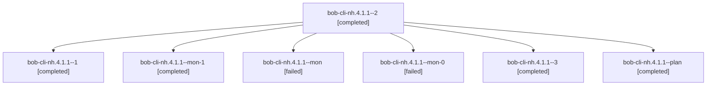

# Session: bob-cli-nh.4.1.1

[Agent Hoods](../README.md) / [bbugyi200](../users/bbugyi200/README.md) / [athena](../users/bbugyi200/machines/athena/README.md) / [bob-cli-nh](../users/bbugyi200/machines/athena/hoods/bob-cli-nh/README.md) / bob-cli-nh.4.1.1

Owner: `bbugyi200.athena` · Hood: `bob-cli-nh` · Members: 7 · Bead: [bob-cli-nh.4.1.1](https://github.com/bobs-org/bob-cli--beads/blob/main/pages/bob-cli-nh/bob-cli-nh.4.1.1.md)

## Lineage

The diagram is an optional enhancement; the ordered table below contains the same lineage in accessible text.

| Role | Agent | State | Model / provider | Timing | Commits | Prompt | Chat |
|---|---|---|---|---|---:|---|---|
| 2 | bob-cli-nh.4.1.1--2 | completed | gpt-6-luna / codex | 2026-11-19T19:38:41.898419+00:00 → 2026-11-19T19:52:47.908541+00:00 | 0 | [Prompt](../agents/bbugyi200.athena.bob-cli-nh.4.1.1--2/prompt.md) | [Chat](../agents/bbugyi200.athena.bob-cli-nh.4.1.1--2/chat.md) |
| 1 | bob-cli-nh.4.1.1--1 | completed | gpt-6-luna / codex | 2026-11-19T19:13:39.396605+00:00 → 2026-11-19T19:22:30.678001+00:00 | 0 | [Prompt](../agents/bbugyi200.athena.bob-cli-nh.4.1.1--1/prompt.md) | [Chat](../agents/bbugyi200.athena.bob-cli-nh.4.1.1--1/chat.md) |
| mon-1 | bob-cli-nh.4.1.1--mon-1 | completed | gpt-6-luna / codex | 2026-11-19T19:50:48.877748+00:00 → 2026-11-19T20:02:06.478058+00:00 | 0 | — | [Chat](../agents/bbugyi200.athena.bob-cli-nh.4.1.1--mon-1/chat.md) |
| mon | bob-cli-nh.4.1.1--mon | failed | gpt-6-luna / codex | 2026-11-19T18:59:39.047473+00:00 → 2026-11-19T19:07:39.503269+00:00 | 0 | — | [Chat](../agents/bbugyi200.athena.bob-cli-nh.4.1.1--mon/chat.md) |
| mon-0 | bob-cli-nh.4.1.1--mon-0 | failed | gpt-6-luna / codex | 2026-11-19T19:20:44.809278+00:00 → 2026-11-19T19:37:56.481969+00:00 | 0 | — | [Chat](../agents/bbugyi200.athena.bob-cli-nh.4.1.1--mon-0/chat.md) |
| 3 | bob-cli-nh.4.1.1--3 | completed | gpt-6-luna / codex | 2026-11-19T20:02:42.600903+00:00 → 2026-11-19T20:36:52.270060+00:00 | [1](../agents/bbugyi200.athena.bob-cli-nh.4.1.1--3/README.md#commits) | [Prompt](../agents/bbugyi200.athena.bob-cli-nh.4.1.1--3/prompt.md) | [Chat](../agents/bbugyi200.athena.bob-cli-nh.4.1.1--3/chat.md) |
| plan | bob-cli-nh.4.1.1--plan | completed | gpt-6-luna / codex | 2026-11-19T18:04:53.036761+00:00 → 2026-11-19T19:01:03.946189+00:00 | 0 | [Prompt](../agents/bbugyi200.athena.bob-cli-nh.4.1.1--plan/prompt.md) | [Chat](../agents/bbugyi200.athena.bob-cli-nh.4.1.1--plan/chat.md) |

## Commits

| Role | Repo | Commit | Subject | Committed |
|---|---|---|---|---|
| 3 | bob-cli | [`749efc2`](https://github.com/bobs-org/bob-cli/commit/749efc28358f0c9b8eb0314cf3d81615a66bb3b9) | feat(intentions): repair owned links during vault rewrites | 2026-11-19 15:35:22 EST |

## Neighbors

| Agent | Relation | State |
|---|---|---|
| [bob-cli-nh.4](bbugyi200.athena.bob-cli-nh.4.md) (session · 3) | ancestor | active 1, completed 2 |
| [bob-cli-nh.4.1.2](../agents/bbugyi200.athena.bob-cli-nh.4.1.2/README.md) | bob-cli-nh.4.1 hood | completed |
| [bob-cli-nh.4.1.3](../agents/bbugyi200.athena.bob-cli-nh.4.1.3/README.md) | bob-cli-nh.4.1 hood | completed |
| [bob-cli-nh.4.1.4](bbugyi200.athena.bob-cli-nh.4.1.4.md) (session · 9) | bob-cli-nh.4.1 hood | completed 5, failed 4 |
| [bob-cli-nh.4.1.land](bbugyi200.athena.bob-cli-nh.4.1.land.md) (session · 5) | bob-cli-nh.4.1 hood | completed 4, failed 1 |
| [bob-cli-nh.1](bbugyi200.athena.bob-cli-nh.1.md) (session · 11) | bob-cli-nh hood | completed 8, failed 3 |
| [bob-cli-nh.2](bbugyi200.athena.bob-cli-nh.2.md) (session · 3) | bob-cli-nh hood | completed 3 |
| [bob-cli-nh.2](../agents/bbugyi200.athena.bob-cli-nh.2/README.md) | bob-cli-nh hood | completed |
| [bob-cli-nh.3](bbugyi200.athena.bob-cli-nh.3.md) (session · 5) | bob-cli-nh hood | completed 5 |
| [bob-cli-nh.5](../agents/bbugyi200.athena.bob-cli-nh.5/README.md) | bob-cli-nh hood | completed |
| [bob-cli-nh.6](bbugyi200.athena.bob-cli-nh.6.md) (session · 3) | bob-cli-nh hood | active 1, completed 2 |
| [bob-cli-nh.6.1.1](bbugyi200.athena.bob-cli-nh.6.1.1.md) (session · 3) | bob-cli-nh hood | completed 3 |
| [bob-cli-nh.6.1.1](../agents/bbugyi200.athena.bob-cli-nh.6.1.1/README.md) | bob-cli-nh hood | completed |
| [bob-cli-nh.6.1.2](bbugyi200.athena.bob-cli-nh.6.1.2.md) (session · 5) | bob-cli-nh hood | completed 2, failed 3 |
| [bob-cli-nh.6.1.2](../agents/bbugyi200.athena.bob-cli-nh.6.1.2/README.md) | bob-cli-nh hood | completed |
| [bob-cli-nh.6.1.3](bbugyi200.athena.bob-cli-nh.6.1.3.md) (session · 7) | bob-cli-nh hood | completed 4, failed 3 |
| [bob-cli-nh.6.1.land](bbugyi200.athena.bob-cli-nh.6.1.land.md) (session · 5) | bob-cli-nh hood | completed 5 |
| [bob-cli-nh.7](bbugyi200.athena.bob-cli-nh.7.md) (session · 3) | bob-cli-nh hood | active 1, completed 2 |
| [bob-cli-nh.7.1.1](../agents/bbugyi200.athena.bob-cli-nh.7.1.1/README.md) | bob-cli-nh hood | active |
| [bob-cli-nh.7.1.2](../agents/bbugyi200.athena.bob-cli-nh.7.1.2/README.md) | bob-cli-nh hood | waiting |
| [bob-cli-nh.7.1.3](../agents/bbugyi200.athena.bob-cli-nh.7.1.3/README.md) | bob-cli-nh hood | waiting |
| [bob-cli-nh.7.1.4](../agents/bbugyi200.athena.bob-cli-nh.7.1.4/README.md) | bob-cli-nh hood | waiting |
| [bob-cli-nh.7.1.land](../agents/bbugyi200.athena.bob-cli-nh.7.1.land/README.md) | bob-cli-nh hood | waiting |
| [bob-cli-nh.8](../agents/bbugyi200.athena.bob-cli-nh.8/README.md) | bob-cli-nh hood | waiting |
| [bob-cli-nh.9](../agents/bbugyi200.athena.bob-cli-nh.9/README.md) | bob-cli-nh hood | waiting |
| [bob-cli-nh.land](../agents/bbugyi200.athena.bob-cli-nh.land/README.md) | bob-cli-nh hood | waiting |
