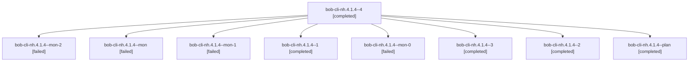

# Session: bob-cli-nh.4.1.4

[Agent Hoods](../README.md) / [bbugyi200](../users/bbugyi200/README.md) / [athena](../users/bbugyi200/machines/athena/README.md) / [bob-cli-nh](../users/bbugyi200/machines/athena/hoods/bob-cli-nh/README.md) / bob-cli-nh.4.1.4

Owner: `bbugyi200.athena` · Hood: `bob-cli-nh` · Members: 9 · Bead: [bob-cli-nh.4.1.4](https://github.com/bobs-org/bob-cli--beads/blob/main/pages/bob-cli-nh/bob-cli-nh.4.1.4.md)

## Lineage

The diagram is an optional enhancement; the ordered table below contains the same lineage in accessible text.

| Role | Agent | State | Model / provider | Timing | Commits | Prompt | Chat |
|---|---|---|---|---|---:|---|---|
| 4 | bob-cli-nh.4.1.4--4 | completed | gpt-6-luna / codex | 2026-11-19T22:07:45.074417+00:00 → 2026-11-19T22:20:02.495397+00:00 | [1](../agents/bbugyi200.athena.bob-cli-nh.4.1.4--4/README.md#commits) | [Prompt](../agents/bbugyi200.athena.bob-cli-nh.4.1.4--4/prompt.md) | [Chat](../agents/bbugyi200.athena.bob-cli-nh.4.1.4--4/chat.md) |
| mon-2 | bob-cli-nh.4.1.4--mon-2 | failed | gpt-6-luna / codex | 2026-11-19T21:55:01.331746+00:00 → 2026-11-19T22:07:45.311653+00:00 | 0 | — | [Chat](../agents/bbugyi200.athena.bob-cli-nh.4.1.4--mon-2/chat.md) |
| mon | bob-cli-nh.4.1.4--mon | failed | gpt-6-luna / codex | 2026-11-19T21:09:08.443222+00:00 → 2026-11-19T21:16:46.034316+00:00 | 0 | — | [Chat](../agents/bbugyi200.athena.bob-cli-nh.4.1.4--mon/chat.md) |
| mon-1 | bob-cli-nh.4.1.4--mon-1 | failed | gpt-6-luna / codex | 2026-11-19T21:41:40.875364+00:00 → 2026-11-19T21:50:28.275218+00:00 | 0 | — | [Chat](../agents/bbugyi200.athena.bob-cli-nh.4.1.4--mon-1/chat.md) |
| 1 | bob-cli-nh.4.1.4--1 | completed | gpt-6-luna / codex | 2026-11-19T21:16:45.619365+00:00 → 2026-11-19T21:28:04.237510+00:00 | 0 | [Prompt](../agents/bbugyi200.athena.bob-cli-nh.4.1.4--1/prompt.md) | [Chat](../agents/bbugyi200.athena.bob-cli-nh.4.1.4--1/chat.md) |
| mon-0 | bob-cli-nh.4.1.4--mon-0 | failed | gpt-6-luna / codex | 2026-11-19T21:26:59.417376+00:00 → 2026-11-19T21:33:18.776214+00:00 | 0 | — | [Chat](../agents/bbugyi200.athena.bob-cli-nh.4.1.4--mon-0/chat.md) |
| 3 | bob-cli-nh.4.1.4--3 | completed | gpt-6-luna / codex | 2026-11-19T21:50:28.023631+00:00 → 2026-11-19T21:56:23.716916+00:00 | 0 | [Prompt](../agents/bbugyi200.athena.bob-cli-nh.4.1.4--3/prompt.md) | [Chat](../agents/bbugyi200.athena.bob-cli-nh.4.1.4--3/chat.md) |
| 2 | bob-cli-nh.4.1.4--2 | completed | gpt-6-luna / codex | 2026-11-19T21:33:18.525144+00:00 → 2026-11-19T21:42:23.247482+00:00 | 0 | [Prompt](../agents/bbugyi200.athena.bob-cli-nh.4.1.4--2/prompt.md) | [Chat](../agents/bbugyi200.athena.bob-cli-nh.4.1.4--2/chat.md) |
| plan | bob-cli-nh.4.1.4--plan | completed | gpt-6-luna / codex | 2026-11-19T20:37:37.112973+00:00 → 2026-11-19T21:11:38.506593+00:00 | 0 | [Prompt](../agents/bbugyi200.athena.bob-cli-nh.4.1.4--plan/prompt.md) | [Chat](../agents/bbugyi200.athena.bob-cli-nh.4.1.4--plan/chat.md) |

## Commits

| Role | Repo | Commit | Subject | Committed |
|---|---|---|---|---|
| 4 | bob-cli | [`992fd33`](https://github.com/bobs-org/bob-cli/commit/992fd33d72dcb0d0b80382666a73da94559322c1) | feat(periods): report legacy and malformed intention findings | 2026-11-19 17:19:17 EST |

## Neighbors

| Agent | Relation | State |
|---|---|---|
| [bob-cli-nh.4](bbugyi200.athena.bob-cli-nh.4.md) (session · 3) | ancestor | active 1, completed 2 |
| [bob-cli-nh.4.1.1](bbugyi200.athena.bob-cli-nh.4.1.1.md) (session · 7) | bob-cli-nh.4.1 hood | completed 5, failed 2 |
| [bob-cli-nh.4.1.2](../agents/bbugyi200.athena.bob-cli-nh.4.1.2/README.md) | bob-cli-nh.4.1 hood | completed |
| [bob-cli-nh.4.1.3](../agents/bbugyi200.athena.bob-cli-nh.4.1.3/README.md) | bob-cli-nh.4.1 hood | completed |
| [bob-cli-nh.4.1.land](bbugyi200.athena.bob-cli-nh.4.1.land.md) (session · 5) | bob-cli-nh.4.1 hood | completed 4, failed 1 |
| [bob-cli-nh.1](bbugyi200.athena.bob-cli-nh.1.md) (session · 11) | bob-cli-nh hood | completed 8, failed 3 |
| [bob-cli-nh.2](bbugyi200.athena.bob-cli-nh.2.md) (session · 3) | bob-cli-nh hood | completed 3 |
| [bob-cli-nh.2](../agents/bbugyi200.athena.bob-cli-nh.2/README.md) | bob-cli-nh hood | completed |
| [bob-cli-nh.3](bbugyi200.athena.bob-cli-nh.3.md) (session · 5) | bob-cli-nh hood | completed 5 |
| [bob-cli-nh.5](../agents/bbugyi200.athena.bob-cli-nh.5/README.md) | bob-cli-nh hood | completed |
| [bob-cli-nh.6](bbugyi200.athena.bob-cli-nh.6.md) (session · 3) | bob-cli-nh hood | active 1, completed 2 |
| [bob-cli-nh.6.1.1](bbugyi200.athena.bob-cli-nh.6.1.1.md) (session · 3) | bob-cli-nh hood | completed 3 |
| [bob-cli-nh.6.1.1](../agents/bbugyi200.athena.bob-cli-nh.6.1.1/README.md) | bob-cli-nh hood | completed |
| [bob-cli-nh.6.1.2](bbugyi200.athena.bob-cli-nh.6.1.2.md) (session · 5) | bob-cli-nh hood | completed 2, failed 3 |
| [bob-cli-nh.6.1.2](../agents/bbugyi200.athena.bob-cli-nh.6.1.2/README.md) | bob-cli-nh hood | completed |
| [bob-cli-nh.6.1.3](bbugyi200.athena.bob-cli-nh.6.1.3.md) (session · 7) | bob-cli-nh hood | completed 4, failed 3 |
| [bob-cli-nh.6.1.land](bbugyi200.athena.bob-cli-nh.6.1.land.md) (session · 5) | bob-cli-nh hood | completed 5 |
| [bob-cli-nh.7](bbugyi200.athena.bob-cli-nh.7.md) (session · 3) | bob-cli-nh hood | active 1, completed 2 |
| [bob-cli-nh.7.1.1](bbugyi200.athena.bob-cli-nh.7.1.1.md) (session · 7) | bob-cli-nh hood | completed 4, failed 3 |
| [bob-cli-nh.7.1.2](../agents/bbugyi200.athena.bob-cli-nh.7.1.2/README.md) | bob-cli-nh hood | completed |
| [bob-cli-nh.7.1.3](../agents/bbugyi200.athena.bob-cli-nh.7.1.3/README.md) | bob-cli-nh hood | completed |
| [bob-cli-nh.7.1.4](../agents/bbugyi200.athena.bob-cli-nh.7.1.4/README.md) | bob-cli-nh hood | completed |
| [bob-cli-nh.7.1.land](bbugyi200.athena.bob-cli-nh.7.1.land.md) (session · 3) | bob-cli-nh hood | completed 3 |
| [bob-cli-nh.8](../agents/bbugyi200.athena.bob-cli-nh.8/README.md) | bob-cli-nh hood | waiting |
| [bob-cli-nh.9](../agents/bbugyi200.athena.bob-cli-nh.9/README.md) | bob-cli-nh hood | completed |
| [bob-cli-nh.land](../agents/bbugyi200.athena.bob-cli-nh.land/README.md) | bob-cli-nh hood | waiting |
