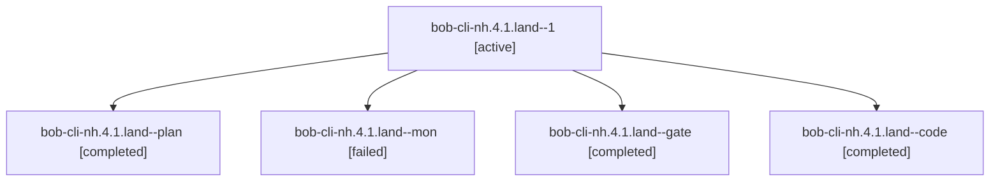

# Session: bob-cli-nh.4.1.land

[Agent Hoods](../README.md) / [bbugyi200](../users/bbugyi200/README.md) / [athena](../users/bbugyi200/machines/athena/README.md) / [bob-cli-nh](../users/bbugyi200/machines/athena/hoods/bob-cli-nh/README.md) / bob-cli-nh.4.1.land

Owner: `bbugyi200.athena` · Hood: `bob-cli-nh` · Members: 5 · Bead: [bob-cli-nh.4.1](https://github.com/bobs-org/bob-cli--beads/blob/main/pages/bob-cli-nh/bob-cli-nh.4.1.md)

## Lineage

The diagram is an optional enhancement; the ordered table below contains the same lineage in accessible text.

| Role | Agent | State | Model / provider | Timing | Commits | Prompt | Chat |
|---|---|---|---|---|---:|---|---|
| 1 | bob-cli-nh.4.1.land--1 | active | gpt-6-luna / codex | 2026-11-19T23:26:19.763366+00:00 | 0 | [Prompt](../agents/bbugyi200.athena.bob-cli-nh.4.1.land--1/prompt.md) | — |
| plan | bob-cli-nh.4.1.land--plan | completed | gpt-6-astra / codex | 2026-11-19T22:27:30.834380+00:00 → 2026-11-19T23:21:19.207037+00:00 | [1](../agents/bbugyi200.athena.bob-cli-nh.4.1.land--plan/README.md#commits) | [Prompt](../agents/bbugyi200.athena.bob-cli-nh.4.1.land--plan/prompt.md) | [Chat](../agents/bbugyi200.athena.bob-cli-nh.4.1.land--plan/chat.md) |
| mon | bob-cli-nh.4.1.land--mon | failed | gpt-6-luna / codex | 2026-11-19T23:19:00.438836+00:00 → 2026-11-19T23:25:55.881004+00:00 | 0 | — | [Chat](../agents/bbugyi200.athena.bob-cli-nh.4.1.land--mon/chat.md) |
| gate | bob-cli-nh.4.1.land--gate | completed | gpt-6-astra / codex | 2026-11-19T22:39:00.404855+00:00 → 2026-11-19T22:39:06.386178+00:00 | 0 | — | [Chat](../agents/bbugyi200.athena.bob-cli-nh.4.1.land--gate/chat.md) |
| code | bob-cli-nh.4.1.land--code | completed | gpt-6-luna / codex | 2026-11-19T22:39:39.966240+00:00 → 2026-11-19T23:21:19.207037+00:00 | 0 | — | [Chat](../agents/bbugyi200.athena.bob-cli-nh.4.1.land--code/chat.md) |

## Commits

| Role | Repo | Commit | Subject | Committed |
|---|---|---|---|---|
| plan | bob-cli | [`8bbb304`](https://github.com/bobs-org/bob-cli/commit/8bbb3041cd33412e67f297c0e481534e927b0b3f) | feat(intentions): recover task rewrite integration | 2026-11-19 17:38:16 EST |

## Neighbors

| Agent | Relation | State |
|---|---|---|
| [bob-cli-nh.4](bbugyi200.athena.bob-cli-nh.4.md) (session · 3) | ancestor | active 1, completed 2 |
| [bob-cli-nh.4.1.1](bbugyi200.athena.bob-cli-nh.4.1.1.md) (session · 7) | bob-cli-nh.4.1 hood | completed 5, failed 2 |
| [bob-cli-nh.4.1.2](../agents/bbugyi200.athena.bob-cli-nh.4.1.2/README.md) | bob-cli-nh.4.1 hood | completed |
| [bob-cli-nh.4.1.3](../agents/bbugyi200.athena.bob-cli-nh.4.1.3/README.md) | bob-cli-nh.4.1 hood | completed |
| [bob-cli-nh.4.1.4](bbugyi200.athena.bob-cli-nh.4.1.4.md) (session · 9) | bob-cli-nh.4.1 hood | completed 5, failed 4 |
| [bob-cli-nh.1](bbugyi200.athena.bob-cli-nh.1.md) (session · 11) | bob-cli-nh hood | completed 8, failed 3 |
| [bob-cli-nh.2](bbugyi200.athena.bob-cli-nh.2.md) (session · 3) | bob-cli-nh hood | completed 3 |
| [bob-cli-nh.2](../agents/bbugyi200.athena.bob-cli-nh.2/README.md) | bob-cli-nh hood | completed |
| [bob-cli-nh.3](bbugyi200.athena.bob-cli-nh.3.md) (session · 5) | bob-cli-nh hood | completed 5 |
| [bob-cli-nh.5](../agents/bbugyi200.athena.bob-cli-nh.5/README.md) | bob-cli-nh hood | completed |
| [bob-cli-nh.6](bbugyi200.athena.bob-cli-nh.6.md) (session · 3) | bob-cli-nh hood | active 1, completed 2 |
| [bob-cli-nh.6.1.1](bbugyi200.athena.bob-cli-nh.6.1.1.md) (session · 3) | bob-cli-nh hood | completed 3 |
| [bob-cli-nh.6.1.1](../agents/bbugyi200.athena.bob-cli-nh.6.1.1/README.md) | bob-cli-nh hood | completed |
| [bob-cli-nh.6.1.2](bbugyi200.athena.bob-cli-nh.6.1.2.md) (session · 5) | bob-cli-nh hood | completed 2, failed 3 |
| [bob-cli-nh.6.1.2](../agents/bbugyi200.athena.bob-cli-nh.6.1.2/README.md) | bob-cli-nh hood | completed |
| [bob-cli-nh.6.1.3](bbugyi200.athena.bob-cli-nh.6.1.3.md) (session · 7) | bob-cli-nh hood | completed 4, failed 3 |
| [bob-cli-nh.6.1.land](bbugyi200.athena.bob-cli-nh.6.1.land.md) (session · 5) | bob-cli-nh hood | completed 5 |
| [bob-cli-nh.7](bbugyi200.athena.bob-cli-nh.7.md) (session · 3) | bob-cli-nh hood | active 1, completed 2 |
| [bob-cli-nh.7.1.1](../agents/bbugyi200.athena.bob-cli-nh.7.1.1/README.md) | bob-cli-nh hood | active |
| [bob-cli-nh.7.1.2](../agents/bbugyi200.athena.bob-cli-nh.7.1.2/README.md) | bob-cli-nh hood | waiting |
| [bob-cli-nh.7.1.3](../agents/bbugyi200.athena.bob-cli-nh.7.1.3/README.md) | bob-cli-nh hood | waiting |
| [bob-cli-nh.7.1.4](../agents/bbugyi200.athena.bob-cli-nh.7.1.4/README.md) | bob-cli-nh hood | waiting |
| [bob-cli-nh.7.1.land](../agents/bbugyi200.athena.bob-cli-nh.7.1.land/README.md) | bob-cli-nh hood | waiting |
| [bob-cli-nh.8](../agents/bbugyi200.athena.bob-cli-nh.8/README.md) | bob-cli-nh hood | waiting |
| [bob-cli-nh.9](../agents/bbugyi200.athena.bob-cli-nh.9/README.md) | bob-cli-nh hood | waiting |
| [bob-cli-nh.land](../agents/bbugyi200.athena.bob-cli-nh.land/README.md) | bob-cli-nh hood | waiting |
