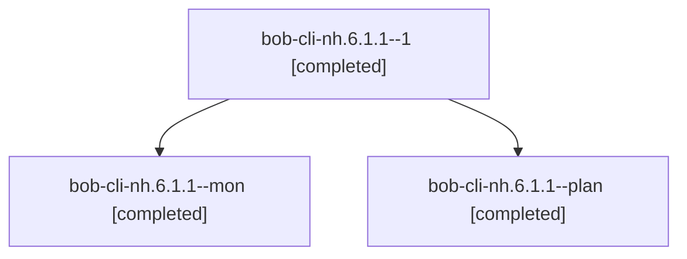

# Session: bob-cli-nh.6.1.1

[Agent Hoods](../README.md) / [bbugyi200](../users/bbugyi200/README.md) / [athena](../users/bbugyi200/machines/athena/README.md) / [bob-cli-nh](../users/bbugyi200/machines/athena/hoods/bob-cli-nh/README.md) / bob-cli-nh.6.1.1

Owner: `bbugyi200.athena` · Hood: `bob-cli-nh` · Members: 3 · Bead: [bob-cli-nh.6.1.1](https://github.com/bobs-org/bob-cli--beads/blob/main/pages/bob-cli-nh/bob-cli-nh.6.1.1.md)

## Lineage



The diagram is an optional enhancement; the ordered table below contains the same lineage in accessible text.

| Role | Agent | State | Model / provider | Timing | Commits | Prompt | Chat |
|---|---|---|---|---|---:|---|---|
| <a id="member-1"></a>1 | bob-cli-nh.6.1.1--1 | completed | opus / claude | 2026-11-19T16:34:01.530329+00:00 → 2026-11-19T16:35:09.488626+00:00 | 0 | [Prompt](../agents/bbugyi200.athena.bob-cli-nh.6.1.1--1/prompt.md) | [Chat](../agents/bbugyi200.athena.bob-cli-nh.6.1.1--1/chat.md) |
| <a id="member-mon"></a>mon | bob-cli-nh.6.1.1--mon | completed | opus / claude | 2026-11-19T16:31:20.374697+00:00 → 2026-11-19T16:34:01.808198+00:00 | 0 | — | [Chat](../agents/bbugyi200.athena.bob-cli-nh.6.1.1--mon/chat.md) |
| <a id="member-plan"></a>plan | bob-cli-nh.6.1.1--plan | completed | opus / claude | 2026-11-19T15:33:21.512481+00:00 → 2026-11-19T16:32:41.227373+00:00 | 0 | [Prompt](../agents/bbugyi200.athena.bob-cli-nh.6.1.1--plan/prompt.md) | [Chat](../agents/bbugyi200.athena.bob-cli-nh.6.1.1--plan/chat.md) |

## Variables

| Role | Variable | Value |
|---|---|---|
| plan | `artifacts` | \[{bead: bob-cli-nh.6.1.1, kind: markdown, label: Property-card kit ownership acceptance summary (nh.6.1.1), path: /home/bryan/.sase/artifacts/agents/gh\_bobs-org\_\_bob-cli/20261119103240/property-card-… |

#### artifacts

**Role:** `plan`

```yaml
- bead: bob-cli-nh.6.1.1
  kind: markdown
  label: Property-card kit ownership acceptance summary (nh.6.1.1)
  path: /home/bryan/.sase/artifacts/agents/gh_bobs-org__bob-cli/20261119103240/property-card-kit-ownership-acceptance-67b061815ffd.md
  ref: file:explicit:5366ba3f1c91e381b416eb0b
  source_path: /tmp/nh611-e2e/out/property-card-kit-ownership-acceptance.md
- bead: bob-cli-nh.6.1.1
  kind: file
  label: Property-card kit baseline e2e reports+screenshots (bob-plugins 36d4801)
  path: /home/bryan/.sase/artifacts/agents/gh_bobs-org__bob-cli/20261119103240/property-card-kit-baseline-36d4801-f568a231b276.tgz
  ref: file:explicit:d19bd1571d8869c3fbd0f94c
  source_path: /tmp/nh611-e2e/out/property-card-kit-baseline-36d4801.tgz
- bead: bob-cli-nh.6.1.1
  kind: file
  label: Property-card kit ownership final e2e reports+screenshots
  path: /home/bryan/.sase/artifacts/agents/gh_bobs-org__bob-cli/20261119103240/property-card-kit-ownership-final-23907d96ccc5.tgz
  ref: file:explicit:6ef537cd9927c600b96c5526
  source_path: /tmp/nh611-e2e/out/property-card-kit-ownership-final.tgz
```

Values are truncated for display; see each member's agent meta.json for the full values.

## Neighbors

| Agent | Relation | State |
|---|---|---|
| [bob-cli-nh.6](bbugyi200.athena.bob-cli-nh.6.md) (session · 3) | ancestor | active 1, completed 2 |
| [bob-cli-nh.6.1.2](bbugyi200.athena.bob-cli-nh.6.1.2.md) (session · 5) | bob-cli-nh.6.1 hood | completed 2, failed 3 |
| [bob-cli-nh.6.1.2](../agents/bbugyi200.athena.bob-cli-nh.6.1.2/README.md) | bob-cli-nh.6.1 hood | completed |
| [bob-cli-nh.6.1.3](bbugyi200.athena.bob-cli-nh.6.1.3.md) (session · 7) | bob-cli-nh.6.1 hood | active 1, completed 3, failed 3 |
| [bob-cli-nh.6.1.land](../agents/bbugyi200.athena.bob-cli-nh.6.1.land/README.md) | bob-cli-nh.6.1 hood | waiting |
| [bob-cli-nh.1](bbugyi200.athena.bob-cli-nh.1.md) (session · 11) | bob-cli-nh hood | completed 8, failed 3 |
| [bob-cli-nh.2](bbugyi200.athena.bob-cli-nh.2.md) (session · 3) | bob-cli-nh hood | completed 3 |
| [bob-cli-nh.2](../agents/bbugyi200.athena.bob-cli-nh.2/README.md) | bob-cli-nh hood | completed |
| [bob-cli-nh.3](bbugyi200.athena.bob-cli-nh.3.md) (session · 5) | bob-cli-nh hood | completed 5 |
| [bob-cli-nh.4](bbugyi200.athena.bob-cli-nh.4.md) (session · 3) | bob-cli-nh hood | active 1, completed 2 |
| [bob-cli-nh.4.1.1](bbugyi200.athena.bob-cli-nh.4.1.1.md) (session · 7) | bob-cli-nh hood | completed 5, failed 2 |
| [bob-cli-nh.4.1.2](../agents/bbugyi200.athena.bob-cli-nh.4.1.2/README.md) | bob-cli-nh hood | waiting |
| [bob-cli-nh.4.1.3](../agents/bbugyi200.athena.bob-cli-nh.4.1.3/README.md) | bob-cli-nh hood | completed |
| [bob-cli-nh.4.1.4](bbugyi200.athena.bob-cli-nh.4.1.4.md) (session · 9) | bob-cli-nh hood | active 1, completed 4, failed 4 |
| [bob-cli-nh.4.1.land](../agents/bbugyi200.athena.bob-cli-nh.4.1.land/README.md) | bob-cli-nh hood | waiting |
| [bob-cli-nh.5](../agents/bbugyi200.athena.bob-cli-nh.5/README.md) | bob-cli-nh hood | waiting |
| [bob-cli-nh.7](../agents/bbugyi200.athena.bob-cli-nh.7/README.md) | bob-cli-nh hood | waiting |
| [bob-cli-nh.8](../agents/bbugyi200.athena.bob-cli-nh.8/README.md) | bob-cli-nh hood | waiting |
| [bob-cli-nh.9](../agents/bbugyi200.athena.bob-cli-nh.9/README.md) | bob-cli-nh hood | waiting |
| [bob-cli-nh.land](../agents/bbugyi200.athena.bob-cli-nh.land/README.md) | bob-cli-nh hood | waiting |
