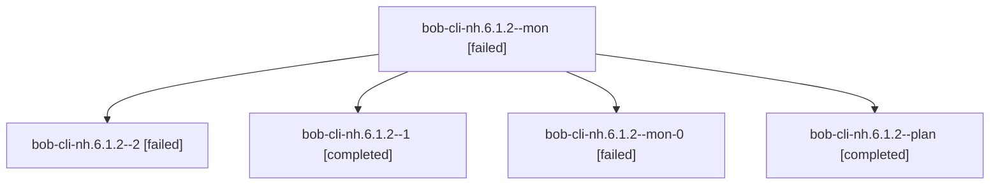

# Session: bob-cli-nh.6.1.2

[Agent Hoods](../README.md) / [bbugyi200](../users/bbugyi200/README.md) / [athena](../users/bbugyi200/machines/athena/README.md) / [bob-cli-nh](../users/bbugyi200/machines/athena/hoods/bob-cli-nh/README.md) / bob-cli-nh.6.1.2

Owner: `bbugyi200.athena` · Hood: `bob-cli-nh` · Members: 5 · Bead: [bob-cli-nh.6.1.2](https://github.com/bobs-org/bob-cli--beads/blob/main/pages/bob-cli-nh/bob-cli-nh.6.1.2.md)

## Lineage

The diagram is an optional enhancement; the ordered table below contains the same lineage in accessible text.

| Role | Agent | State | Model / provider | Timing | Commits | Prompt | Chat |
|---|---|---|---|---|---:|---|---|
| mon | bob-cli-nh.6.1.2--mon | failed | grok-4.6 / grok | 2026-11-19T17:08:47.665606+00:00 → 2026-11-19T17:17:29.696623+00:00 | 0 | — | [Chat](../agents/bbugyi200.athena.bob-cli-nh.6.1.2--mon/chat.md) |
| 2 | bob-cli-nh.6.1.2--2 | failed | grok-4.6 / grok | 2026-11-19T17:37:32.522451+00:00 → 2026-11-19T17:48:53.843367+00:00 | 0 | [Prompt](../agents/bbugyi200.athena.bob-cli-nh.6.1.2--2/prompt.md) | — |
| 1 | bob-cli-nh.6.1.2--1 | completed | grok-4.6 / grok | 2026-11-19T17:20:29.127640+00:00 → 2026-11-19T17:30:48.385657+00:00 | 0 | [Prompt](../agents/bbugyi200.athena.bob-cli-nh.6.1.2--1/prompt.md) | [Chat](../agents/bbugyi200.athena.bob-cli-nh.6.1.2--1/chat.md) |
| mon-0 | bob-cli-nh.6.1.2--mon-0 | failed | grok-4.6 / grok | 2026-11-19T17:28:18.464393+00:00 → 2026-11-19T17:36:12.745877+00:00 | 0 | — | [Chat](../agents/bbugyi200.athena.bob-cli-nh.6.1.2--mon-0/chat.md) |
| plan | bob-cli-nh.6.1.2--plan | completed | grok-4.6 / grok | 2026-11-19T16:42:34.383911+00:00 → 2026-11-19T17:10:25.603539+00:00 | 0 | [Prompt](../agents/bbugyi200.athena.bob-cli-nh.6.1.2--plan/prompt.md) | [Chat](../agents/bbugyi200.athena.bob-cli-nh.6.1.2--plan/chat.md) |

## Neighbors

| Agent | Relation | State |
|---|---|---|
| [bob-cli-nh.6](bbugyi200.athena.bob-cli-nh.6.md) (session · 3) | ancestor | active 1, completed 2 |
| [bob-cli-nh.6.1.1](bbugyi200.athena.bob-cli-nh.6.1.1.md) (session · 3) | bob-cli-nh.6.1 hood | completed 3 |
| [bob-cli-nh.6.1.1](../agents/bbugyi200.athena.bob-cli-nh.6.1.1/README.md) | bob-cli-nh.6.1 hood | completed |
| [bob-cli-nh.6.1.3](bbugyi200.athena.bob-cli-nh.6.1.3.md) (session · 7) | bob-cli-nh.6.1 hood | completed 4, failed 3 |
| [bob-cli-nh.6.1.land](bbugyi200.athena.bob-cli-nh.6.1.land.md) (session · 4) | bob-cli-nh.6.1 hood | active 3, completed 1 |
| [bob-cli-nh.1](bbugyi200.athena.bob-cli-nh.1.md) (session · 11) | bob-cli-nh hood | completed 8, failed 3 |
| [bob-cli-nh.2](bbugyi200.athena.bob-cli-nh.2.md) (session · 3) | bob-cli-nh hood | completed 3 |
| [bob-cli-nh.2](../agents/bbugyi200.athena.bob-cli-nh.2/README.md) | bob-cli-nh hood | completed |
| [bob-cli-nh.3](bbugyi200.athena.bob-cli-nh.3.md) (session · 5) | bob-cli-nh hood | completed 5 |
| [bob-cli-nh.4](bbugyi200.athena.bob-cli-nh.4.md) (session · 3) | bob-cli-nh hood | active 1, completed 2 |
| [bob-cli-nh.4.1.1](bbugyi200.athena.bob-cli-nh.4.1.1.md) (session · 7) | bob-cli-nh hood | completed 5, failed 2 |
| [bob-cli-nh.4.1.2](../agents/bbugyi200.athena.bob-cli-nh.4.1.2/README.md) | bob-cli-nh hood | completed |
| [bob-cli-nh.4.1.3](../agents/bbugyi200.athena.bob-cli-nh.4.1.3/README.md) | bob-cli-nh hood | completed |
| [bob-cli-nh.4.1.4](bbugyi200.athena.bob-cli-nh.4.1.4.md) (session · 9) | bob-cli-nh hood | completed 5, failed 4 |
| [bob-cli-nh.4.1.land](bbugyi200.athena.bob-cli-nh.4.1.land.md) (session · 3) | bob-cli-nh hood | active 2, completed 1 |
| [bob-cli-nh.5](../agents/bbugyi200.athena.bob-cli-nh.5/README.md) | bob-cli-nh hood | completed |
| [bob-cli-nh.7](../agents/bbugyi200.athena.bob-cli-nh.7/README.md) | bob-cli-nh hood | waiting |
| [bob-cli-nh.8](../agents/bbugyi200.athena.bob-cli-nh.8/README.md) | bob-cli-nh hood | waiting |
| [bob-cli-nh.9](../agents/bbugyi200.athena.bob-cli-nh.9/README.md) | bob-cli-nh hood | waiting |
| [bob-cli-nh.land](../agents/bbugyi200.athena.bob-cli-nh.land/README.md) | bob-cli-nh hood | waiting |
