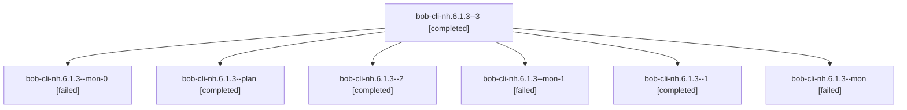

# Session: bob-cli-nh.6.1.3

[Agent Hoods](../README.md) / [bbugyi200](../users/bbugyi200/README.md) / [athena](../users/bbugyi200/machines/athena/README.md) / [bob-cli-nh](../users/bbugyi200/machines/athena/hoods/bob-cli-nh/README.md) / bob-cli-nh.6.1.3

Owner: `bbugyi200.athena` · Hood: `bob-cli-nh` · Members: 7 · Bead: [bob-cli-nh.6.1.3](https://github.com/bobs-org/bob-cli--beads/blob/main/pages/bob-cli-nh/bob-cli-nh.6.1.3.md)

## Lineage



The diagram is an optional enhancement; the ordered table below contains the same lineage in accessible text.

| Role | Agent | State | Model / provider | Timing | Commits | Prompt | Chat |
|---|---|---|---|---|---:|---|---|
| <a id="member-3"></a>3 | bob-cli-nh.6.1.3--3 | completed | gpt-6-luna / codex | 2026-11-19T21:04:06.765636+00:00 → 2026-11-19T22:20:07.591939+00:00 | 0 | [Prompt](../agents/bbugyi200.athena.bob-cli-nh.6.1.3--3/prompt.md) | [Chat](../agents/bbugyi200.athena.bob-cli-nh.6.1.3--3/chat.md) |
| <a id="member-mon-0"></a>mon-0 | bob-cli-nh.6.1.3--mon-0 | failed | gpt-6-luna / codex | 2026-11-19T20:34:09.048723+00:00 → 2026-11-19T20:40:24.882656+00:00 | 0 | — | [Chat](../agents/bbugyi200.athena.bob-cli-nh.6.1.3--mon-0/chat.md) |
| <a id="member-plan"></a>plan | bob-cli-nh.6.1.3--plan | completed | gpt-6-luna / codex | 2026-11-19T19:44:00.395083+00:00 → 2026-11-19T20:22:29.524428+00:00 | 0 | [Prompt](../agents/bbugyi200.athena.bob-cli-nh.6.1.3--plan/prompt.md) | [Chat](../agents/bbugyi200.athena.bob-cli-nh.6.1.3--plan/chat.md) |
| <a id="member-2"></a>2 | bob-cli-nh.6.1.3--2 | completed | gpt-6-luna / codex | 2026-11-19T20:40:24.844888+00:00 → 2026-11-19T20:51:57.395984+00:00 | 0 | [Prompt](../agents/bbugyi200.athena.bob-cli-nh.6.1.3--2/prompt.md) | [Chat](../agents/bbugyi200.athena.bob-cli-nh.6.1.3--2/chat.md) |
| <a id="member-mon-1"></a>mon-1 | bob-cli-nh.6.1.3--mon-1 | failed | gpt-6-luna / codex | 2026-11-19T20:50:21.292030+00:00 → 2026-11-19T20:58:49.045402+00:00 | 0 | — | [Chat](../agents/bbugyi200.athena.bob-cli-nh.6.1.3--mon-1/chat.md) |
| <a id="member-1"></a>1 | bob-cli-nh.6.1.3--1 | completed | gpt-6-luna / codex | 2026-11-19T20:25:16.421042+00:00 → 2026-11-19T20:34:55.327639+00:00 | 0 | [Prompt](../agents/bbugyi200.athena.bob-cli-nh.6.1.3--1/prompt.md) | [Chat](../agents/bbugyi200.athena.bob-cli-nh.6.1.3--1/chat.md) |
| <a id="member-mon"></a>mon | bob-cli-nh.6.1.3--mon | failed | gpt-6-luna / codex | 2026-11-19T20:21:36.078477+00:00 → 2026-11-19T20:25:16.931016+00:00 | 0 | — | [Chat](../agents/bbugyi200.athena.bob-cli-nh.6.1.3--mon/chat.md) |

## Variables

| Role | Variable | Value |
|---|---|---|
| 3 | `artifacts` | \[{bead: bob-cli-nh.6.1.3, kind: file, label: Final property-card acceptance evidence bundle (reports, screenshots, logs, provenance, comparison), path: /home/bryan/.sase/artifacts/agents/gh\_bobs-org\_… |

#### artifacts

**Role:** `3`

```yaml
- bead: bob-cli-nh.6.1.3
  kind: file
  label: Final property-card acceptance evidence bundle (reports, screenshots, logs, provenance, comparison)
  path: /home/bryan/.sase/artifacts/agents/gh_bobs-org__bob-cli/20261119155747/nh613-final-evidence-4b80713fa1b6.tgz
  ref: file:explicit:a50033287bd8564938d9063a
  source_path: /tmp/nh613-final-evidence.tgz
- bead: bob-cli-nh.6.1.3
  kind: markdown
  label: Final property-card acceptance comparison and status
  path: /home/bryan/.sase/artifacts/agents/gh_bobs-org__bob-cli/20261119155747/README-15b5e7f0c4d3.md
  ref: file:explicit:57b7adc6f806ce185b185519
  source_path: /tmp/nh613-final-evidence/README.md
```

Values are truncated for display; see each member's agent meta.json for the full values.

## Neighbors

| Agent | Relation | State |
|---|---|---|
| [bob-cli-nh.6](bbugyi200.athena.bob-cli-nh.6.md) (session · 3) | ancestor | active 1, completed 2 |
| [bob-cli-nh.6.1.1](bbugyi200.athena.bob-cli-nh.6.1.1.md) (session · 3) | bob-cli-nh.6.1 hood | completed 3 |
| [bob-cli-nh.6.1.1](../agents/bbugyi200.athena.bob-cli-nh.6.1.1/README.md) | bob-cli-nh.6.1 hood | completed |
| [bob-cli-nh.6.1.2](bbugyi200.athena.bob-cli-nh.6.1.2.md) (session · 5) | bob-cli-nh.6.1 hood | completed 2, failed 3 |
| [bob-cli-nh.6.1.2](../agents/bbugyi200.athena.bob-cli-nh.6.1.2/README.md) | bob-cli-nh.6.1 hood | completed |
| [bob-cli-nh.6.1.land](bbugyi200.athena.bob-cli-nh.6.1.land.md) (session · 5) | bob-cli-nh.6.1 hood | completed 5 |
| [bob-cli-nh.1](bbugyi200.athena.bob-cli-nh.1.md) (session · 11) | bob-cli-nh hood | completed 8, failed 3 |
| [bob-cli-nh.2](bbugyi200.athena.bob-cli-nh.2.md) (session · 3) | bob-cli-nh hood | completed 3 |
| [bob-cli-nh.2](../agents/bbugyi200.athena.bob-cli-nh.2/README.md) | bob-cli-nh hood | completed |
| [bob-cli-nh.3](bbugyi200.athena.bob-cli-nh.3.md) (session · 5) | bob-cli-nh hood | completed 5 |
| [bob-cli-nh.4](bbugyi200.athena.bob-cli-nh.4.md) (session · 3) | bob-cli-nh hood | active 1, completed 2 |
| [bob-cli-nh.4.1.1](bbugyi200.athena.bob-cli-nh.4.1.1.md) (session · 7) | bob-cli-nh hood | completed 5, failed 2 |
| [bob-cli-nh.4.1.2](../agents/bbugyi200.athena.bob-cli-nh.4.1.2/README.md) | bob-cli-nh hood | completed |
| [bob-cli-nh.4.1.3](../agents/bbugyi200.athena.bob-cli-nh.4.1.3/README.md) | bob-cli-nh hood | completed |
| [bob-cli-nh.4.1.4](bbugyi200.athena.bob-cli-nh.4.1.4.md) (session · 9) | bob-cli-nh hood | completed 5, failed 4 |
| [bob-cli-nh.4.1.land](bbugyi200.athena.bob-cli-nh.4.1.land.md) (session · 5) | bob-cli-nh hood | completed 4, failed 1 |
| [bob-cli-nh.5](../agents/bbugyi200.athena.bob-cli-nh.5/README.md) | bob-cli-nh hood | completed |
| [bob-cli-nh.7](bbugyi200.athena.bob-cli-nh.7.md) (session · 3) | bob-cli-nh hood | active 1, completed 2 |
| [bob-cli-nh.7.1.1](bbugyi200.athena.bob-cli-nh.7.1.1.md) (session · 7) | bob-cli-nh hood | completed 4, failed 3 |
| [bob-cli-nh.7.1.2](../agents/bbugyi200.athena.bob-cli-nh.7.1.2/README.md) | bob-cli-nh hood | completed |
| [bob-cli-nh.7.1.3](../agents/bbugyi200.athena.bob-cli-nh.7.1.3/README.md) | bob-cli-nh hood | completed |
| [bob-cli-nh.7.1.4](../agents/bbugyi200.athena.bob-cli-nh.7.1.4/README.md) | bob-cli-nh hood | completed |
| [bob-cli-nh.7.1.land](bbugyi200.athena.bob-cli-nh.7.1.land.md) (session · 3) | bob-cli-nh hood | completed 3 |
| [bob-cli-nh.8](../agents/bbugyi200.athena.bob-cli-nh.8/README.md) | bob-cli-nh hood | completed |
| [bob-cli-nh.9](../agents/bbugyi200.athena.bob-cli-nh.9/README.md) | bob-cli-nh hood | completed |
| [bob-cli-nh.land](bbugyi200.athena.bob-cli-nh.land.md) (session · 3) | bob-cli-nh hood | active 2, completed 1 |
